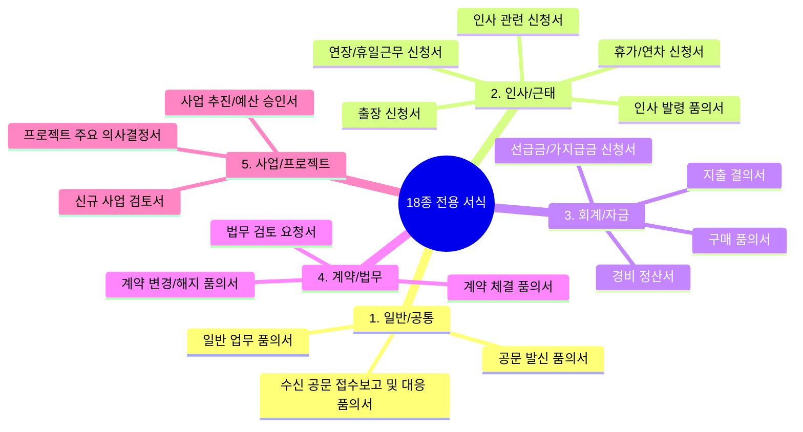

# 기안 양식 안내 (18종 전용 서식)

::: tip 📸 실제 화면 안내

*관리자 참고: 해당 화면의 실제 캡처 이미지를 `./images/forms.png` 경로에 등록해 주세요.*
:::

> **IBS 전자결재 시스템**은 단순 텍스트 입력을 넘어, 사내 업무 도메인(인사, 회계, 법무, 부동산 개발 사업 등)에 최적화된 **18종 전용 서식**과 유연한 **동적 맞춤형 폼**을 제공합니다.

* **접근 경로**: 시스템 좌측 내비게이션 메뉴에서 **[전자결재 시스템] → [문서 기안 및 작성] → [기안 양식 안내 (18종)]**을 선택하여 접속합니다.

## 1. 18종 전용 서식 카테고리 구조

## 2. 일반 / 공통 카테고리 (3종)

| 양식명 | 전결 평가 기준 | 주요 입력 항목 | 특징 및 자동 연동 |
| :--- | :---: | :--- | :--- |
| **일반 업무 품의서** | 소요 예산 금액 | 품의 목적, 주요 추진 내용, 기대 효과, 소요 예산 | 회사 전반의 일반 안건 승인을 위한 범용 표준 서식 |
| **공문 발신 품의서** | - | 수신처, 발신 명의, 시행 일자, 공문 본문, 첨부 증빙 | 최종 승인 완료 시 대외 공식 공문 일련번호 자동 채번 및 직인 날인 연동 |
| **수신 공문 접수보고 및 대응 품의서** | - | 발신 기관/거래처, 접수 일자, 접수 번호, 공문 제목/요약, 처리 방침(회신공문 발송 / 자체 종결 / 부서 이첩 등), 회신 기한, 검토 의견 | **사내 수신 공문 대장과 자동 연동**되며, 접수된 공문의 처리 방침을 보고하고 회신용 대외 공문 발송 품의서와의 유기적 연계를 지원 |

## 3. 인사 / 근태 카테고리 (5종)

| 양식명 | 주요 입력 항목 | 특징 및 자동 연동 |
| :--- | :--- | :--- |
| **휴가 / 연차 신청서** | 휴가 구분(연차/반차/경조/공가/병가), 기간, 차감 일수, 비상연락처 | 반차(0.5일)/전일(1.0일) 선택에 따른 차감 일수 자동 계산 및 **최종 승인 시 잔여 연차 자동 차감** |
| **출장 신청서** | 출장지, 출장 목적, 출장 기간, 숙박비·교통비·일비 예상 경비 | 출장 여비 규정에 따른 예상 경비 산출 |
| **연장 / 휴일근무 신청서** | 근무 일시, 사전 승인 사유, 예상 근무 시간 | 주 52시간 근태 관리 사전 승인 연동 |
| **인사 발령 품의서** | 대상자, 발령 구분(승진/전보/보직 발령), 발령 부서 및 직책 | **최종 승인 완료 시 사내 인사 관리 시스템에 보직 발령 자동 반영** |
| **인사 관련 신청서** | 신청 구분(재직/경력증명서, 교육 신청, 복리후생 지원 등), 신청 사유 | 각종 인사 총무 지원 요청 원스톱 처리 |

## 4. 회계 / 자금 카테고리 (4종)

| 양식명 | 전결 평가 기준 | 주요 입력 항목 | 특징 및 자동 연동 |
| :--- | :---: | :--- | :--- |
| **구매 품의서** | 구입 총액 | 품목명, 규격, 수량, 단가, 공급가액, 부가세(VAT), 구입 목적 | 품목별 소계 및 공급가액/부가세(10%) 자동 계산 그리드 제공 |
| **지출 결의서** | 지출 금액 | 지출 회계 계정, 지급 대상자, 지급 기한, 입금 계좌정보, 세금계산서 증빙 | 본사 회계 시스템 및 프로젝트 자금 집행 전표 연동 |
| **경비 정산서** | 정산 총액 | 영수증 사용 일자, 사용처, 금액, 정산 사유, 법인카드 승인번호 | 출장비 및 법인카드 일상 경비 실비 정산 |
| **선급금 / 가지급금 신청서** | 신청 금액 | 신청 금액, 지급 목적, 정산 예정 일자, 지급 계좌 | 사업비 및 공사비 선지급 사전 승인 |

## 5. 계약 / 법무 카테고리 (3종)

| 양식명 | 전결 평가 기준 | 주요 입력 항목 | 특징 및 자동 연동 |
| :--- | :---: | :--- | :--- |
| **계약 체결 품의서** | 계약 금액 | 계약 상대방(상호/대표), 계약 금액, 계약 기간, 대금 지급 조건, 주요 조항 | 계약 체결 사전 의사결정 및 계약서 초안 검토 |
| **계약 변경 / 해지 품의서** | 증감 금액 | 원 계약 정보, 변경/해지 사유, 계약금 증감 내역, 정산 조건 | 기 체결된 계약의 변경 합의서 및 타절 정산 승인 |
| **법무 검토 요청서** | - | 검토 안건명, 사실관계 요약, 주요 법적 쟁점, 회신 희망일, 계약 초안 첨부 | 사내외 법무 자문 변호사 및 법무팀 전문 검토 지원 |

## 6. 사업 / 프로젝트 카테고리 (3종)

| 양식명 | 전결 평가 기준 | 주요 입력 항목 | 특징 및 자동 연동 |
| :--- | :---: | :--- | :--- |
| **신규 사업 검토서** | 예상 사업비 | 대상 사업지 위치/규모, 사업 개요, 수지 분석 요약, 예상 수익률(IRR/ROI) | 사업 초기 타당성 검토 및 투자 심의 |
| **사업 추진 / 예산 승인서** | 승인 예산 | 사업 실행 계획, 단계별 집행 예산, 인허가 일정, 이사회 의결 사항 | 대규모 자금 투입 및 본 PF/시행 추진 승인 |
| **프로젝트 주요 의사결정서** | - | 의사결정 배경, **복수 대안 비교 평가표**, 최종 권고안, 리스크 평가 | 설계/시공사 선정, 분양가 책정 등 부동산 개발 핵심 의사결정 |

## 7. 동적 맞춤형 서식 확장

18종 기본 서식 외에 특수한 프로젝트 양식이나 비정기 보고서가 필요한 경우:
* 관리자 콘솔에서 입력 양식 정의(JSON 스키마)를 등록하면, 시스템이 텍스트, 숫자, 날짜, 선택 목록 등의 입력 항목을 화면에 자동으로 생성합니다.
* 별도의 시스템 소스 코드 배포 없이도 신규 양식을 즉시 운영 화면에 추가할 수 있습니다.

## 8. 신입사원을 위한 서식 선택 가이드

* **💡 연차나 반차를 사용하고 싶을 때** ➔ `[인사/근태] > 휴가 / 연차 신청서`를 작성하세요. 승인 즉시 잔여 휴가가 자동 차감됩니다.
* **💡 외근이나 출장 경비를 정산할 때** ➔ `[회계/자금] > 경비 정산서`를 선택하고 영수증 사진이나 카드 승인 내역을 첨부하세요.
* **💡 사무용품이나 비품을 구입해야 할 때** ➔ `[회계/자금] > 구매 품의서`를 통해 사전 승인을 받으세요.
* **💡 외부 기관에 공식 문서를 발송할 때** ➔ `[일반/공통] > 공문 발신 품의서`를 작성하면 회사 직인 날인과 문서번호 채번이 자동으로 처리됩니다.
