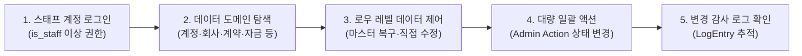

# 관리자 페이지 (Django Admin)

시스템의 로우 레벨 데이터 관리, 마스터 데이터 긴급 복구 및 프론트엔드에서 지원하지 않는 세부 시스템 설정을 수행하는 기술 관리자 전용 백오피스 도구입니다.

- **위치**: [ibs.dyibs.com/admin/](https://ibs.dyibs.com/admin/) (스태프 권한 `is_staff` 계정 로그인 필요)

::: tip 📸 실제 화면 안내

*관리자 참고: 해당 화면의 실제 캡처 이미지를 `./images/admin-page.png` 경로에 등록해 주세요.*
:::

## 개요

프론트엔드(Vue SPA)가 정형화된 비즈니스 규칙과 업무 흐름에 따라 일반 사용자의 입력을 처리한다면, **관리자 페이지(Django Admin)**는 데이터베이스의 모델(Model)에 직접 접근하여 시스템의 근간 데이터를 제어하는 백오피스입니다. 데이터 정합성 오류 긴급 복구, 대량 데이터 일괄 관리, 시스템 관리자 권한 부여 등 '시스템 마스터 컨트롤러'의 역할을 수행합니다.

## 주요 관리 기능

- **데이터베이스 전수 관리**: 데이터베이스에 정의된 모든 애플리케이션(App)과 테이블(Model)에 대한 직접적인 조회·생성·수정·삭제(CRUD) 지원
- **사용자 및 시스템 권한 제어**: 최상위 슈퍼유저 권한(`is_superuser`), 스태프 접속 권한(`is_staff`) 및 Django 모델 단위 기본 권한 부여
- **마스터 데이터 긴급 복구**: 프론트엔드 유효성 검사 오류로 꼬인 비즈니스 데이터나 일반 화면에서 삭제가 잠긴 비정상 레코드의 강제 수정 및 복원
- **상세 감사 이력(Audit Log) 추적**: 관리자 페이지를 통해 발생한 모든 데이터의 생성, 수정, 삭제 이력(`LogEntry`)을 담당자 및 시점별로 영구 보관
- **대량 데이터 일괄 액션 (Admin Actions)**: 목록에서 다수의 레코드를 선택한 후 원클릭으로 상태를 일괄 변경하거나 엑셀로 추출

## 도메인별 관리 범위

관리자 페이지는 수많은 비즈니스 도메인을 체계적인 그룹으로 나누어 관리합니다.

### 1. 계정 및 권한 (Accounts & Auth)
- **사용자 (User)**: 계정 생성, 비밀번호 강제 초기화, 슈퍼유저 및 스태프 권한 부여, 계정 활성화/비활성화
- **프로필 (Profile)**: 사용자별 부서, 직책, 연락처 등 상세 프로필 관리
- **스태프 권한 (StaffAuth)**: 프론트엔드 전용 기능별 세부 권한 플래그 설정

### 2. 회사 및 조직 (Company & Organization)
- **회사 (Company)**: 시스템 운영 주체 법인 정보 및 사업자 등록 데이터 관리
- **회사 인장 (CompanySeal)**: 법인인감, 사용인감, 부서/프로젝트 직인 이미지 및 전결 자격 기준 설정
- **부서 및 직책 (Department, Duty, Position)**: 회사 조직도 체계 및 직급/직책 마스터 데이터 관리

### 3. 프로젝트 및 비즈니스 코어 (Project, Contract, Payment, Ledger)
- **프로젝트 (Project)**: 프로젝트 생성, 사업지 상태 변경, 공용/비공개 설정
- **계약 및 유닛 (Contract, HouseUnit, UnitType)**: 분양 계약 상태 강제 복구, 동호수 매핑 교정
- **수납 및 장부 (Payment, ProjectTransaction)**: 은행 거래 전표, 수납 내역, 정산 일자 등 금융 회계 원장 관리

### 4. 업무 및 전자결재 (Work, Approval, Docs)
- **업무 관리 (IssueProject, Issue, Meeting)**: 워크스페이스 구조, 업무 이력, 회의록 마스터 관리
- **전자결재 (Approval, Document)**: 결재 양식 템플릿, 결재선 경로, 반려/승인 문서 복구
- **문서 및 소송 (LawsuitCase, Docs)**: 소송 사건 마스터, 법률 문서, 첨부 파일 링크 제어

## 💡 주요 관리 포인트 및 주의 사항

> [!CAUTION]
> **직접 수정 시 비즈니스 로직 우회 위험**
> 관리자 페이지에서의 데이터 직접 수정은 프론트엔드의 복잡한 유효성 검사, 시그널(Signal) 트리거, 자동 분개 로직을 우회할 수 있습니다. 특히 **수납(Payment)**이나 **회계 자금(Ledger)** 데이터를 임의로 수정하면 정산 장부의 차액 불일치가 발생하므로, 반드시 데이터 구조와 종속 관계를 완벽히 숙지한 시스템 관리자만 수행해야 합니다.

- **권한 체계의 이중 구조 이해**:
  - 일반 업무 메뉴 노출은 프론트엔드의 `권한 설정 관리`에서 제어됩니다.
  - 하지만 관리자 백오피스(`.../admin/`)에 로그인하려면 사용자 정보의 **스태프 권한(`is_staff`)** 속성이 반드시 `True`로 켜져 있어야 합니다.
- **외래키(ForeignKey) 고아 데이터(Orphan) 발생 방지**: 프론트엔드에서 삭제가 차단된 상위 데이터(예: 계약자가 존재하는 동호수, 입출금 전표가 연결된 은행 계좌 등)를 관리자 페이지에서 강제로 삭제할 경우 연관 하위 데이터들이 유실되거나 시스템 오류를 일으킬 수 있습니다. 삭제 전 반드시 연관 관계를 확인하십시오.
- **초기 대량 데이터 세팅 편의성**: 신규 프로젝트 개설 시 수백 개의 동호수 정보나 기초 비목 정보를 밀어넣어야 할 때, 관리자 페이지의 대량 입력 또는 스크립트 실행 기능을 활용하면 빠르고 정확하게 기초 데이터를 구축할 수 있습니다.
