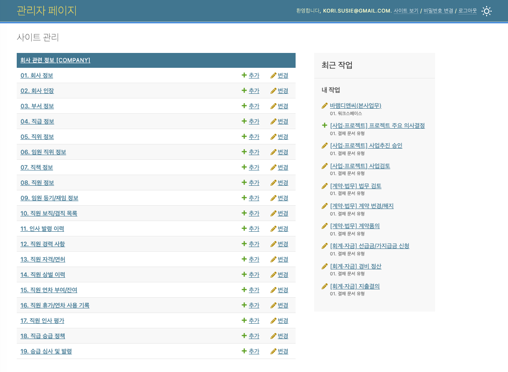

# 관리자 페이지 (Admin)

시스템의 기준 정보 관리, 데이터 긴급 복구 및 일반 업무 화면에서 지원하지 않는 세부 시스템 설정을 수행하는 시스템 관리자 전용 백오피스 도구입니다.

- **위치**: [ibs.dyibs.com/admin/](https://ibs.dyibs.com/admin/) (관리자 접속 권한 계정 로그인 필요)

::: tip 📸 실제 화면 안내

*▲ 관리자 페이지*
:::

## 개요

일반 업무 화면이 정형화된 업무 규칙과 흐름에 따라 사용자의 입력을 처리한다면, **관리자 페이지**는 시스템의 기초 기준 정보와 저장 데이터를 직접 관리하는 관리자 전용 백오피스입니다. 데이터 정합성 오류 긴급 복구, 대량 데이터 일괄 관리, 관리자 권한 부여 등 '시스템 마스터 컨트롤러'의 역할을 수행합니다.

## 주요 관리 기능

- **시스템 전수 데이터 관리**: 시스템에 등록된 모든 업무 영역별 기준 정보 및 이력 데이터에 대한 직접 조회·등록·수정·삭제 지원
- **사용자 및 관리자 권한 제어**: 최고 관리자 권한, 관리자 페이지 접속 권한 및 영역별 세부 관리 권한 부여
- **기준 정보 긴급 복구**: 일반 화면에서 수정이나 삭제가 제한된 예외 레코드나 오류가 발생한 데이터를 관리자가 직접 보정·복원
- **상세 감사 이력 추적**: 관리자 페이지를 통해 발생한 모든 데이터의 생성, 수정, 삭제 이력을 작업자 및 시점별로 보관하여 추적 가능
- **대량 데이터 일괄 작업**: 목록에서 여러 항목을 선택한 후 상단 일괄 작업 메뉴로 상태를 한 번에 변경하거나 자료로 추출

## 영역별 관리 범위

관리자 페이지는 다양한 사내 업무 영역을 체계적인 그룹으로 나누어 관리합니다.

### 1. 계정 및 권한 관리

- **사용자 계정**: 계정 생성, 비밀번호 강제 초기화, 관리자 접속 권한 및 최고 관리자 권한 부여, 계정 활성화/비활성화
- **직원 정보 및 세부 권한**: 사용자별 부서, 직책, 연락처 및 업무 화면 내 세부 권한 설정

### 2. 회사 및 조직 관리

- **회사 정보**: 시스템 운영 주체 법인 정보 및 사업자 등록 정보 관리
- **회사 인장**: 법인인감, 사용인감, 부서/프로젝트 직인 이미지 및 전결 기준 설정
- **부서 및 직책**: 회사 조직도 체계 및 직급/직책 기준 정보 관리

### 3. 프로젝트·계약·자금 관리

- **프로젝트**: 프로젝트 생성, 사업지 상태 변경, 공용/비공개 설정
- **계약 및 동호수**: 분양 계약 상태 복구, 동호수 및 타입 정보 보정
- **수납 및 자금 원장**: 계좌 입출금 전표, 수납 내역, 정산 일자 등 회계 원장 관리

### 4. 업무 및 전자결재 관리

- **업무 및 협업**: 워크스페이스 구조, 업무 이력, 회의록 기준 정보 관리
- **전자결재**: 결재 양식 템플릿, 결재선 경로, 결재 문서 상태 보정
- **법무 및 문서**: 소송 사건 관리, 법률 문서 및 첨부 자료 연결 제어

## 💡 주요 관리 포인트 및 주의 사항

> [!CAUTION]
> **직접 수정 시 업무 검증 우회 위험**
> 관리자 페이지에서의 데이터 직접 수정은 일반 업무 화면의 입력 검증과 자동 연동 절차를 건너뛰게 됩니다. 특히 **수납**이나 **회계·자금** 데이터를 임의로 수정하면 정산 장부의 합계 불일치가 발생할 수 있으므로, 반드시 업무 영향도를 확인한 시스템 관리자만 수정해야 합니다.

- **업무 화면 권한과 관리자 접속 권한 구분**:
    - 일반 사내 메뉴의 접근 권한은 `환경설정 › 권한 설정 관리`에서 제어됩니다.
    - 관리자 페이지에 로그인하려면 해당 계정에 별도의 **관리자 페이지 접속 권한**이 활성화되어 있어야 합니다.
- **연관 데이터 연결 주의**: 일반 화면에서 삭제가 차단된 상위 데이터(예: 계약자가 연결된 동호수, 입출금 내역이 연결된 계좌 등)를 관리자 페이지에서 강제 삭제하면 연결된 하위 데이터에 오류가 발생할 수 있으므로, 삭제 전 반드시 연관 내역을 확인하십시오.
- **초기 대량 데이터 등록 활용**: 신규 프로젝트 개설 시 다수의 동호수 정보나 예산 비목 등 기초 데이터를 일괄 등록할 때 관리자 페이지의 일괄 입력 기능을 활용하면 빠르고 정확하게 데이터를 구축할 수 있습니다.
