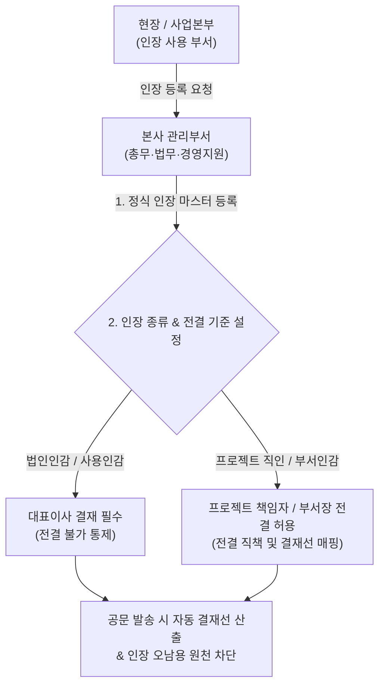

# 회사 인장 관리 (관리자 가이드)

법인인감, 사용인감, 프로젝트 직인, 부서인감 등 회사의 공식 도장을 시스템에 정식 등록하고, 각 인장별 허용 전결 자격(결재 규정)을 사전에 설정하여 인장 오남용과 월권을 원천 통제하는 관리자 전용 화면입니다.

- **위치**: 
  - Django Admin 백오피스: `회사 및 조직 관리 > 회사 인장` (`/admin/company/companyseal/`)
  - 또는 `회사 정보 관리` 상세 페이지 내 `회사 인장` 인라인 목록
- **관리 주체**: 본사 관리부서(경영지원본부, 총무팀, 법무팀) 담당자 및 최고 관리자 (`SuperUser`)

::: tip 📸 실제 화면 안내

*관리자 참고: 해당 화면의 실제 캡처 이미지를 `./images/company-seal.png` 경로에 등록해 주세요.*
:::

## 개요

회사의 도장과 서명은 대외적인 법적 권리·의무를 발생시키는 핵심 법률 자산입니다. 따라서 일반 사용자가 임의로 이미지를 등록하거나 사용할 수 없으며, 본사 관리부서의 정식 검증 및 등록 절차를 통해서만 시스템에 편입됩니다. 인장마다 허용되는 최소 결재 직책(전결 기준)과 연동 결재선을 지정하여, 공문서 발송 시 시스템이 결재선을 자동으로 산출하고 무단 날인을 차단합니다.

## 주요 기능 및 등록 가이드

관리부서에서 신규 인장을 등록할 때 설정해야 하는 핵심 필드 기준표입니다.

| 항목 | 영문 필드 | 상세 설명 및 설정 가이드 |
| :--- | :--- | :--- |
| **소속 회사** | `company` | 해당 인장이 귀속되는 소속 법인을 선택합니다. |
| **인장 종류** | `seal_type` | • **법인인감 (`CORP_SEAL`)**: 대표이사 직인 (원칙적 전결 불가) • **사용인감 (`USAGE_SEAL`)**: 토지매매, 분양계약 등 특정 용도 지정 인감 • **부서/프로젝트 직인 (`DEPT_SEAL`)**: 사업본부장, 현장소장 명의 직인 • **직인생략 (`OMIT`)**: 단순 통지용 문서 |
| **인장 명칭** | `name` | 사용자가 쉽게 식별할 수 있는 공식 명칭 (예: *대표이사 법인인감*, *고성 아야진 현장소장 직인*) |
| **지정 용도/범위** | `purpose` | 해당 인장의 사용 제한 범위 (예: *사업부지 토지매매계약 체결 전용*, *분양 계약 및 옵션 체결 전용*) |
| **인장 이미지** | `seal_image` | **배경이 투명한 PNG 형식 (정방형 1:1 비율)** 업로드 권장. (PDF 출력 시 문서 배경과 자연스럽게 합성됨) |
| **보관 구분** | `custody_type` | • **사내 보관 (`internal`)**: 본사 금고 또는 현장 사무소 보관 • **외부 교부 (`external`)**: 토지용역사, 분양대행사, 법무사 등 외부 위임처 교부 |
| **실물 보관처 / 수임자** | `custodian` | 실물 도장 보관 위치 및 수임자 (예: *본사 재경팀 금고*, *(주)개발컨설팅 김실장*) |
| **사내 총괄 관리책임자** | `internal_manager` | 외부 교부 시에도 본사에서 교부/회수를 책임지는 정규직 관리자 (`Staff`) 지정 |
| **유효 기간 / 만료일** | `valid_from` / `valid_until` | 외부 용역 계약 기간에 따른 인감 교부 및 회수 예정 기한 관리 |
| **전결 직책 자격** | `final_approval_duty` | **🌟 핵심 통제 기준**: 이 인장이 날인되기 위해 필요한 **최소 최종 전결 직책** 지정 • `팀장/현장소장`: 현장 책임자 승인으로 결재 종결 가능 • `미지정 (빈칸)`: 대표이사까지 결재선이 반드시 상신됨 |
| **연동 전결 결재선** | `route_template` | **🔒 필수 안전장치**: 부서장/현장 직인(`DEPT_SEAL`)을 전자결재 공문에 사용하려면, 해당 책임자가 최종 전결권자로 지정된 **수동 결재선 템플릿**을 반드시 연동해야 합니다. 미연동 시 전자결재 기안 화면의 인장 목록에서 자동 제외됩니다. |
| **사용 여부** | `is_active` | 폐기되거나 분실/회수된 인장은 체크를 해제하여 시스템 사용을 즉시 중단 처리합니다. |

## 인장 종류별 결재선 분기 메커니즘

단일한 공문서 기안 양식 내에서도 관리부서가 사전에 지정한 인장의 전결 기준에 따라 결재선이 지능적으로 자동 분기됩니다.

### 1. 대표이사 법인인감 (`CORP_SEAL`)
- **설정 기준**: `전결 직책 자격`을 **미지정(빈칸)**으로 보관합니다.
- **작동 원리**: 기안자가 해당 인장을 선택하면 시스템은 자동으로 결재선을 대표이사까지 필수 상신하도록 강제하며, **대표이사의 최종 승인이 완료되기 전에는 어떠한 경우에도 인장이 날인되지 않습니다.**

### 2. 프로젝트 직인 / 부서장 직인 (`DEPT_SEAL`)
- **설정 기준**: **사내 총괄 관리책임자(`internal_manager`)**와 **연동 전결 결재선(`route_template`)** 설정이 필수입니다.
- **전자결재 발송 시**: 해당 책임자가 최종 전결권자인 결재선 템플릿이 연결된 인장만 기안 화면에 표시되며, 상신 시 해당 전결 결재선이 자동 적용됩니다.
- **수동 직접 발송 시**: 인장 선택 시 등록된 책임자의 직책과 성명(예: *본부장 홍길동*)이 발송자 명의에 고정 반영되어 권한 없는 자의 명의 도용을 원천 차단합니다.

## 💡 관리부서 실무 유의사항

- **실물 인감 날인 후 스캔본 보관 절차**: 대외 관공서 제출용으로 종이 출력 후 실물 인감을 직접 날인하여 발송하는 경우, 공문 기안 시 인장을 `인장 미선택 / (직인생략 / 출력 후 실물날인)`으로 상신하도록 안내하십시오. 발송 완료 후에는 실제 날인된 종이 문서를 스캔하여 **스캔본(PDF)으로 재등록**해야 공문 대장의 법적 증빙 효력이 유지됩니다.
- **발송 완료 후 증빙 위변조 방지**: 대외 발송이 완료된 공문서는 시스템 내 PDF 재생성(템플릿 덮어쓰기)이 완전히 잠깁니다. 이미 발송된 공문의 스캔본을 불가피하게 교체해야 할 때는 일반 사용자 권한으로는 불가능하며, 관리부서(슈퍼유저/워크매니저)가 사유를 확인한 후 직접 처리해야 합니다.
- **투명 배경 인장 이미지 가공**: 도장 이미지를 등록할 때 흰색 배경이 남아있으면 공문서 텍스트나 하단 테두리를 가려 서식이 조잡해 보일 수 있습니다. 포토샵이나 배경 제거 도구를 활용하여 도장 테두리 바깥이 투명한 PNG 파일로 등록해 주십시오.
