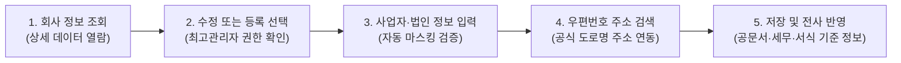

# 회사 정보 관리

시스템의 운영 주체가 되는 회사의 기본 정보(사업자 정보, 법인 정보, 공식 주소 등)를 등록하고 관리하는 화면입니다.

- **위치**: `환경설정 > 회사 정보 관리`

::: tip 📸 실제 화면 안내

*관리자 참고: 해당 화면의 실제 캡처 이미지를 `./images/index.png` 경로에 등록해 주세요.*
:::

## 개요

회사의 법적, 행정적 기초 정보를 총괄 관리합니다. 여기서 등록된 정보는 전자결재 대외 공문의 발신인 명의, 세무 신고 자료, 분양 수납 고지서 및 계약서 등 시스템 전반의 공식 서식에서 회사를 식별하는 최상위 기준 데이터로 활용되므로 정확하고 최신의 정보를 유지해야 합니다.

## 주요 기능

- **회사 기본 정보 통합 조회**: 회사명, 대표자명, 사업자등록번호, 법인등록번호, 업태/종목, 개업일자 등 핵심 법인 정보를 한눈에 확인
- **신규 회사 등록 및 변경**: 시스템 초기 도입 또는 법인 합병/신설 시 회사 정보 생성 (최고 관리자 전용)
- **실시간 입력 유효성 검사 및 자동 마스킹**:
  - 사업자등록번호: `###-##-#####` (10자리) 서식 자동 교정
  - 법인등록번호: `######-#######` (13자리) 서식 자동 교정
- **공식 도로명 주소 검색 연동**: 우편번호 검색 서비스를 통해 표준 도로명 주소와 5자리 우편번호 자동 입력 지원
- **역할 기반 보안 제어**: 회사 정보의 중요성을 고려하여 수정 및 등록 권한(`CompanySettingsAuthGuard`)이 부여된 인가자만 접근 가능

## 화면 구성 및 실무 가이드

### 1. 회사 정보 상세 조회 (Detail)

시스템에 등록된 회사의 상세 데이터를 확인하는 화면입니다.

- **주요 표시 항목**:
  - `회사명`: 법인 등기부등본상의 정식 명칭 (예: *(주)디와이아이비에스*)
  - `대표자 성명`: 법인 등기 대표이사 성명
  - `사업자등록번호 / 법인등록번호`: 세무서 및 법원 등록 번호
  - `업태 및 종목`: 사업자등록증상의 업태(예: *부동산 개발 및 공급업*) 및 종목
  - `설립일자 및 개업일자`: 법인 설립 등기일 및 세무서 개업 연월일
  - `회사 공식 주소`: 본사 소재지 우편번호 및 도로명 상세 주소
- **제어 버튼**:
  - [수정하기]: 등록된 회사 정보를 변경하기 위해 입력 폼 화면으로 전환
  - [등록하기]: 시스템 초기 상태로 회사 정보가 없을 때 신규 등록 화면 호출

### 2. 회사 정보 입력 및 수정 폼 (Form)

회사 정보를 신규 작성하거나 변경 사항을 갱신하는 양식 화면입니다.

| 입력 항목 | 필수 여부 | 상세 설명 및 실무 팁 |
| :--- | :---: | :--- |
| **회사명** | 필수 | 법인 등기부등본 및 사업자등록증과 토씨 하나 틀리지 않게 정확히 입력합니다. |
| **대표자명** | 필수 | 공식 대표이사 성명을 기재합니다. |
| **사업자등록번호** | 필수 | 10자리 숫자를 입력하면 자동으로 하이픈(`-`)이 적용됩니다. |
| **법인등록번호** | 선택 | 법인인 경우 등기소 발행 13자리 법인 번호를 입력합니다. |
| **업태 / 종목** | 필수 | 사업자등록증에 명시된 주 업태와 종목을 입력합니다. |
| **설립일자 / 개업일자** | 필수 | 연월일 선택기를 통해 정확한 날짜를 지정합니다. |
| **회사 주소** | 필수 | [우편번호] 버튼을 클릭하여 팝업창에서 도로명 주소를 검색한 후, 상세 주소(층, 호수)를 입력합니다. |

## 💡 실무 관리 포인트

- **사업자등록증 원본 대조 필수**: 사업자등록번호와 법인번호는 세금계산서 발행, 전자결재 공문서, 분양 계약서 하단 등에 그대로 연동됩니다. 1자리라도 오타가 발생하면 세무 불일치나 계약 효력 문제가 발생할 수 있으므로 반드시 사업자등록증 원본과 대조하십시오.
- **사무실 이전 시 주소 즉시 최신화**: 본사 사무실 이전으로 도로명 주소가 변경된 경우 즉시 업데이트해야 합니다. 이전 주소를 방치할 경우 대외 발송 공문 및 고지서에 구 주소가 인쇄되어 우편물 반송 및 대외 신뢰도 저하를 초래합니다.
- **최고 관리자(SuperUser) 권한 통제**: 회사의 신규 등록이나 삭제는 데이터베이스 전체 무결성에 영향을 주므로 최고 관리자 권한을 가진 사용자에게만 허용됩니다. 일반 관리자는 필요 시 정보 수정 권한만 부여받아 운영합니다.
