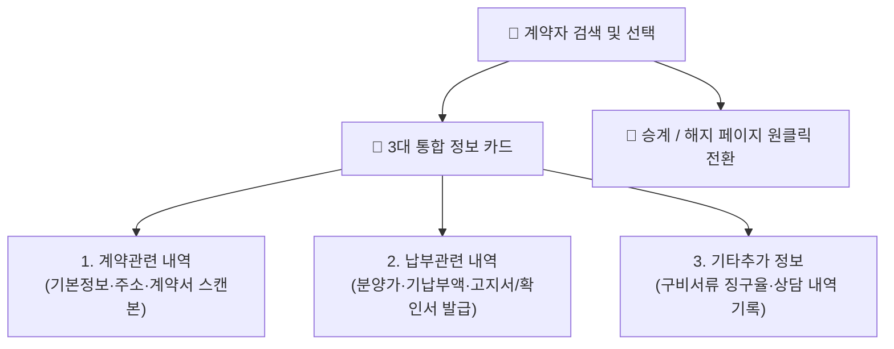

# 계약 상세 관리

::: tip 📸 실제 화면 안내

*관리자 참고: 해당 화면의 실제 캡처 이미지를 `./images/details.png` 경로에 등록해 주세요.*
:::

> **계약 상세 관리**는 특정 계약자의 기본 인적 사항, 분양가 및 수납 현황, 필수 구비 서류 제출 상태, 대외 증명서 발급, 그리고 일자별 민원 상담 내역을 한 화면에서 총괄 처리하는 종합 계약 카드입니다.

* **접근 경로**: 시스템 좌측 내비게이션 메뉴에서 **[PJT 관리 시스템] → [계약 정보 관리] → [계약 상세 관리]**를 선택하여 접속합니다. (또는 계약 목록에서 계약자명 클릭)

## 1. 계약자 검색 및 빠른 내비게이션

* **신속한 계약자 검색**: 상단 검색창에 계약자 성명, 동호수, 휴대전화 뒷자리, 계약 일련번호를 입력하면 즉시 매칭 결과 버튼이 표출되어 원클릭으로 로드할 수 있습니다.
* **상태 알림 배지**: 현재 조회 중인 계약자의 상태(정상 계약, 청약, 승계 진행 중, 해지 신청, 해지 완료)가 상단에 강조 표시되어 업무 실수를 방지합니다.
* **업무 전환 탭**: 계약자 상세를 보면서 곧바로 **`[권리 의무 승계]`** 또는 **`[계약 해지 관리]`** 화면으로 컨텍스트를 유지한 채 즉시 전환할 수 있습니다.

## 2. 3대 상세 정보 탭 안내

사용자의 작업 편의를 위해 정보를 3개 탭으로 구분하여 제공하며, 다중 탭을 동시에 열어놓고 비교 검토할 수 있습니다.

### 📋 1. 계약관련 내역
* **계약 마스터 정보**: 계약 일련번호, 분양 차수, 배정 타입, 동호수, 가입 계약일, 정식 공급 계약일, 계약 상태
* **계약자 인적 사항**: 성명, 생년월일, 성별, 자격 구분(조합원/일반분양), 연락처(휴대전화, 유선전화, 이메일)
* **주소 및 거주지 관리**:
  * `주민등록 주소`: 등본상 법정 주소지
  * `우편물 수령 주소`: 각종 고지서 및 총회 안내문 발송 주소지
  * `주소 변경 이력`: 주소 변경 버튼을 통해 새 주소를 등록하고 과거 이전 이력을 상시 열람
* **공식 계약서 파일**: 날인 완료된 원본 계약서 스캔본(PDF) 다운로드 및 교체/추가

### 💰 2. 납부관련 내역 (수납 및 증명서 발급)
* **분양가 구성**: 총 분양가, 건축물가, 대지가, 부가세(10%) 분리 표출
* **수납 현황 요약**: 현재까지 납입된 총 수납액, 미납 잔액, 완납된 최종 회차
* **회차별 입금 내역 목록**: 회차명, 입금 일자, 입금액, 입금 계좌정보, 수납 영수증 링크
* **각종 고지서 및 증명서 즉시 발급**:
  * **대금수납 고지서**: 해당 차수 납부 기한 및 입금 계좌가 인쇄된 공식 고지서 출력
  * **납부내역 확인서 (일반 / 금융기관 제출용)**: 은행 중도금 대출이나 연말정산용 납부 영수 증명서
  * **연체료 / 할인료 정산 내역서**: 선납할인 및 미납 연체이자 정산 상세표
  * **주택 인도 증서 (입주증)**: 잔금 완납 후 입주 시 입주지원센터에 제출하는 공식 열쇠 불출 증서

### 📁 3. 기타추가 정보 (구비 서류 & 고객 상담)
* **구비 서류 제출 현황 (증명서류 & 동의서류)**:
  * 주민등록등본, 인감증명서, 신분증 사본, 확약서 등 사전 등록된 필수 서류의 제출 여부와 수량을 관리합니다.
  * 미제출 서류 건수와 **서류 징구 완료율(%)**이 막대 그래프로 시각화됩니다.
  * 접수된 서류 스캔본을 해당 항목에 바로 첨부하여 보관할 수 있습니다.
* **상담 내역 기록 대장**:
  * 계약자와의 전화 통화, 모델하우스 내방 상담, 민원 요청 사항을 시계열로 기록합니다.
  * 상담 일자, 상담 채널(전화/방문/서면), 상담 유형(중도금대출/동호수변경/일정문의/단순민원), 중요도, 처리 상태(대기/처리중/완료)를 체계적으로 관리합니다.

## 3. 신입사원을 위한 실무 가이드

* **💡 계약자 민원 전화 응대 시 3단계 프로세스**:
  1. 상단 검색창에서 고객명 또는 동호수를 검색하여 상세 화면을 엽니다.
  2. `[납부관련 내역]` 탭에서 현재까지 입금된 금액과 미납된 회차, 연체 이자가 있는지 즉시 확인합니다.
  3. 통화가 끝나면 반드시 `[기타추가 정보] > 상담 내역`에 통화 요지와 약속 사항(예: "중도금 대출 자서 일정 안내 완료")을 기록하여 후속 담당자와 정보를 공유하십시오.
* **💡 각종 확인서 발급 요령**:
  * 수분양자가 "연말정산용 영수증"이나 "은행 대출용 납부증명서"를 요구할 때는 `[납부관련 내역]`의 **[납부내역 확인서]** 버튼을 클릭하여 A4 규격 공식 증명서를 즉시 출력하거나 PDF로 저장해 이메일/팩스로 발송할 수 있습니다.
