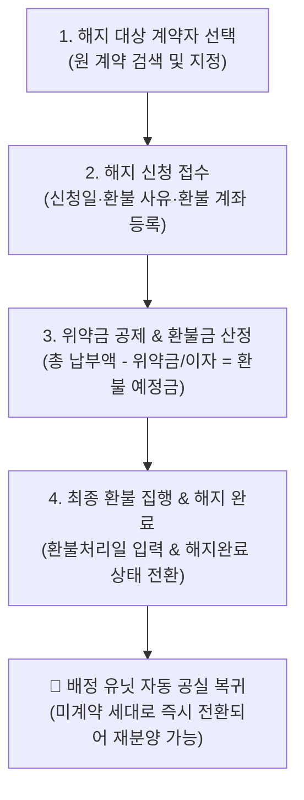

# 계약 해지 관리

::: tip 📸 실제 화면 안내

*관리자 참고: 해당 화면의 실제 캡처 이미지를 `./images/release.png` 경로에 등록해 주세요.*
:::

> **계약 해지 관리**는 수분양자의 개인 사정(단순 변심, 자금난 등)이나 자격 상실, 대금 장기 미납으로 인한 계약 해제·해지 신청을 접수하고, 위약금 공제 및 환불금 정산, 그리고 배정 유닛의 공실 자동 원복을 총괄 제어하는 모듈입니다.

* **접근 경로**: 시스템 좌측 내비게이션 메뉴에서 **[PJT 관리 시스템] → [계약 정보 관리] → [계약 해지 관리]**를 선택하여 접속합니다.

## 1. 주요 기능 및 업무 흐름

* **해지 대상 계약자 검색 및 선택**: 해지를 진행할 계약자를 신속하게 검색하여 대상자로 지정
* **해지 상태 라이프사이클 제어**: `신청 취소`, `해지 신청`, `해지 완료`, `자격 상실` 4단계 상태 관리
* **환불 정산 정보 관리**: 기납부 총액 대비 위약금 공제 후 최종 환불 예정금액 및 본인 명의 환불 계좌 관리
* **해지 완료 시 자동 시스템 연동 (핵심 ⭐️)**:
  * 해지 처리가 최종 완료되면 해당 계약은 비활성화되며, 배정되어 있던 **동호수(유닛)는 즉시 공실(미계약 세대)로 자동 복귀**되어 다른 고객에게 재분양이 가능해집니다.
* **계약 해지 대장 엑셀 출력**: 전체 해지 및 환불 진행 목록을 엑셀 파일로 다운로드하여 회계 결산 및 이사회 보고서에 활용

## 2. 화면 구성 및 조작 가이드

### 1. 해지 대상 계약자 검색
* 화면 상단 검색창에서 해지하고자 하는 계약자의 성명, 동호수, 계약번호를 검색하여 선택합니다.
* 현재 계약자의 분양가, 기납부 총액, 최종 납입 회차가 상단 알림 카드에 요약 표시됩니다.

### 2. 계약 해지 현황 목록 그리드
프로젝트 내에서 접수된 모든 해지 건의 상태와 환불 정산 현황을 조회합니다.

| 컬럼 항목 | 상세 설명 및 실무 기준 |
|:---|:---|
| **계약 해지자** | 해지 대상 계약자의 성명 및 배정 동호수 |
| **현재 상태** | `해지 신청`, `해지 완료`, `신청 취소`, `자격 상실` 배지 표출 |
| **환불(예정)금액** | 기납부금 중 위약금을 공제한 최종 실환불 지급액 |
| **환불 계좌 정보** | 은행명, 계좌번호, 예금주 (반드시 계약자 본인 명의) |
| **해지 신청일** | 고객의 해지 신청서가 정식 접수된 일자 |
| **환불 처리일** | 회사 통장에서 환불금이 실제로 송금 완료된 일자 |
| **관리 작업** | 해지 상세 정보 확인, 상태 변경 및 수정 모달 호출 |

### 3. 계약 해지 등록/수정 팝업

우측 상단의 **`[신규 해지 등록]`** 버튼 또는 목록의 **`[확인/수정]`** 버튼을 클릭하여 작성합니다:

* **계약자 정보**: (시스템 자동 바인딩) 대상 계약자의 성명, 동호수, 기납부 총액
* **해지 구분 (상태)**:
  * `해지 신청`: 고객의 해지 신청서가 접수되어 심사 및 정산 중인 상태
  * `해지 완료`: 위약금 정산 및 환불금 송금이 완전히 종결된 상태
  * `자격 상실`: 무주택 자격 탈락 등으로 조합원 자격이 강제 박탈된 상태
  * `신청 취소`: 해지 신청 후 위약금 부담 등으로 고객이 해지를 철회한 상태
* **환불(예정)금액**: 총 납부 대금에서 사내 공급계약서상 위약금(통상 분양가의 10% 등) 및 금융비용을 공제한 실수령 환불액 입력
* **환불 계좌 정보**: 환불금을 지급할 금융기관명, 계좌번호, 예금주 성명 입력
* **해지 신청일**: 해지 신청 서류가 접수된 날짜
* **해지(환불) 처리일**: 환불 송금이 실행된 날짜 (상태를 '해지 완료'로 변경할 때 필수 입력)
* **비고**: 해지 사유(단순 변심, 해외 이민, 부적격 탈락 등) 및 특이사항 기재

## 3. 신입사원을 위한 실무 가이드

* **💡 본인 명의 환불 계좌 원칙**:
  * 계약 해지 환불금은 금융 사고 방지를 위해 **반드시 계약자 본인 명의의 통장 사본**을 징구하여 해당 계좌로만 송금해야 합니다. 타인 계좌(가족 포함)로 환불할 경우 인감증명서가 첨부된 정식 위임장을 필히 수취해야 합니다.
* **💡 해지 완료 시 유닛 공실 전환 확인**:
  * 해지 처리가 '해지 완료'로 저장되는 즉시, [동호 배치 현황](/contract/status) 화면에서 해당 호실이 다시 **'공실'**로 바뀌었는지 확인하십시오. 공실로 정상 복귀되어야 신규 계약자가 해당 호수를 선택하여 재계약할 수 있습니다.
