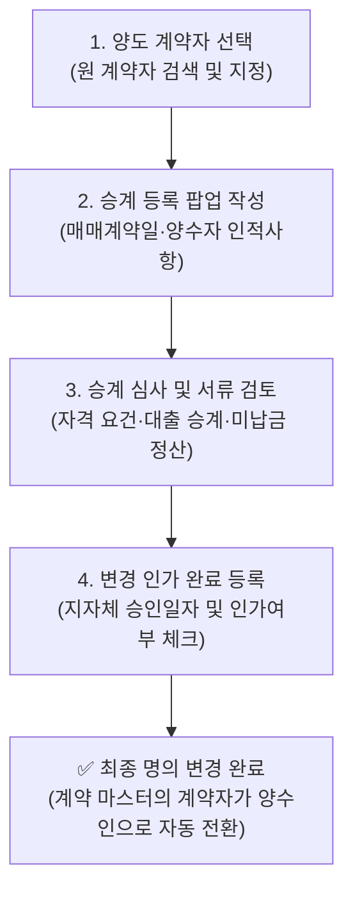

# 권리 의무 승계 (명의 변경)

::: tip 📸 실제 화면 안내

*관리자 참고: 해당 화면의 실제 캡처 이미지를 `./images/succession.png` 경로에 등록해 주세요.*
:::

> **권리 의무 승계**는 분양권 전매(매매, 증여, 상속 등)나 조합원 지위 이전에 따라 기존 계약자(양도인)의 모든 계약상 권리와 대금 납부 의무를 새로운 인수자(양수인)에게 법적으로 이전하고 명의 변경을 처리하는 관리 모듈입니다.

* **접근 경로**: 시스템 좌측 내비게이션 메뉴에서 **[PJT 관리 시스템] → [계약 정보 관리] → [권리 의무 승계]**를 선택하여 접속합니다.

## 1. 주요 기능 및 업무 흐름

* **양도 계약자 검색 및 선택**: 승계 대상이 되는 기존 계약자를 신속하게 검색하여 양도인으로 지정
* **승계 신청 건 등록 및 수정**: 양수인의 인적사항, 실거주 주소, 매매계약일, 승계신청일 등록
* **변경 인가 상태 추적**: 지자체 인허가(조합원 권리의무승계 변경인가 등) 접수 및 승인 완료일 관리
* **최종 명의 자동 승계**: 관청 인가 또는 회사 승인이 완료되어 **'변경인가여부'가 체크되는 즉시 계약 마스터의 명의가 양수인으로 자동 변경**
* **승계 진행 대장 관리 및 엑셀 출력**: 전체 승계 진행 목록 조회 및 보고서용 엑셀 다운로드

## 2. 화면 구성 및 조작 가이드

### 1. 양도 계약자 검색 및 선택
* 화면 상단 검색창에서 양도하고자 하는 원 계약자의 성명, 동호수, 계약번호를 검색하여 선택합니다.
* 이미 다른 승계가 진행 중이거나 해지된 계약자는 경고 배지가 표시되어 중복 접수를 방지합니다.

### 2. 승계 진행 건 목록 그리드
현재 등록되어 심사 또는 인가 대기 중인 모든 승계 건을 한눈에 파악할 수 있습니다.

| 컬럼 항목 | 상세 설명 및 실무 기준 |
|:---|:---|
| **계약 정보** | 대상 계약의 일련번호 및 배정 동호수 |
| **양도계약자** | 기존 권리를 매도/이전하는 원 계약자 성명 |
| **양수계약자** | 권리와 채무를 새로 인수받는 양수인 성명 |
| **승계신청일** | 회사에 명의변경 신청서류가 정식 접수된 일자 |
| **매매계약일** | 당사자 간 부동산 매매(또는 증여) 계약서상 체결 일자 |
| **변경인가일** | 시·군·구청 등 관할 관청의 조합원 변경인가 승인 일자 |
| **변경인가여부** | 인가 완료 여부 (완료 시 계약자 명의 자동 변경) |
| **관리 작업** | 상세 확인 및 수정, 서류 첨부 모달 호출 |

### 3. 권리 의무 승계 등록 팝업

우측 상단의 **`[신규 승계 등록]`** 버튼을 누르면 나타나는 팝업창입니다:

* **양도 계약자 정보**: (시스템 자동 바인딩) 기존 계약자의 성명 및 동호수
* **승계 신청일**: 필수. 회사 접수 창구에 서류가 제출된 일자
* **매매 계약일**: 필수. 실거래 신고된 부동산 매매계약 체결일
* **양수 계약자 상세 인적사항**:
  * 성명, 생년월일, 성별, 휴대전화 번호 (필수)
  * 주민등록 주소 (등본상 주소, 우편번호 검색 지원)
  * 우편물 송달 주소 (안내문 수령지)
  * 추가 연락처 및 이메일
* **변경 인가 여부 및 인가일**:
  * 관할 관청(구청 등)의 변경인가 공문이 도착하면 체크박스를 활성화하고 인가 완료일을 입력합니다.

## 3. 신입사원을 위한 실무 가이드

* **💡 권리 의무 승계 시 필수 확인 3대 체크리스트**:
  1. **기납부 대금 및 연체료 정산 확인**: 양도 시점까지 도래한 분양 대금과 연체료가 완납되었는지 [계약 상세 관리](/contract/details)에서 먼저 확인해야 합니다.
  2. **중도금 대출 승계 확약**: 은행 중도금 대출이 실행된 세대인 경우, 대출 취급 은행의 대출 채무 승계 동의서가 징구되었는지 확인하십시오.
  3. **조합원 자격 요건 검증**: 지역주택조합 등 조합 사업지의 경우, 양수인이 법정 조합원 자격(무주택 세대주 요건, 거주 기간 등)을 충족하는지 자격 증빙 서류를 철저히 검토해야 관청 인가 반려를 예방할 수 있습니다.
* **💡 '변경인가여부' 체크의 효과**:
  * 단순 접수 상태에서는 원 계약자 명의가 유지되지만, 관청 인가 후 관리자가 **'변경인가여부'에 체크하고 저장하는 순간 시스템 전체에서 계약자 정보가 양수인으로 일괄 자동 전환**됩니다.
