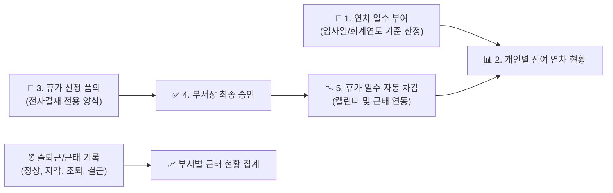

# 근태 및 휴가 관리

::: tip 📸 실제 화면 안내

*관리자 참고: 해당 화면의 실제 캡처 이미지를 `./images/attendance.png` 경로에 등록해 주세요.*
:::

> **근태 및 휴가 관리**는 근로기준법 및 사내 취업규칙에 따른 연차 유급휴가 일수 부여, 전자결재 연동을 통한 휴가 신청·자동 차감, 일별 출퇴근 및 부서별 근태 현황을 종합적으로 관리하는 본사 인사 모듈입니다.

* **접근 경로**: 시스템 좌측 내비게이션 메뉴에서 **[본사 관리] → [인사 조직 관리] → [근태 및 휴가 관리]**를 선택하여 접속합니다. (전 임직원 열람/신청 지원, 관리자는 전사 정산 및 근태 통계 관리)

## 1. 연차 부여 관리 (Leave Quota)

임직원별 연간 발생 연차 휴가 일수를 등록하고 잔여 일수를 정산합니다.

* **산정 방식 지원**:
  * **입사일 기준 산정**: 개별 임직원의 입사일을 기준으로 매년 근속 연수에 따라 연차가 산정됩니다.
  * **회계연도 기준 산정**: 매년 1월 1일 전사 일괄 부여되며, 중도 입사자는 첫해 근속 기간에 따라 일할 계산됩니다.
* **법정 가산 연차 자동 계산**: 3년 이상 근속 시 매 2년마다 1일씩 가산되는 근로기준법상 가산 연차 규정을 지원합니다.
* **포상 및 대체 휴가 부여**: 특별 프로젝트 완수 포상 휴가나 휴일 근무에 따른 대체 휴가를 별도 일수로 추가 부여하여 관리할 수 있습니다.

## 2. 휴가 신청 및 자동 차감 프로세스 (Leave Usage)

IBS에서는 번거로운 수기 휴가계 제출 없이 **전자결재 시스템과 100% 자동 연동**되어 휴가가 처리됩니다.

* **전자결재 승인 시 자동 연계 (핵심 ⭐️)**:
  * 직원이 전자결재에서 `[휴가/근태 신청서]` 양식으로 품의를 올려 부서장의 최종 승인이 완료되면, **시스템이 자동으로 잔여 연차 일수를 차감**하고 본사 근태 현황판 및 워크스페이스 캘린더에 휴가 일정을 자동 등록합니다.
* **휴가 유형별 차감 기준**:
  * **전일 연차**: 1.0일 차감
  * **오전 반차 / 오후 반차**: 0.5일 차감 (오전 반차: 09:00~13:00, 오후 반차: 14:00~18:00 기준)
  * **반반차 (사내 규정 적용 시)**: 0.25일 (2시간 단위 사용)
  * **경조휴가 / 공가 / 병가**: 사내 규정에 따른 유급 인정 (연차 일수 미차감, 증빙 서류 첨부 필요)
* **휴가 취소 및 연차 자동 복원**:
  * 승인이 완료된 휴가 일정이 업무 사정으로 취소되거나 변경된 경우, `[휴가 취소원]` 전자결재를 상신하여 최종 승인되면 **차감되었던 연차 일수가 안전하게 즉시 원복**됩니다.

## 3. 근태 현황 관리 (Attendance Status)

임직원의 일별 출퇴근 기록, 지각, 조퇴, 외출, 결근 현황을 모니터링하고 집계합니다.

* **실시간 부서 근태 현황판**: 오늘 날짜의 출근, 외근, 지각, 휴가자 현황을 부서별로 한눈에 조회할 수 있어 팀원 간 업무 공백을 사전에 방지합니다.
* **월간 근태 집계**: 월별 총 실근무일수, 연장근로 시간, 지각 횟수 등을 자동 집계하여 매월 급여 정산의 기초 데이터로 활용할 수 있습니다.
* **유연근무제 및 시차출퇴근제 지원**: 부서별 코어타임(예: 10:00 ~ 16:00 필수 근무) 준수 여부를 확인하고 탄력적인 근태 관리를 지원합니다.

## 4. 신입사원을 위한 실무 가이드

* **💡 내 잔여 연차 확인 방법**:
  * 화면 상단의 마이페이지 또는 본 메뉴의 개인 요약 카드에서 **[총 부여 일수 / 사용 일수 / 잔여 일수]**를 실시간으로 확인할 수 있습니다.
* **💡 휴가 신청 절차**:
  1. 잔여 연차 일수를 확인한 후, 상단 바로가기 또는 [전자결재 > 결재문서 작성](/approval/draft)으로 이동합니다.
  2. 양식 목록에서 **`휴가/근태 신청서`**를 선택합니다.
  3. 휴가 종류(연차, 반차 등)와 기간(시작일~종료일), 사유를 기재하고 상신합니다.
  4. 부서장 승인이 완료되면 본인의 잔여 연차에서 자동으로 차감 처리됩니다.
