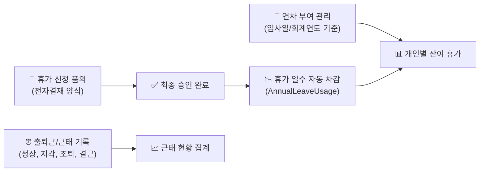

# 근태 및 휴가 관리

> **근태 및 휴가 관리**는 근로기준법 및 사내 규정에 따른 연차 유급휴가 일수 부여, 전자결재 연동을 통한 휴가 신청·차감, 일별 출퇴근 및 근태 현황을 종합적으로 관리하는 모듈입니다.

- **메뉴 위치**: `본사 관리 > 인사 조직 관리 > 근태 휴가 관리` (`/hr-manage/leave-quota`, `leave-usage`, `attendance`)
- **관리 대상**: 전 임직원 (휴가 신청/조회), 인사 담당자 (연차 산정/부여)

## 1. 연차 부여 관리 (Leave Quota)

임직원별 연간 연차 휴가 일수를 등록하고 잔여 일수를 정산합니다.

- **산정 방식 지원**:
  - `입사일 기준`: 입사일을 기준으로 매년 근속연수에 따른 연차 발생
  - `회계연도 기준`: 매년 1월 1일 일괄 부여 (중도 입사자는 일할 계산)
- **가산 연차 자동 계산**: 3년 이상 근속 시 매 2년마다 1일씩 가산되는 법정 가산 연차 규정을 지원합니다.
- **포상/대체 휴가 부여**: 야근 수당 대체 휴가나 특별 포상 휴가 일수를 별도로 부여하여 관리할 수 있습니다.

## 2. 휴가 사용 내역 (Leave Usage)

전자결재를 통해 승인된 휴가 신청 내역을 바탕으로 사용 일수를 자동 집계하고 잔여 연차를 관리합니다.

- **전자결재 자동 연계**: 전자결재 시스템의 `휴가/근태 신청서` 양식이 최종 승인되면, 시스템이 자동으로 휴가 사용 내역에 등록하고 잔여 일수에서 차감합니다.
- **다양한 휴가 유형 처리**:
  - `연차` (1.0일 차감)
  - `오전/오후 반차` (0.5일 차감)
  - `반반차` (0.25일 차감, 사내 규정 적용 시)
  - `경조휴가 / 공가 / 병가` (유급 인정, 연차 미차감)
- **신청 취소 및 반환**: 승인 완료된 휴가라도 일정 변경 시 취소 품의를 통해 차감되었던 연차 일수가 안전하게 원복됩니다.

## 3. 근태 현황 관리 (Attendance Status)

임직원의 일별 출퇴근 기록, 지각, 조퇴, 외출, 결근 현황을 모니터링하고 집계합니다.

- **실시간 근태 모니터링**: 오늘 날짜의 출근, 지각, 휴가자 현황을 부서별로 한눈에 조회할 수 있습니다.
- **월간 근태 집계**: 월별 근무일수, 총 연장근로 시간, 지각 횟수 등을 집계하여 급여 정산 기초 자료로 활용할 수 있습니다.
- **유연근무제 지원**: 시차출퇴근제 등 탄력적 근로시간제를 적용하는 부서의 경우 지정된 코어타임 준수 여부를 점검할 수 있습니다.
