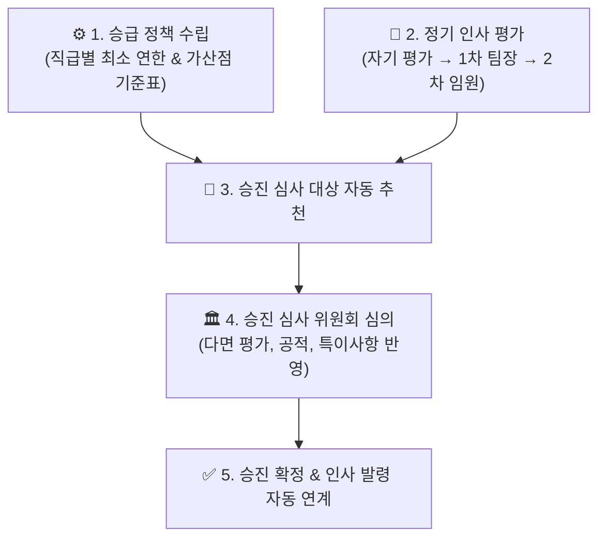

# 인사 평가 및 승진

::: tip 📸 실제 화면 안내

*관리자 참고: 해당 화면의 실제 캡처 이미지를 `./images/evaluation.png` 경로에 등록해 주세요.*
:::

> **인사 평가 및 승진**은 사내 직급별 승급 정책(최소 근속 연한 및 필수 평가 등급)을 수립하고, 정기 인사 고과에 따른 업적 평가와 승진 심사 대상자 선발 및 인사 발령을 원스톱으로 처리하는 본사 인사 모듈입니다.

* **접근 경로**: 시스템 좌측 내비게이션 메뉴에서 **[본사 관리] → [인사 조직 관리] → [인사 평가 및 승진]**을 선택하여 접속합니다. (평가 기간 동안 전 임직원 자기 평가 참여 지원, 심사는 인사 위원회 전용)

## 1. 승급 정책 설정 (Promotion Policy)

회사의 취업규칙 및 인사 규정에 맞추어 각 직급별 승진에 필요한 필수 요건과 기준 점수를 설정합니다.

* **직급별 표준 체류 연한**:
  * 각 직급(사원 → 대리 → 과장 → 차장 → 부장)에서 다음 상위 직급으로 승진하기 위한 최소 근속 연수를 지정합니다.
* **평가 등급 환산 기준**:
  * S등급, A등급, B등급, C등급, D등급 등 상대/절대 평가 등급에 따른 배점 기준표를 정의하여 심사 종합 점수에 반영합니다.
* **발탁 승진 요건**:
  * 탁월한 성과를 창출한 특례 승진 후보자를 위해 표준 체류 연한 미달 시에도 추천할 수 있는 특별 공적 기준을 마련할 수 있습니다.

## 2. 인사 업적 평가 (Evaluations)

분기, 반기 또는 연간 단위로 진행되는 직무 역량 및 업적 평가 프로세스를 지원합니다.

* **3단계 다면 평가 프로세스**:
  1. **자기 평가 (본인 평가)**: 피평가자 본인이 설정한 핵심 업무 목표 대비 달성도와 성과를 기술하고 자가 진단합니다.
  2. **1차 평가 (부서장 / 팀장)**: 직속 상급자가 실무 수행 능력, 직무 태도, 팀 기여도를 평가하고 코칭 피드백을 작성합니다.
  3. **2차 평가 (상위 임원 / 본부장)**: 부서 간 균형과 전사 기여도를 고려하여 종합 등급을 최종 확정합니다.
* **평가 지표 구성**:
  * 핵심 성과 지표(KPI) 달성도, 직무 전문성, 협업 및 커뮤니케이션, 리더십 등 직급별 가중치에 맞춰 유연하게 지표를 구성할 수 있습니다.

## 3. 승진 심사 대상 관리 (Promotions)

설정된 승급 정책과 누적된 인사 평가 점수를 바탕으로 정기 승진 대상자를 시스템이 자동으로 산출하고 심사합니다.

* **후보자 자동 추천 엔진**:
  * 직급별 최소 근속 연수를 충족하고 누적 평가 점수가 사내 기준치를 만족하는 임직원을 시스템이 자동 필터링하여 후보군 목록으로 제시합니다.
* **심사 위원회 의견 수렴**:
  * 승진 심사 위원들이 후보자별 업무 성과, 주요 공적, 근태 현황, 교육 이수 내역을 종합 검토하고 최종 승진 승인 여부를 결정합니다.
* **인사 발령 자동 연계 (One-click Update)**:
  * 승진 심사가 최종 확정되면, 시스템이 자동으로 신규 직급 및 직위가 반영된 공식 **인사 발령**을 생성하여 조직도와 인사 기록 대장에 즉시 반영합니다.

## 4. 신입사원을 위한 자기 평가 작성 팁

* **구체적 수치와 근거 중심 작성**:
  * "열심히 일했습니다"라는 정성적 서술보다는 "A 프로젝트 완료율 100% 달성", "현장 인허가 지연 0건 처리" 등 구체적인 실적과 산출물을 중심으로 작성하는 것이 좋은 평가를 받는 핵심 팁입니다.
* **IBS 시스템 내 활동 내역 링크 활용**:
  * 자신이 주도한 주요 [업무(Issue)](/work-manage/issue)나 확정된 [회의록](/work-manage/meeting) 번호를 자기 평가서에 기재해 두면 평가자가 실질적인 성과를 즉시 검토할 수 있습니다.
* **기한 준수**:
  * 1차 평가자의 검토 일정을 고려하여 안내된 자기 평가 마감일 최소 하루 전에 작성을 완료하고 제출하십시오.
