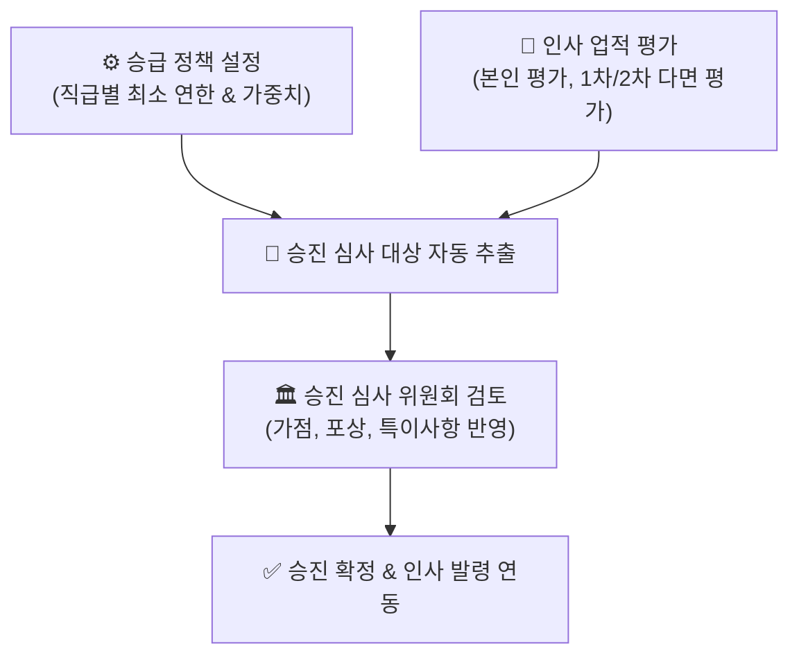

# 인사 평가 및 승진

> **인사 평가 및 승진**은 사내 직급별 승급 정책(최소 연한 및 평가 점수)을 수립하고, 정기 인사 고과에 따른 업적 평가와 승진 심사 대상자 선발 및 확정을 체계화하는 모듈입니다.

- **메뉴 위치**: `본사 관리 > 인사 조직 관리 > 인사 승진 평가` (`/hr-manage/evaluations`, `promotions`, `promotion-policy`)
- **관리 대상**: 인사 담당자, 임원진, 평가 위원회

## 1. 승급 정책 설정 (Promotion Policy)

회사의 인사 규정에 맞추어 각 직급별 승진에 필요한 필수 요건과 기준 점수를 설정합니다.

- **직급별 표준 체류 연한**: 각 직급(사원 $\to$ 대리 $\to$ 과장 $\to$ 차장 $\to$ 부장)에서 다음 직급으로 승진하기 위한 최소 근속 연수를 지정합니다.
- **평가 등급 환산 기준**: S/A/B/C/D 등급에 대한 가산점 및 배점을 정의하여 심사 점수에 반영합니다.
- **발탁 승진 요건**: 특례 승진 대상자를 위한 특별 공적 인정 기준을 마련할 수 있습니다.

## 2. 인사 업적 평가 (Evaluations)

분기/반기/연간 단위로 진행되는 직무 역량 및 업적 평가 프로세스를 수행합니다.

- **다단계 평가 프로세스**:
  - `자기 평가`: 피평가자 본인의 목표 달성도 및 성과 기술
  - `1차 평가`: 직속 부서장(팀장)의 실무 역량 평가 및 피드백
  - `2차 평가`: 상위 임원/본부장의 종합 역량 평가
- **평가 항목 구성**: KPI 달성도, 직무 전문성, 협업/리더십 등 조직 특성에 맞는 지표를 설정할 수 있습니다.

## 3. 승진 심사 대상 관리 (Promotions)

설정된 승급 정책과 누적 평가 점수를 바탕으로 정기 승진 대상자를 자동으로 산출하고 심사합니다.

- **대상자 자동 추천**: 직급별 최소 근속 연수를 충족하고 평가 점수가 기준치 이상인 임직원을 시스템이 자동 필터링하여 후보군 목록으로 제시합니다.
- **심사 위원회 의견 수렴**: 승진 심사 위원들이 후보자별 공적, 근태, 교육 이수 현황을 종합 검토하고 최종 승진 승인 여부를 결정합니다.
- **인사 발령 자동 연계**: 승진 심사가 확정되면 클릭 한 번으로 신규 직급/직위가 반영된 인사 발령(`company.StaffAssignment`)을 자동 생성합니다.
