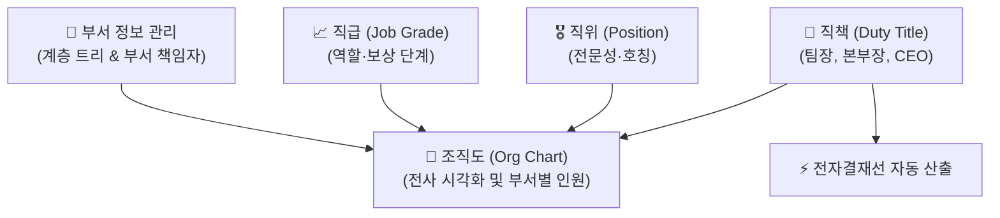

# 조직 체계 관리

> **조직 체계 관리**는 회사의 부서 계층 구조, 직급·직위·직책 및 임원 직위 체계를 정의하고, 이를 바탕으로 전사 조직도를 시각화하여 체계적인 인력 및 결재선을 지원하는 기초 관리 모듈입니다.

- **메뉴 위치**: `본사 관리 > 인사 조직 관리 > 조직 체계 관리` (`/hr-manage/department`, `grade`, `position`, `duty`, `executive-rank`, `org-chart`)
- **관리 대상**: 부서 관리자, 인사 담당자, 시스템 관리자

## 1. 부서 정보 관리 (Department)

부서는 회사의 기능별 조직 단위를 정의하며, 상위 부서 지정을 통해 무제한 계층 트리(Tree) 구조를 형성합니다.

- **계층 레벨 자동 계산**: 상위 부서 선택 시 해당 부서의 레벨이 자동으로 연산되며, 상위 부서가 변경될 경우 하위 조직의 레벨도 연쇄 갱신됩니다.
- **순환 참조 방지**: 자기 자신을 상위 부서로 지정하거나 상·하위 간 순환 참조가 발생하지 않도록 유효성 검사가 적용되어 있습니다.
- **부서 책임자(Manager) 지정**: 각 부서의 장(부서장/팀장)을 임직원 목록에서 지정하며, 전자결재 시 부서 내 1차 승인권자로 자동 연결됩니다.

| 주요 필드 | 설명 | 비고 |
| :--- | :--- | :--- |
| **상위 부서** | 소속된 상위 조직 단위 | 최상위 부서인 경우 미지정 (Level 1) |
| **부서명** | 공식 부서 명칭 (예: 경영지원팀, 개발기획본부) | 필수 입력 |
| **주요 업무** | 부서의 핵심 R&R 및 직무 설명 | 선택 입력 |
| **책임자** | 부서 책임자 (`company.Staff`) | 전자결재 자동 결재선의 기준 |

## 2. 직급 · 직위 · 직책 체계

IBS는 인사 평가, 보상, 결재 권한의 혼선을 방지하기 위해 **직급(Grade)**, **직위(Position)**, **직책(Duty)**을 명확히 분리하여 관리합니다.

### 직급 (Job Grade)
- 조직 내에서 개인의 역할, 책임, 성장 단계 및 보상 수준을 일관된 기준으로 관리하는 체계입니다.
- 최소 근속 연수와 승급 기준표(`PromotionPolicy`)와 연계되어 승진 심사 대상 선발의 기준이 됩니다.

### 직위 (Position)
- 대외적 호칭 및 전문성 수준을 나타냅니다. (예: 사원, 대리, 과장, 차장, 부장)
- 하나의 직위에는 복수의 직급 단계가 매핑될 수 있습니다.

### 직책 (Duty Title)
- 현재 맡고 있는 관리 및 지휘 책임입니다. (예: 팀장, 본부장, 부문장, 대표이사)
- **전자결재 자동 결재선 산출의 핵심 기준**으로 활용됩니다.

## 3. 임원 직위 관리 (Executive Rank)

등기 및 비등기 임원에 대한 특화 직위 체계(상무, 전무, 부사장, 사장, 부회장, 회장 등)를 정의하며, 이사회 및 대표이사 전결 규정과 연동됩니다.

## 4. 전사 조직도 (Org Chart)

등록된 부서 계층과 부서별 배속된 임직원(정규직/계약직/임원)의 현황을 실시간 다이어그램으로 시각화합니다.

- **부서별 인원 집계**: 부서 단위별 현재 재직 인원수가 자동으로 카운트됩니다.
- **책임자 및 구성원 표출**: 부서장을 최상단에 강조 표시하고 소속 팀원들의 직위/직책을 한눈에 조회할 수 있습니다.
- **조직도 검색**: 특정 부서명이나 직원명을 검색하여 조직 내 위치를 빠르게 확인할 수 있습니다.
