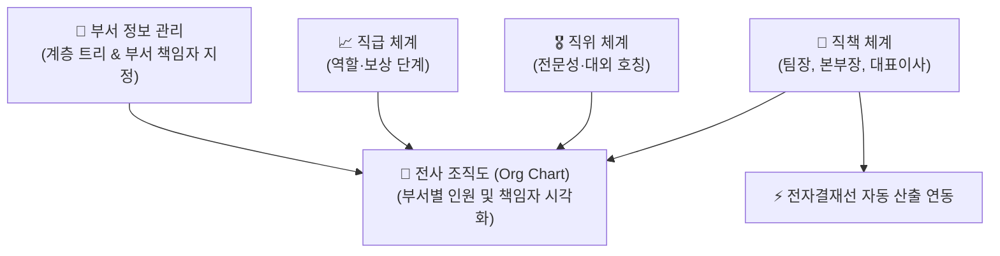

# 조직 체계 관리

::: tip 📸 실제 화면 안내

*관리자 참고: 해당 화면의 실제 캡처 이미지를 `./images/organization.png` 경로에 등록해 주세요.*
:::

> **조직 체계 관리**는 회사의 부서 계층 구조, 직급·직위·직책 및 임원 직위 체계를 정의하고, 이를 바탕으로 전사 조직도를 시각화하여 체계적인 인력 배치와 결재선을 지원하는 본사 인사 관리 모듈입니다.

* **접근 경로**: 시스템 좌측 내비게이션 메뉴에서 **[본사 관리] → [인사 조직 관리] → [조직 체계 관리]**를 선택하여 접속합니다. (인사 담당자 및 관리자 권한 필요, 일반 직원은 조직도 열람 지원)

## 1. 부서 정보 관리 (Department)

부서는 회사의 고유 업무 단위(팀, 본부, 실, 부문 등)를 정의하며, 상위 부서 지정을 통해 무제한 계층 트리(Tree) 구조를 형성합니다.

* **계층 레벨 자동 계산**: 상위 부서를 선택하면 해당 부서의 하위 레벨이 자동으로 연산되며, 상위 부서 변경 시 하위 모든 하위 부서의 레벨도 연쇄적으로 갱신됩니다.
* **순환 참조 방지**: 자기 자신을 상위 부서로 지정하거나 상·하위 간 꼬임 현상이 발생하지 않도록 시스템 유효성 검사가 작동합니다.
* **부서 책임자 지정**: 각 부서의 장(부서장/팀장)을 임직원 목록에서 지정하며, 전자결재 품의 상신 시 부서 내 **1차 결재 승인권자**로 자동 연결됩니다.

| 주요 필드 | 설명 | 비고 |
| :--- | :--- | :--- |
| **상위 부서** | 소속된 상위 조직 단위 | 최상위 부서인 경우 미지정 (Level 1) |
| **부서명** | 공식 부서 명칭 (예: 개발사업본부, 경영지원팀) | 필수 입력 |
| **주요 업무** | 부서의 핵심 역할(R&R) 및 직무 설명 | 부서 소개로 활용 |
| **책임자** | 부서 책임자 (팀장/부서장) | 전자결재 자동 결재선의 기준 |

## 2. 직급 · 직위 · 직책 체계

신입사원과 임직원이 쉽게 구분할 수 있도록 IBS는 **직급**, **직위**, **직책**의 개념을 명확히 분리하여 관리합니다.

| 구분 | 개념 및 정의 | 실제 사내 예시 | 주요 활용 영역 |
| :--- | :--- | :--- | :--- |
| **직급** | 개인의 역할, 역량, 보상 수준을 나타내는 내부 등급 | 1등급, 2등급, J1, S2, 사원 1호봉 등 | 급여 및 승진 심사 기준 |
| **직위** | 대외적 호칭과 업무 숙련도를 나타내는 명칭 | 사원, 대리, 과장, 차장, 부장 | 명함 표기, 대외 커뮤니케이션 |
| **직책** | 부서 내에서 맡고 있는 지휘·감독 책임 | 팀원, 팀장, 실장, 본부장, 부문장 | **전자결재 결재선 산출**, 전결 권한 |

### 직급 (Job Grade)
* 조직 내에서 개인의 성장 단계와 보상 수준을 일관되게 관리하는 체계입니다.
* 최소 근속 연수 및 사내 승급 정책 기준표와 연계되어 정기 승진 심사 대상 선발의 기준이 됩니다.

### 직위 (Position)
* 대외적인 호칭과 숙련도 수준을 나타내며, 하나의 직위 내에 복수의 직급 단계가 매핑될 수 있습니다.

### 직책 (Duty Title)
* 실질적으로 조직을 지휘하고 관리하는 권한을 의미하며, **전자결재 자동 결재선 산출의 핵심 기준**이 됩니다.

## 3. 임원 직위 관리 (Executive Rank)

등기 및 비등기 임원에 대한 특화 직위 체계(상무, 전무, 부사장, 사장, 부회장, 회장 등)를 정의하며, 이사회 및 대표이사 전결 규정과 연동됩니다.

## 4. 전사 조직도 (Org Chart)

등록된 부서 계층과 부서별 배속된 임직원의 현황을 실시간 다이어그램으로 시각화합니다.

* **부서별 인원 집계**: 부서 단위별 현재 재직 중인 인원수가 자동으로 카운트됩니다.
* **책임자 및 팀원 표출**: 부서장을 최상단에 강조 표시하고 소속 팀원들의 직위와 직책을 직관적으로 조회할 수 있습니다.
* **조직도 검색**: 특정 부서명이나 직원명을 검색하여 조직 내 위치와 담당 부서를 즉시 확인할 수 있습니다.

## 5. 실무 활용 팁

* **신입사원 팁 (동료 및 협조 부서 찾기)**:
  * 업무 중 다른 부서의 담당자나 팀장을 찾아야 할 때는 **전사 조직도**를 활용하세요. 부서별 조직 구성원과 직책, 내선번호 및 이메일을 바로 확인할 수 있어 원활한 업무 협조에 도움이 됩니다.
* **인사 담당자 팁 (부서 신설 시 주의사항)**:
  * 신규 부서를 생성한 후에는 반드시 **[책임자]**를 지정해 주어야 해당 부서 직원이 휴가나 기안문을 상신할 때 1차 결재선이 정상적으로 자동 산출됩니다.
