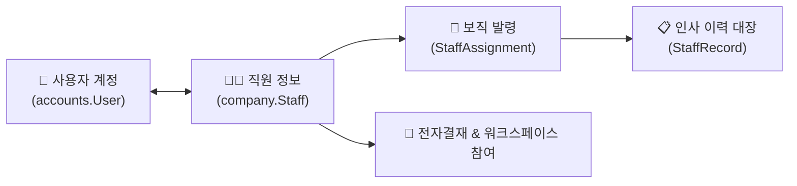

# 직원 인사 관리

> **직원 인사 관리**는 임직원의 기초 인적 사항, 계정 연동, 고용 형태(정규직/계약직/위촉직 등)를 관리하고, 부서 발령·보직 이동·승진 등의 인사 이력을 영구적으로 기록·보관하는 모듈입니다.

- **메뉴 위치**: `본사 관리 > 인사 조직 관리 > 직원 인사 관리` (`/hr-manage/staff`, `executives`, `appointments`, `records`)
- **관리 대상**: 인사 담당자, 부서장, 시스템 관리자

## 1. 직원 정보 관리 (Staff)

임직원의 기본 정보(성명, 생년월일, 연락처, 입사일, 재직 상태)를 등록하고 로그인 계정과 1:1 매핑합니다.

- **사용자 계정 매핑**: 시스템 계정(`accounts.User`)과 직원 레코드를 연결하여 로그인 시 본인의 인사 정보, 휴가 현황, 결재 권한이 자동으로 동기화됩니다.
- **고용 형태 세분화**: 정규직, 계약직/기간제, 파견직, 위촉직/자문, 인턴/수습, 파트타임 등 고용 형태를 구분하여 관리하며, 계약직의 경우 계약 만료일을 추적할 수 있습니다.
- **재직 상태 제어**:
  - `재직`: 정상 근무 상태 (시스템 및 결재 권한 활성)
  - `휴직`: 육아/질병 휴직 등 (업무 일시 중지)
  - `퇴직신청 / 퇴직`: 퇴사일 지정 및 시스템 접근 권한 자동 차단

## 2. 임원 정보 관리 (Executive)

회사의 등기 임원 및 미등기 임원에 대한 직무 구분, 선임일, 임기 만료일, 주주총회/이사회 이력을 독립적으로 관리합니다.

- **임기 관리**: 임원별 임기 시작일과 만료일을 기록하여 중임/퇴임 시점을 사전에 알림받을 수 있습니다.
- **결재 전결 연동**: 대표이사 및 담당 임원의 결재 전결 규정과 연동되어 고액 지출 및 중요 계약 품의 시 필수 심사선으로 지정됩니다.

## 3. 인사 발령 관리 (Appointments)

입사, 부서 이동, 전보, 승진, 겸직 등 조직 개편 및 인사이동 시 발령을 등록하고 적용합니다.

- **주보직(Primary) 및 겸직(Secondary) 지원**:
  - 직원은 기본적으로 하나의 주보직을 가지며, 프로젝트 투입이나 태스크포스(TF) 등에 따른 겸직을 복수로 부여받을 수 있습니다.
  - 전자결재 기안 시 상신 보직을 선택하여 결재선(본사 부서 결재 vs 프로젝트 결재)을 유연하게 전환할 수 있습니다.
- **발령 적용 시점**: 발령 일자를 지정하여 정기 인사 시점에 맞추어 조직 및 결재선이 자동 갱신됩니다.

## 4. 인사 이력 관리 (Records)

입사부터 퇴사까지 임직원의 모든 신분 변동 내역(승진, 보직 변경, 포상, 징계, 휴직 등)을 시계열로 영구 보관합니다.

- **자동 이력 생성**: 인사 발령이 승인되면 변경 전/후 부서, 직급, 직책 정보가 인사 이력 대장에 자동으로 스냅샷으로 기록됩니다.
- **인사 기록 카드 출력**: 필요 시 직원의 전체 재직 이력을 한눈에 볼 수 있는 인사 기록 카드로 조회 및 인쇄할 수 있습니다.
