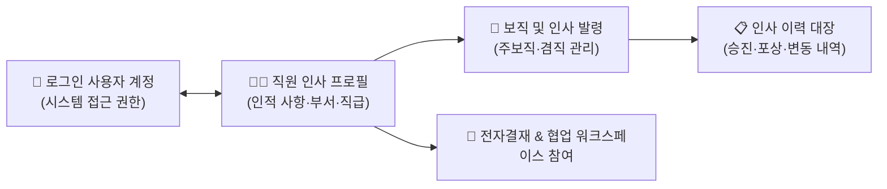

# 직원 인사 관리

::: tip 📸 실제 화면 안내

*관리자 참고: 해당 화면의 실제 캡처 이미지를 `./images/staff.png` 경로에 등록해 주세요.*
:::

> **직원 인사 관리**는 임직원의 기초 인적 사항, 로그인 계정 연동, 고용 형태(정규직/계약직/위촉직 등)를 관리하고, 부서 발령·보직 이동·승진 등의 인사 이력을 영구적으로 기록·보관하는 본사 인사 모듈입니다.

* **접근 경로**: 시스템 좌측 내비게이션 메뉴에서 **[본사 관리] → [인사 조직 관리] → [직원 인사 관리]**를 선택하여 접속합니다. (인사 담당자 및 관리자 권한 필요)

## 1. 직원 정보 관리 (Staff)

임직원의 기본 정보(성명, 생년월일, 연락처, 입사일, 재직 상태)를 등록하고 시스템 로그인 계정과 1:1로 매핑합니다.

* **사용자 계정 1:1 매핑**:
  * 시스템 로그인 계정과 직원 인사 레코드를 연결하여, 로그인 시 본인의 인사 정보, 잔여 휴가 현황, 결재 권한이 자동으로 동기화됩니다.
* **고용 형태 세분화**:
  * 정규직, 계약직/기간제, 파견직, 위촉직/자문, 인턴/수습, 파트타임 등 고용 형태를 구분하여 관리하며, 계약직의 경우 계약 만료일을 설정하여 사전에 갱신 시점을 관리할 수 있습니다.
* **재직 상태 제어**:
  * **재직 (정상)**: 정상 근무 상태로, 모든 시스템 접근 및 전자결재 권한이 활성화됩니다.
  * **휴직**: 육아 휴직, 질병 휴직 등으로 업무 및 결재 권한이 일시 정지됩니다.
  * **퇴직 (퇴사)**: 퇴사일이 기록되며 시스템 로그인이 즉시 차단되고, 과거 작성된 결재 및 업무 이력은 영구 보존됩니다.

## 2. 임원 정보 관리 (Executive)

회사의 등기 임원 및 미등기 임원에 대한 직무 구분, 선임일, 임기 만료일, 주주총회/이사회 이력을 독립적으로 관리합니다.

* **임기 및 중임 관리**: 임원별 임기 시작일과 만료일을 기록하여 중임/퇴임 시점을 체계적으로 관리합니다.
* **전결 규정 연동**: 대표이사 및 담당 임원의 결재 전결 규정과 연동되어 고액 사업비 지출 및 중요 계약 품의 시 필수 최종 승인선으로 자동 지정됩니다.

## 3. 인사 발령 관리 (Appointments)

신규 입사, 부서 이동, 전보, 승진, 겸직 등 조직 개편 및 인사이동 시 발령을 등록하고 일괄 적용합니다.

* **주보직 및 겸직 지원**:
  * 직원은 기본적으로 하나의 주보직(소속 부서 및 직책)을 가지며, 특정 프로젝트 파견이나 태스크포스(TF) 등에 따른 겸직을 복수로 부여받을 수 있습니다.
  * 전자결재 기안 시 상신 보직을 선택할 수 있어 본사 부서 결재선과 프로젝트 결재선을 유연하게 구분하여 상신할 수 있습니다.
* **발령 적용 시점 지정**:
  * 발령 예정 일자를 사전 등록해 두면 정기 인사 발령 당일에 맞추어 조직도와 전자결재선이 자동으로 갱신됩니다.

## 4. 인사 이력 관리 (Records)

입사부터 퇴사까지 임직원의 모든 신분 변동 내역(승진, 보직 변경, 포상, 징계, 휴직 등)을 시계열로 영구 보관합니다.

* **자동 이력 스냅샷 생성**: 인사 발령이 승인되는 즉시 변경 전/후 부서, 직급, 직책 정보가 인사 이력 대장에 자동으로 기록되어 변경 이력의 위변조를 방지합니다.
* **인사 기록 카드 출력**: 필요 시 직원의 전체 재직 이력을 한눈에 볼 수 있는 '인사 기록 카드' 양식으로 조회하고 인쇄할 수 있습니다.

## 5. 실무 운영 가이드

* **신입사원 온보딩 시 계정 연동 (인사 담당자 필독 ⭐️)**:
  1. 먼저 [설정 관리 > 사용자](/work-setting/user) 메뉴에서 신입사원의 시스템 로그인 계정을 생성합니다.
  2. 본 **직원 인사 관리** 화면에서 [직원 추가] 버튼을 누르고, 기본 인적 사항을 입력한 뒤 방금 생성한 로그인 계정을 매핑합니다.
  3. 주보직 발령(소속 부서, 직위, 직책)을 등록하면 신입사원의 온보딩 세팅이 완료됩니다.
* **퇴사자 처리 원칙**:
  * 직원이 퇴사하는 경우 프로필을 삭제하지 않고 **재직 상태를 '퇴직'으로 변경**하십시오. 이렇게 해야 퇴사자가 과거에 결재하거나 기안한 문서의 작성자 정보가 시스템에 안전하게 보존됩니다.
