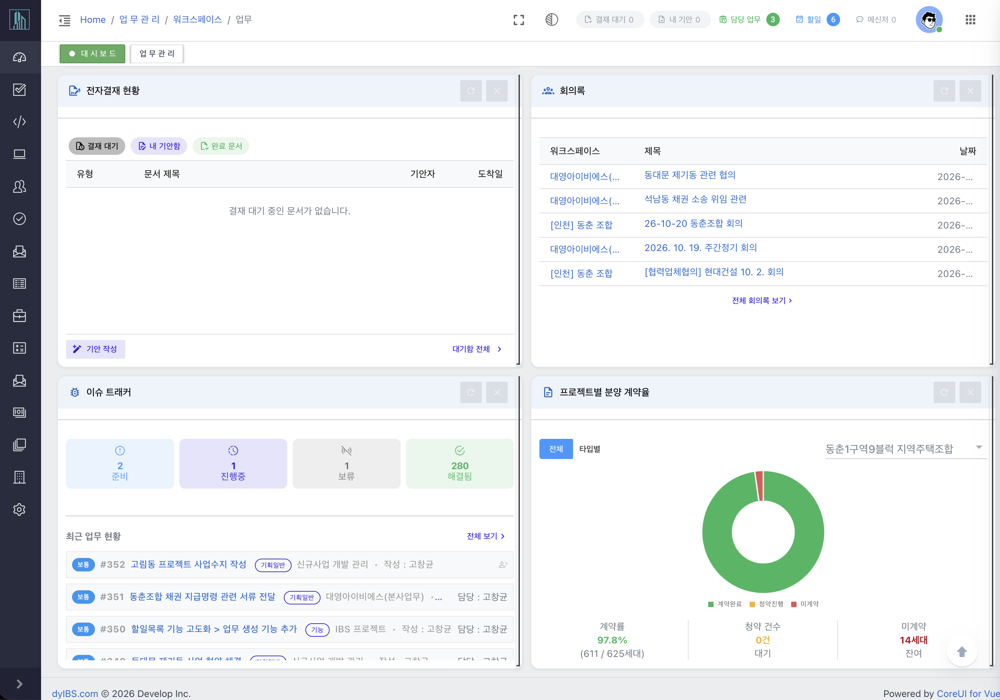
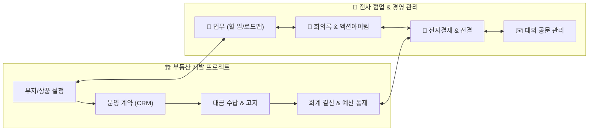

# IBS 워크스페이스 소개

> **IBS (Intelligent Business System)**는 부동산 개발사업의 전 과정 (토지 매입부터 인허가, 분양 계약, 대금 수납, 회계 정산, 소송 관리까지)에서 발생하는 핵심 데이터와 일상적인
> 업무를 하나로 통합하여 협업하는 **디벨로퍼 전용 지능형 업무 플랫폼**입니다.

모든 부서의 업무 (할 일), 회의 결정 사항, 전자결재 품의 이력 및 현장 실사 데이터가 유기적으로 연결되어, 개인의 경험에 의존하던 노하우를 조직의 영구적인 지식 자산으로 축적합니다.

::: tip 📸 실제 화면 안내

:::

## 🚀 신입사원을 위한 직무별 빠른 시작 (Quick Guide)

IBS에 처음 오셨다면, 본인의 직무와 소속 부서에 맞는 길잡이를 따라 시작해 보세요.

| 직무 / 소속               | 신입사원 1일차 추천 경로                                                                                                                          | 핵심 활용 메뉴                               |
|:--------------------------|:--------------------------------------------------------------------------------------------------------------------------------------------------|:---------------------------------------------|
| **🏢 본사 / 경영지원**    | [내 프로필 확인](/intro/getting-started) → [인사 정보 및 조직도 조회](/hr-manage/organization) → [첫 전자결재 품의 작성](/approval/draft) | 전자결재 18종, 대외 공문 발송, 근태/연차     |
| **🏗️ 개발 / 사업관리**    | [워크스페이스 참여](/work-manage/workspace) → [회의록 작성](/work-manage/meeting) → [첫 업무(할 일) 등록](/work-manage/issue)             | 워크스페이스, 회의록, 로드맵, 현장 사진 첨부 |
| **🤝 분양 / 영업 / CRM**  | [프로젝트 선택](/project/) → [동·호수 배치 현황 확인](/contract/status) → [분양 계약 등록](/contract/)                                    | 동호배치도, 계약 등록/승계, 수수료 정산      |
| **💰 자금 / 수납 / 회계** | [대시보드 자금 확인](/intro/dashboard) → [회차별 대금 수납 등록](/payment/) → [입금 매칭](/ledger/status)                                 | 수납 관리, 고지서 출력, 회계 자금 출납       |
| **👔 임원 / 부서장**      | [모바일 앱 설치 및 생체인증 등록](/intro/getting-started) → [결재 대기 문서 원터치 승인](/approval/action)                                    | 대시보드 지표 모니터링, 전자결재 승인/전결   |

## 시스템 핵심 아키텍처

IBS는 흩어져 있는 업무 영역을 하나의 맥락으로 연결하여 데이터 무결성과 신속한 의사결정을 지원합니다.

## 왜 IBS 워크스페이스인가?

- **친숙하고 직관적인 업무 관리** - 회의록에서 결정된 액션 아이템이 담당자의 업무 (Issue)로 원클릭 발행되어 생성부터 완료까지 투명하게 추적됩니다.
- **도메인 결합형 원스톱 데이터 파이프라인** - 부지, 상품, 계약, 수납, 회계가 단일 흐름으로 연결되어 엑셀 수기 관리 시 발생하는 오기와 누락을 원천 차단합니다.
- **의사결정의 지식 자산화** - 과거 회의 의제, 경영진의 전자결재 품의 승인 이력, 공문 발송 기록이 영구 보관되어 담당자가 바뀌어도 업무 히스토리가 완벽히 계승됩니다.
- **현장과 본사의 실시간 동기화** - 외근 및 공사 현장 실사 중 모바일로 촬영한 현장 사진과 이슈가 즉시 본사 PC 대시보드에 0.1초 내로 동기화됩니다.

## 멀티플랫폼 협업 환경 (웹 & 모바일)

IBS 워크스페이스는 사무실 대화면 업무를 위한 **데스크톱 웹 (PC)**과 현장 점검 및 외근 이동성을 위한 **스마트폰 모바일 앱 (iOS / Android)**이 실시간으로 상호 연동됩니다.

| 구분               | 데스크톱 웹 (PC)                                           | 모바일 앱 (iOS / Android)                                      |
|:-------------------|:-----------------------------------------------------------|:---------------------------------------------------------------|
| **주요 활용 환경** | 사무실 PC, 대화면 모니터                                   | 외근, 출장, 현장 이동, 긴급 상황                               |
| **핵심 목적**      | 심층 회계 정산, 대량 데이터 등록, 계약/수납 관리, PDF 인쇄 | 원터치 전자결재 승인, 현장 사진 첨부 및 이슈 처리, 실시간 소통 |
| **전자결재**       | 상세 품의 작성, 첨부파일 검토, 결재선/위임 관리, PDF 출력  | **생체인증(Face ID/지문) 원터치 승인**, 긴급 상신 및 결재 알림 |
| **업무 및 회의**   | 로드맵 간트차트, 간트 일정 관리, 회의록 상세 작성          | **현장 사진 즉시 촬영·첨부**, 진척도 슬라이더 갱신, 안건 확인  |
| **사내 메신저**    | 화면 우측 슬라이드 드로어 소통, 파일/미디어 서랍 열람      | **최상단 헤더 원터치 진입**, **실시간 푸시 알림** 즉시 답장    |
| **특화 기능**      | 다중 창 분할 열람, 엑셀/PDF 대량 다운로드                  | **스마트폰 외부 파일 공유 연동**, 오프라인 네트워크 감지 배너  |

::: tip 💡 유기적인 데이터 동기화
웹 (PC)에서 작성한 전자결재나 회의 안건은 모바일 앱에 즉시 푸시 알림으로 전달되며, 모바일에서 현장 사진을 촬영하여 등록한 업무는 웹 화면에 실시간으로 즉시 반영됩니다.
:::

## 주요 기능 및 매뉴얼 안내

### 🏢 1. 본사 관리 시스템 (HQ Management)

* **[인사 조직 관리](/hr-manage/organization)**: 부서 계층 트리, 직급/직위/직책, 전사 조직도, 직원 정보, 연차/근태 및 승진 심사
* **[전자결재 시스템](/approval/)**: 18종 전용 양식 기안, 조직도 기반 자동 결재선 산출, 전결 규정, 결재 위임 및 전자직인 PDF 보관
* **[대외 공문 관리](/official-letter/)**: 관공서/협력사 발송 공문 표준 A4 작성 (실시간 프리뷰), 수신 공문 접수 및 회신 공문 연계
* **[본사 회계 관리](/ledger/status)**: 본사 법인 계좌 거래 내역, 본사 운영비 및 출납 결산 관리

### 🎯 2. 업무 관리 및 협업 공간 (Workspace & Collaboration)

* **[워크스페이스 개요](/work-manage/workspace)**: 전사 부서 및 프로젝트 단위 통합 협업 공간 구성
* **[회의록 관리](/work-manage/meeting)**: 회의 의제, 결정 사항, 후속 조치 (Action Item) 연동 자산화
* **[업무 (할 일) 및 로드맵](/work-manage/issue)**: 담당자별 업무 할당, 진척률 관리, 마일스톤 로드맵 트래킹
* **[캘린더 & 사내 메신저](/work-manage/calendar)**: 마일스톤 일정 공유 및 실시간 1:1 / 프로젝트 공용 채널 소통

### 🏗️ 3. 프로젝트 관리 시스템 (Project Development)

* **[프로젝트 설정](/project/)**: 사업지 마스터 정보 등록, 동·호수 및 유닛 타입 배치, 분양 조건 및 사업 예산 편성
* **[부지 정보 관리](/project/site-manage)**: 필지별 토지 조서, 소유자 상담 및 토지 매입 계약 관리
* **[분양 계약 관리](/contract/)**: 수분양자 계약 등록, 옵션 계약, 동·호수 배치 현황 및 권리의무 승계·해약 관리
* **[분양 대행 관리](/sales/)**: 직영/외주 분양 조직 구성, 계약 실적 매핑, 차수별 수수료 정책 및 정산·지급
* **[대금 수납 및 고객 고지](/payment/)**: 회차별 납부 관리, 연체료 자동 산출, 맞춤형 수납 고지서 출력 및 SMS 발송
* **[프로젝트 회계 & 자금](/project/budgets)**: 사업비 집행 통제, 사업 수지 캐시플로우 및 예산 대비 실적 분석
* **[문서 보관소 & 소송 관리](/document/)**: 프로젝트 인허가 문서 영구 보관, 소송 사건 기일 및 판결 관리

## 시작하기 가이드

처음 방문하셨다면 아래 가이드부터 순서대로 확인하시는 것을 추천합니다.

* 💡 **[IBS 시작하기 가이드](/intro/getting-started)**: 첫 로그인, 계정 온보딩, 1일차 5분 퀵스타트 체크리스트
* 📊 **[대시보드 사용 매뉴얼](/intro/dashboard)**: 30초 조작법, 추천 핵심 위젯 TOP 5 및 개인 맞춤 레이아웃 설정
* 💬 **[사내 메신저 가이드](/intro/chat)**: 실시간 채팅, 현장 사진/자료 공유, 모바일 푸시 알림 설정
