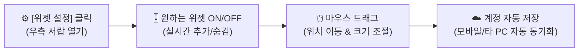

# 대시보드 (Dashboard) 사용 매뉴얼

> **IBS 대시보드**는 프로젝트 진행 상황, 분양 및 계약 지표, 자금 흐름, 그리고 개인의 업무/회의 현황까지 시스템 내의 핵심 데이터를 한눈에 모니터링할 수 있는 **개인 맞춤형 지능형 포털**입니다.

## 1. 30초 만에 끝내는 대시보드 조작법

대시보드는 레고 블록처럼 원하는 위젯을 배치하고 크기를 바꿀 수 있습니다.

### 💡 위젯 추가 및 숨김 (Widget Drawer)
* 화면 우측 상단의 **[위젯 설정]** 버튼을 클릭하면 우측 서랍(Drawer) 패널이 열립니다.
* 필요한 위젯의 토글 스위치를 켜면 즉시 대시보드 빈 공간에 배치되며, 끄면 화면에서 숨겨집니다.
* 배치가 꼬였거나 초기 구성으로 되돌리고 싶다면 패널 하단의 **[기본값으로 초기화]**를 누르면 됩니다.

### 🧩 위젯 위치 이동 및 크기 조절 (Drag & Resize)
* **위치 이동 (Drag)**: 위젯 상단의 타이틀 바를 마우스로 잡고 끌면 원하는 위치로 바둑판 격자에 맞춰 매끄럽게 재배치됩니다.
* **크기 조절 (Resize)**: 위젯 우측 하단 모서리를 잡고 늘리거나 줄여 가로 폭과 세로 높이를 자유롭게 조정할 수 있습니다.

### ☁️ 자동 클라우드 동기화 (Auto Cloud Sync)
* 설정한 위젯의 위치와 크기는 사용자의 계정에 실시간 자동 저장됩니다.
* 회사 PC, 집 노트북, 태블릿, 모바일 어디서 로그인하든 **내가 정성껏 꾸민 대시보드 레이아웃이 그대로 유지**됩니다.

## 2. ⭐️ 신규 임직원 추천 핵심 위젯 TOP 5

처음 시작하는 임직원에게 가장 권장하는 5가지 필수 위젯입니다.

1. **내 업무 (`my-issue`)**:
   - 나에게 담당자로 배정된 진행 중인 업무 목록과 마감일, 진척률을 확인하고 클릭하여 바로 처리할 수 있습니다.
2. **전자결재 현황 (`approval-status`)**:
   - 내가 기안한 품의서의 승인 진행 상황과, 내가 결재해야 할 대기 문서를 한눈에 파악합니다.
3. **회의록 (`meeting-minutes`)**:
   - 최근 참석한 회의의 핵심 결정 사항과 나에게 할당된 후속 조치(Action Item)를 놓치지 않도록 요약해 줍니다.
4. **공지 목록 (`notice-list`)**:
   - 전사 및 담당 프로젝트의 주요 공지사항과 중요 알림을 실시간으로 확인합니다.
5. **빠른 작업 (`quick-actions`)**:
   - 자주 쓰는 주요 업무(`거래 등록`, `업무 등록`, `계약 등록`, `일정 보기`, `납부 내역` 등)를 메뉴를 찾아 헤맬 필요 없이 단축 버튼으로 즉시 실행합니다.

## 3. 전체 위젯 목록 (16종 상세 안내)

IBS는 업무 성격에 따라 총 16종의 다채로운 위젯을 지원합니다. (⭐️: 초기 기본 활성화 위젯)

### 🎯 협업 및 개인 업무 관리 위젯

| 위젯 이름 | 영문 ID | 기본 크기 | 주요 기능 및 연관 매뉴얼 |
|:---|:---|:---:|:---|
| **내 업무** ⭐️ | `my-issue` | $6 \times 4$ | 본인에게 할당된 진행 중인 작업 목록 및 진척률 확인 $\to$ [업무 관리](/work-manage/issue) |
| **회의록** ⭐️ | `meeting-minutes` | $6 \times 4$ | 최근 회의의 아젠다, 결정 사항 및 액션아이템 요약 $\to$ [회의록 관리](/work-manage/meeting) |
| **전자결재 현황** ⭐️ | `approval-status` | $6 \times 4$ | 기안 상신, 결재 대기, 진행 중 문서 및 최근 결재 이력 요약 $\to$ [전자결재](/approval/) |
| **이슈 트래커** ⭐️ | `issue-tracker` | $6 \times 4$ | 전체 업무(이슈)의 유형별/상태별 진행 통계 차트 $\to$ [로드맵](/work-manage/roadmap) |
| **캘린더** | `calendar` | $12 \times 5$ | 프로젝트 주요 마일스톤, 업무 마감일, 회의 일정 시각화 $\to$ [캘린더](/work-manage/calendar) |
| **활동 피드** | `activity-feed` | $3 \times 4$ | 시스템 전반에서 발생한 실시간 변경 및 작업 로그 타임라인 $\to$ [실행내역](/work-manage/activity) |

### 🏢 프로젝트 및 분양·수납·영업 위젯

| 위젯 이름 | 영문 ID | 기본 크기 | 주요 기능 및 연관 매뉴얼 |
|:---|:---|:---:|:---|
| **프로젝트 현황** | `project-status` | $6 \times 4$ | 참여 중인 프로젝트의 기본 정보, 사업 기간, 전체 진행 상태 요약 $\to$ [프로젝트 등록](/project/) |
| **프로젝트별 분양 계약률** | `contract-status` | $6 \times 4$ | 프로젝트별 분양 완료율 및 계약 상태 요약 도넛 차트 $\to$ [동호배치 현황](/contract/status) |
| **최근 등록 계약** | `contract-log` | $6 \times 4$ | 최근 체결된 분양 계약 및 입금 트랜잭션 실시간 목록 $\to$ [계약 관리](/contract/) |
| **분양 대행 및 수수료 정산** | `sales-status` | $6 \times 4$ | 회차별 분양 수수료 정산 현황, 총 세후 실지급액, 영업팀 지급 진척도 $\to$ [수수료 정산 관리](/sales/settlement) |
| **프로젝트별 수납 현황** | `financial-status` | $6 \times 4$ | 회차별 수납액, 미납액 및 분양 대금 자금 흐름 그래프 $\to$ [수납 현황](/payment/status) |
| **최근 문서 목록** | `document-list` | $6 \times 4$ | 프로젝트 및 본사에서 최근 공유된 공식 문서 목록 $\to$ [문서 관리](/document/) |

### ⚡ 정보 포털 및 편의 위젯

| 위젯 이름 | 영문 ID | 기본 크기 | 주요 기능 및 상세 안내 |
|:---|:---|:---:|:---|
| **오늘의 한마디** ⭐️ | `wise-word` | $12 \times 2$ | 매일 아침 새로운 비즈니스 격언 및 동기부여 메시지 표출 |
| **공지 목록** ⭐️ | `notice-list` | $6 \times 4$ | 전사 및 프로젝트별 최신 공지사항 목록 $\to$ [공지 관리](/work-manage/news) |
| **빠른 작업** | `quick-actions` | $3 \times 4$ | 거래등록, 업무등록, 계약등록 등 8대 단축 버튼 모음 |
| **메인 슬라이드** | `main-carousel` | $12 \times 5$ | 주요 사내 배너 및 비주얼 이미지 슬라이드 뷰어 |

## 4. 직무별 추천 위젯 배치 템플릿

어떤 위젯을 어떻게 배치해야 할지 고민된다면 다음 직무별 추천 구성을 참고해 보세요.

* **프로젝트 총괄 (PM / 사업관리자)**:
  * **상단**: `프로젝트 현황`, `전자결재 현황`, `이슈 트래커`
  * **중단**: `캘린더`, `회의록`, `활동 피드`
  * **하단**: `공지 목록`, `최근 문서 목록`
* **영업 / 분양 / 수납 담당자**:
  * **상단**: `프로젝트별 분양 계약률`, `분양 대행 및 수수료 정산`, `프로젝트별 수납 현황`
  * **중단**: `최근 등록 계약`, `내 업무`, `빠른 작업`
  * **하단**: `공지 목록`, `캘린더`
* **일반 실무자 / 신규 입사자**:
  * **상단**: `오늘의 한마디`, `내 업무`, `전자결재 현황`
  * **중단**: `회의록`, `캘린더`, `공지 목록`
  * **하단**: `빠른 작업`, `활동 피드`
