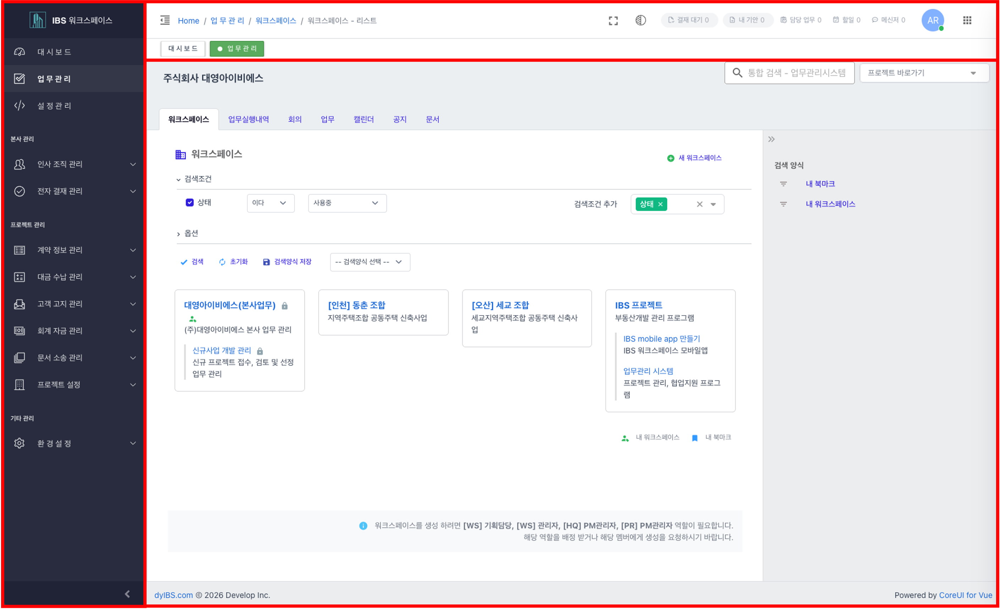

# IBS 워크스페이스 시작하기

> **IBS (Intelligent Business System)**는 부동산 개발사업의 전 과정을 '업무 (Issue)'와 '데이터 파이프라인' 중심으로 관리하고 협업하는 디벨로퍼 전용 업무 플랫폼입니다.
>
> 이 문서는 신규 사용자가 시스템에 처음 접속하여 계정을 설정하고, 본인의 업무와 팀 워크스페이스에 참여하여 첫 업무를 시작하는 온보딩 과정을 안내합니다.

## 대상 사용자

* **개발/사업관리 실무자** - 부지 매입, 인허가, 공정 및 외주 협력사 관리, 현장 이슈 점검
* **분양/영업 담당자** - 동·호수 배치, 분양 계약 등록, 권리의무 승계 및 해약 관리
* **수납/재무 담당자** - 회차별 대금 수납, 연체료 계산, 자금 출납 및 사업 수지 분석
* **임원 및 의사결정자** - 전자결재 승인, 실시간 대시보드 및 사업 지표 모니터링

## ⚡ 1일차 5분 퀵스타트 체크리스트

처음 로그인하셨다면, 원활한 업무를 위해 아래 3가지를 먼저 확인해 주세요.

1. **내 프로필 확인 및 비밀번호 변경**:
   - 우측 상단 사용자 아바타를 클릭하고 `[내 정보 수정]`으로 이동합니다.
   - 연락처(휴대전화번호)가 정확한지 확인하고, 초기 비밀번호를 안전한 개인 비밀번호로 변경합니다.
2. **모바일 앱 설치 및 생체인증 등록**:
   - 외근이나 현장 방문 시에도 긴급 결재와 실시간 소통을 놓치지 않도록 사내 모바일 앱(iOS / Android)을 설치합니다.
   - 첫 로그인 후 **생체인증(Face ID / 지문)** 및 **푸시 알림**을 허용해 두면 원터치로 빠르게 결재를 승인할 수 있습니다.
3. **대시보드에서 '내 업무' 확인**:
   - 로그인 직후 열리는 [대시보드](/intro/dashboard)에서 나에게 할당된 업무 목록(`내 업무`)과 결재 요청 문서(`전자결재 현황`)를 확인합니다.

## 시스템 접속 및 온보딩 3단계

IBS를 정상적으로 이용하기 위해서는 계정 생성 후 관리자의 **인사 정보 연결 및 워크스페이스 권한 부여**가 진행됩니다.

### 1단계: 계정 생성 (회원 가입)
* **접속 주소**: [https://ibs.dyibs.com](https://ibs.dyibs.com)
* 메인 화면의 **[회원가입]** 링크를 클릭하여 아이디와 비밀번호를 등록합니다.
* 가입 시 사내 보안 코드인 **계정 생성코드 (`dyibs-staff`)**를 반드시 입력해야 가입이 완료됩니다.

### 2단계: 인사 정보 등록 및 보직 발령 (인사 담당자 처리)
* 인사 담당자가 신규 가입 계정과 사내 인사 정보(직원 카드)를 연결합니다.
* 소속 부서와 직책(팀장, 담당 등)이 부여되면, **[전자결재 시스템](/approval/)의 기안 양식 로드 및 자동 결재선 산출** 기능이 자동으로 활성화됩니다.

### 3단계: 워크스페이스 초대 및 권한 부여 (프로젝트 관리자 처리)
* 담당 프로젝트나 본사 워크스페이스에 구성원으로 초대되고 역할(권한)을 부여받습니다.
* 권한 설정이 완료되면 좌측 사이드바에 담당 프로젝트의 실무 메뉴(계약, 수납, 부지 등)가 모두 활성화됩니다.

## 기본 화면 구성 (UI Overview)

로그인 후 마주치는 화면은 크게 3개의 핵심 영역으로 구성되어 있습니다.

1. **상단 헤더 바 (Header Bar)**:
   * **회사/프로젝트 선택기**: 작업 대상 회사 및 프로젝트를 원클릭으로 전환
   * **알림 (Notice)**: 나에게 할당된 업무 변경, 결재 요청, 공지사항 실시간 알림
   * **사내 메신저 아이콘**: 실시간 [사내 메신저](/intro/chat) 드로어 호출
   * **테마 및 사용자 메뉴**: 라이트/다크 테마 전환 및 내 정보 수정
2. **좌측 사이드바 (Navigation Drawer)**:
   * **업무 관리**: 워크스페이스, 회의록, 로드맵, 업무(이슈), 캘린더, 문서, 게시판
   * **본사 관리**: 인사 조직 관리, 전자결재 시스템, 대외 공문 관리, 본사 회계 관리
   * **프로젝트 관리**: 부지 관리, 유닛 설정, 계약 관리, 대금 수납, 분양 대행, 프로젝트 회계, 소송 관리
3. **메인 작업 뷰 (Main View)**:
   * 개인 맞춤형 위젯 기반의 [대시보드](/intro/dashboard) 및 선택한 메뉴의 상세 업무 화면이 표시됩니다.

::: tip 📱 모바일 앱 (iOS / Android) 화면 구성 및 외근/현장 팁
* **상단 헤더 바 (Header Bar)**:
  * **전역 메신저 아이콘**: 실시간 [사내 메신저](/intro/chat) 목록으로 원터치 이동
  * **통합 알림 벨**: 실시간 결재 요청, 업무 할당 알림 확인
  * **프로필**: 다크 테마 설정 및 생체인증 관리
* **하단 네비게이션 탭 (Bottom Navigation Bar)**:
  * **홈 (Home)**: 모바일 전용 요약 대시보드 (결재 대기, 진행 중 업무)
  * **업무 (Work)**: 워크스페이스별 회의록 및 업무(이슈) 관리
  * **프로젝트 (Project)**: 사업지 현황 및 분양/계약 요약 조회
  * **소통 (Channel)**: 사내 피드 및 부서별 소통 공간
* **현장 외근 시 유용한 기능**:
  - 현장 실사 중 스마트폰 카메라로 **현장 사진을 즉시 촬영하여 업무(이슈)나 회의록에 첨부**할 수 있습니다.
  - 긴급 전자결재 요청 시 PC를 켤 필요 없이 **Face ID / 지문 인증으로 1초 만에 승인**할 수 있습니다.
:::

## 일일 권장 업무 루틴 (Daily Workflow)

* **09:00 (출근 & 대시보드 점검)**: [대시보드](/intro/dashboard)에서 오늘의 일정(캘린더), 나에게 할당된 업무, 결재 대기 문서를 확인합니다.
* **11:00 (회의 및 협업)**: [회의록](/work-manage/meeting)을 통해 의제를 공유하고, 결정 사항에 따른 후속 조치 업무를 등록합니다.
* **14:00 (실무 데이터 처리 & 결재)**: [계약 등록](/contract/), [수납 처리](/payment/)를 수행하고 필요한 지출/품의 건은 [전자결재](/approval/draft)로 상신합니다.
* **18:00 (퇴근 전 진척률 갱신)**: 오늘 진행한 작업의 **업무 진척률**과 작업 로그를 갱신하여 팀원들과 진행 상황을 투명하게 공유합니다.

::: details ⚙️ [관리자 및 PM 전용] 신규 프로젝트 초기 데이터 구축 5단계
새로운 사업지나 프로젝트 워크스페이스를 처음 구축할 때는 다음 순서로 기초 데이터를 설정하는 것을 권장합니다.

1. **[프로젝트 기본 정보 등록](/project/)**: 사업명, 사업 형태(일반분양, 조합 등), 위치, 사업 기간 등 마스터 정보 설정
2. **[상품 및 유닛 구성](/project/units)**: 분양 대상 동·호수 배치와 타입별 전용/공급 면적, 층별 공급 가격 등록
3. **[분양 조건 및 예산 편성](/project/settings)**: 납부 회차별 비율(계약금, 중도금, 잔금) 및 [사업 예산 항목](/project/budgets) 설정
4. **[부지 관리 및 기존 계약 이관](/project/site-manage)**: 사업 부지 필지별 소유 현황 등록 및 기존 수분양자 계약·수납 데이터 이관
5. **[첫 회의록 작성 및 킥오프 업무 등록](/work-manage/meeting)**: 킥오프 회의록을 작성하여 결정 사항과 액션 아이템을 도출하고 첫 [업무 (Issue)](/work-manage/issue) 발행
:::

## 도움 요청 및 기술 지원

시스템 사용 중 문의사항이나 오류가 발생하면 아래 채널을 이용해 주세요.

* **사내 문의 게시판**: [IBS 기술지원 게시판](https://ibs.dyibs.com/#/work/project/dyibs/forum/1)
* **담당 부서**: IT·디지털혁신팀
* **문의 요령**: 오류 발생 화면 캡처, URL, 재현 경로를 함께 기재해 주시면 신속한 처리가 가능합니다.
