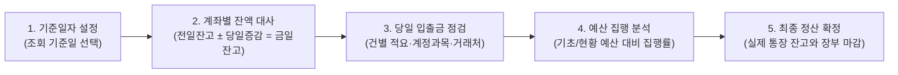

# 정산 현황 관리

프로젝트의 실시간 자금 현황, 당일 입출금 내역 및 예산 대비 집행 실적을 통합적으로 조회하고 마감 정산을 관리하는 화면입니다.

- **위치**: `회계 자금 관리 > 정산 현황 관리`

::: tip 📸 실제 화면 안내

*관리자 참고: 해당 화면의 실제 캡처 이미지를 `./images/status.png` 경로에 등록해 주세요.*
:::

## 개요

특정 **기준일자**를 중심으로 프로젝트의 현금성 자산 상태와 사업비 예산 집행 현황을 입체적으로 분석합니다. 은행 계좌별 잔액 현황, 일자별 상세 거래 내역, 그리고 사업비 예산 대비 실제 지출액을 대조하여 프로젝트의 재무 건전성을 실시간으로 파악하고 일일 마감 정산을 확정할 수 있습니다.

## 주요 기능

- **기준일자별 시점 조회**: 과거 또는 특정 날짜를 지정하여 해당 시점의 계좌 잔고와 입출금 내역을 그대로 재현
- **계좌별 자금 흐름 동기화**: 프로젝트가 보유한 모든 계좌의 전일 잔고, 당일 입출금 증감, 현재 잔고를 실시간 계산
- **일일 입출금 상세 내역 대사**: 기준일 당일 발생한 입금 및 출금 건별 적요, 회계 계정과목, 거래처 정보 조회
- **사업비 예산 집행 분석**: 승인된 기초 예산 및 변경된 현황 예산 대비 누적 집행액, 집행률, 잔여 가용 예산 모니터링
- **원클릭 현황 예산 수정**: 별도 설정 메뉴 이동 없이 화면 내에서 예산 항목 더블 클릭을 통한 인라인 즉시 수정
- **캐시플로우(Cash Flow) 엑셀 출력**: 경영진 보고 및 금융기관 제출용 표준 월별 자금 집행 서식 다운로드 지원
- **최종 정산 확정(Check Balance)**: 실제 은행 통장 잔액과 시스템 장부 금액의 일치를 검증하고 정산 마감 확정

## 화면 구성 및 실무 가이드

### 1. 기준일자 및 보고서 탭 선택

모든 데이터 집계의 기준이 되는 날짜를 지정하고 확인하고자 하는 세부 보고서 탭을 선택합니다.

- **기준일자**: 오늘 날짜가 기본으로 설정되며, 날짜를 변경하면 해당 일자의 거래 상태로 모든 수치가 재계산됩니다.
- **보고서 탭 전환**:
  - `계좌별 자금현황`: 통장별 잔액 증감 현황
  - `당일 입출금내역`: 기준일에 발생한 건별 입출금 명세
  - `예산대비 집계`: 사업비 비목별 예산 집행 실적 및 잔여액

### 2. 계좌별 자금현황 (탭)

프로젝트가 보유한 보통예금 계좌들의 잔액 증감 현황을 한눈에 파악합니다.

| 표시 항목 | 상세 설명 및 산출 공식 |
| :--- | :--- |
| **계좌명 (은행)** | 프로젝트에 등록된 통장 별칭 및 금융기관 명칭입니다. |
| **전일잔고** | 기준일자 직전일까지의 누적 잔액입니다. |
| **금일입금 (증가)** | 기준일 당일 통장에 입금된 총금액입니다. |
| **금일출금 (감소)** | 기준일 당일 통장에서 출금된 총금액입니다. |
| **금일잔고** | `전일잔고 + 금일입금 - 금일출금` 결과로 계산된 현재 시점의 실제 장부 잔고입니다. |

- **조회 필터 토글**:
  - `잔고 존재 계좌만 보기`: 거래가 없거나 잔액이 0원인 비활성 계좌를 제외하고 실제 자금이 있는 계좌만 압축 조회
  - `직불 용역비 계좌 포함`: 시공사 또는 용역사에 직불되는 특수 목적 계좌를 집계에 포함할지 여부 선택

### 3. 당일 입출금내역 (탭)

기준일에 발생한 개별 거래의 상세 명세를 입금과 출금으로 구분하여 표시합니다.

- **표시 정보**: 거래 발생 계좌명, 통장 적요(메모), 입금액/출금액, 매핑된 회계 계정과목 및 거래처 정보
- **장부 대사 활용**: 실제 은행 통장의 거래 내역서를 옆에 두고 건별로 적요와 금액이 빠짐없이 입력되었는지 대조할 때 활용합니다.

### 4. 예산대비 집계 (탭)

프로젝트 초기 승인 예산과 실제 집행된 사업비 누계를 대조하여 예산 초과 여부를 감시합니다.

| 집계 항목 | 상세 설명 |
| :--- | :--- |
| **예산 금액** | **기초 예산**(초기 수립 사업비) 또는 **현황 예산**(설계 변경 등으로 조정된 예산)을 라디오 버튼으로 전환 표시합니다. |
| **전월 집행 누계** | 기준일이 속한 당월 직전까지 집행된 누적 지출액입니다. |
| **당월 집행 금액** | 이번 달 1일부터 기준일까지 집행된 지출액입니다. |
| **집행금액 합계** | `전월 집행 누계 + 당월 집행 금액`으로 산출된 현재까지의 총 지출 누계입니다. |
| **가용 예산 합계** | `예산 금액 - 집행금액 합계`로 현재 추가 지출 가능한 잔여 예산입니다. |
| **집행률 (%)** | 예산 대비 누적 집행률을 백분율로 표시하며, 100% 초과 시 경고 색상으로 강조됩니다. |

- **캐시플로우(Cash Flow) 서식 다운로드**: 우측 상단의 **[캐시플로우 폼]** 버튼을 누르면 연도별/월별 수입·지출 집행 내역이 정리된 표준 엑셀 보고서가 자동 생성됩니다.

### 5. 최종 정산 확정 (Check Balance)

모든 입출금 입력과 계좌 대사가 완료된 후, 시스템 상의 장부 잔액을 공식 확정하는 기능입니다.

- **정산 상태 안내**: 화면 하단에 마지막 거래일자와 현재 시스템 정산 마감일자를 비교하여 "정산 필요" 또는 "정산 완료" 상태를 표시합니다.
- **정산 확정 버튼**: 실제 은행 잔고와 장부 잔고가 100% 일치함을 확인한 후 [정산 확정]을 클릭하면 해당 일자까지의 마감 상태가 기록됩니다.

## 💡 실무 활용 팁

- **화면 내 현황 예산 즉시 수정**: [예산대비 집계] 탭에서 '현황 예산' 라디오 버튼을 선택한 상태에서 **예산 금액 셀을 마우스로 더블 클릭**하면 입력창으로 전환되어 [프로젝트 설정 > 예산 정보] 메뉴로 이동하지 않고도 즉시 변경 예산을 반영할 수 있습니다.
- **일과 마감 시 일일 자금 대사(Reconciliation) 루틴**: 매일 퇴근 전 [계좌별 자금현황]의 '금일잔고 합계'와 실제 은행 기업뱅킹 앱의 '총 잔액'을 대조하세요. 차액이 발생한다면 이체 수수료(500원 등) 누락이나 미등록 출금 건이 있는지 [거래 내역 관리]에서 확인해야 합니다.
- **마감 데이터 무결성 보호**: 최종 정산이 완료된 일자 이전의 거래 데이터는 임의 수정이 잠깁니다. 과거 정산 데이터를 수정해야 할 경우 상급 관리자 권한을 통해 정산 취소 또는 수정 승인을 거쳐야 합니다.
