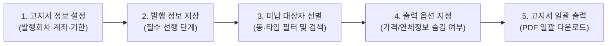

# 수납 고지서 관리

프로젝트의 납부 회차별 대금 수납 고지서를 생성하고 발행 정보를 관리하는 화면입니다.

- **위치**: `고객 고지 관리 > 수납 고지서 출력`

::: tip 📸 실제 화면 안내

*관리자 참고: 해당 화면의 실제 캡처 이미지를 `./images/bill.png` 경로에 등록해 주세요.*
:::

## 개요

특정 납부 회차(계약금, 중도금, 잔금 등)에 대한 고지서를 발행하기 위해 시행사/대행사 정보, 수납 계좌, 안내 문구 등을 설정합니다. 설정된 발행 정보를 바탕으로 계약자별 납부 현황(완납/미납)을 자동으로 판별하고, 고지 대상 계약자들을 선택하여 표준 서식의 고지서를 PDF 파일로 일괄 생성·다운로드할 수 있습니다.

## 주요 기능

- **고지서 기본 정보 및 계좌 설정**: 고지서 상단/하단에 인쇄될 발행 기관 정보(시행자, 대행사, 연락처, 주소)와 수납 계좌(최대 2개 은행) 지정
- **발행 대상 회차 및 납부 기한 연동**: 발행 회차 선택 및 당회 납부 기한 지정 (저장 시 회차별 약정 기한과 자동 연동)
- **실시간 납부 상태 판별**: 선택 회차를 기준으로 계약자별 완납/미납 상태 자동 계산 및 미납 대상자 중심 선택 제어
- **다양한 필터링 및 검색**: 프로젝트 내 차수, 유닛 타입, 동별 필터 및 계약자명, 동호수, 일련번호 검색 지원
- **고지서 출력 옵션 제어**: 필요에 따라 공급가액/상세 분양가 숨김(`가격정보 미표시`) 또는 연체료 계산 내역 숨김(`연체정보 미표시`) 선택 지원
- **고품질 PDF 일괄 생성**: 선택된 계약자들의 개별 고지서를 단일 PDF 문서로 병합 다운로드하여 인쇄 작업 간소화

## 화면 구성 및 실무 가이드

### 1. 고지서 발행 정보 설정

고지서의 머리말과 꼬리말에 표시될 공식 사업 주체 정보와 대금 입금을 위한 수납 금융 계좌를 입력합니다.

| 입력 항목 | 필수 여부 | 상세 설명 및 실무 팁 |
| :--- | :---: | :--- |
| **발행일자** | 필수 | 고지서 상단에 공식 인쇄될 기준 발행일자입니다. |
| **발행회차** | 필수 | 현재 고지서를 발행할 대상 납부 회차(예: 계약금, 1차 중도금 등)를 선택합니다. |
| **당회 납부기한** | 선택 | 해당 회차의 입금 마감 기일입니다. 입력 후 저장하면 연결된 회차 관리 정보에도 자동 반영됩니다. |
| **시행자 / 대행사 정보** | 필수 | 고지 주체의 법인명(또는 조합명) 및 공식 안내 연락처(전화번호)를 입력합니다. |
| **수납은행 (1, 2)** | 필수 | 계약 대금을 수납할 전용 계좌 정보(은행명, 계좌번호, 예금주)를 지정합니다. (최대 2개 계좌 지원) |
| **시행자 주소** | 필수 | 고지서 하단에 표기될 사업단 또는 시행사의 공식 우편 주소입니다. |
| **고지서 제목 / 내용** | 필수 | 고지서 중앙에 노출될 메인 제목(예: *제2차 중도금 납부 안내의 건*)과 본문 상세 공지 문구를 작성합니다. |

> [!IMPORTANT]
> **고지서 출력 전 발행 정보 저장 필수**: 고지서 PDF를 생성하려면 화면 우측 상단의 **[저장]** 버튼을 눌러 발행 설정 데이터를 먼저 저장해야 합니다. 설정을 변경한 후 저장하지 않고 출력하면 이전 설정 내용으로 인쇄될 수 있습니다.

### 2. 목록 제어 및 대상 필터링

고지서를 발송할 대상 계약자를 신속하게 찾기 위한 조건 필터를 제공합니다.

- **필터 항목**: 차수, 유닛 타입, 동별 선택 셀렉터 및 계약자명/일련번호 통합 검색창
- **회차 정보 강조 표시**: 현재 설정된 '발행회차' 명칭이 테이블 상단에 강조 표시되어 다른 회차의 대상자와 혼동되지 않도록 방지합니다.

### 3. 고지서 다운로드 옵션

상황에 따라 고지서에 인쇄되는 세부 금융 항목을 제어할 수 있습니다.

- **가격정보 미표시**: 체크 시 계약 총액 및 상세 분양 가격 정보를 제외하고 납부할 금액과 계좌 정보만 간결하게 표시합니다.
- **연체정보 미표시**: 연체 이자 계산 항목을 숨기고 정액 분담금/중도금 원금만 표기할 때 활용합니다. (납부 독촉이 아닌 단순 입금 일정 사전 안내 시 유용)

### 4. 계약자 목록 및 선택

계약자별 수납 상태를 확인하고 실제 고지서를 출력할 대상을 선택합니다.

- **납입상태 자동 판별**:
  - **완납중**: 설정된 발행회차까지의 약정 금액을 모두 납부 완료한 계약자입니다. 체크박스가 비활성화되어 중복 고지서 발행을 방지합니다.
  - **미납중**: 해당 회차에 납부해야 할 잔여금이 남아있는 계약자입니다. 고지 대상자로 체크박스를 선택할 수 있습니다.
- **선택 제어**: 테이블 상단의 전체 선택 체크박스를 클릭하면 이미 완납된 계약자는 자동으로 제외되고, **실제 미납 상태인 계약자들만 일괄 선택**됩니다.

## 💡 실무 활용 팁

- **납부 기한 동기화 편의성**: [고지서 발행 정보 설정]에서 '당회 납부기한'을 지정하고 저장하면, [수납 관리 > 납부 회차 등록]의 약정일자 데이터도 함께 업데이트되어 두 메뉴를 번갈아 수정할 필요가 없습니다.
- **사전 1~2건 샘플 출력 검증**: 전체 수백 명의 고지서를 일괄 출력하기 전에, 1~2건의 계약자만 선택하여 PDF를 다운로드한 후 계좌번호 오타, 연락처, 줄바꿈 서식이 깔끔한지 미리 확인하는 것이 안전합니다.
- **계좌 정보 사전 확인**: 분양 대금 전용 수납 계좌(신탁사 계좌 등)와 옵션 품목 수납 계좌가 분리되어 있는 경우, 이번 고지서 회차에 맞는 계좌인지 예금주와 계좌번호를 재차 검토하세요.
