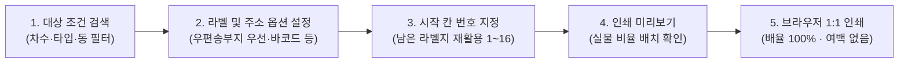

# 우편 라벨 관리

프로젝트 계약자들의 주소 정보를 바탕으로 규격 라벨지에 인쇄할 수 있도록 라벨 데이터를 생성하고 출력하는 화면입니다.

- **위치**: `고객 고지 관리 > 우편 라벨 관리`

::: tip 📸 실제 화면 안내

*관리자 참고: 해당 화면의 실제 캡처 이미지를 `./images/label.png` 경로에 등록해 주세요.*
:::

## 개요

고지서, 총회 책자, 안내문, 동의서 등의 우편물 발송 시 필요한 수신처 라벨 스티커를 표준 폼텍(Formtec) 라벨지 규격에 맞춰 손쉽게 출력할 수 있습니다. 차수·타입·동별 필터링은 물론, 실거주지 우선/주민등록지 전용 등 주소 기준 선택, 사용하다 남은 라벨지 재활용을 위한 인쇄 시작 위치(Offset) 지정, 수신자 맞춤 인쇄 옵션을 제공합니다.

## 주요 기능

- **표준 라벨 규격 완벽 지원**: 국내 우편 실무에서 가장 널리 사용되는 한국폼텍 표준 라벨지(Formtec 3107: 99.1 × 38.1 mm, A4당 16칸, 2열 8행) 기본 지원
- **인쇄 시작 위치(오프셋) 지정**: 이미 몇 칸을 사용하고 남은 라벨 용지를 알뜰하게 재활용할 수 있도록 첫 번째 라벨 인쇄 위치(1번~16번) 지정 가능
- **실무 맞춤형 주소지 선택 기준 지원**:
  - `우편송부지 우선`: 우편송부지가 등록되어 있으면 우편송부지를, 미등록 시 주민등록상 주소를 자동 적용
  - `우편송부지 전용`: 우편송부지가 별도로 등록된 계약자만 선별하여 출력
  - `주민등록지 전용`: 우편송부지 등록 여부와 상관없이 계약자의 주민등록상 기본 주소만 출력
- **수신처 맞춤 인쇄 옵션**: 우편번호 바코드 서식 표시, 계약자 성명 뒤 존칭('귀하') 출력, 계약 동·호수(또는 일련번호) 표기 여부 토글
- **대용량 데이터 최적화 페이징 및 선택**: 수천 명의 계약자 데이터를 쾌적하게 조회할 수 있도록 페이지당 표시 개수(30/50/100/200건) 설정, 현재 페이지 선택 및 검색 전체 대상 일괄 선택 지원
- **외부 프로그램 없는 브라우저 1:1 다이렉트 인쇄**: 라벨 규격에 최적화된 인쇄 스타일시트가 적용되어 별도의 전용 소프트웨어 설치 없이 브라우저 인쇄(Ctrl+P / Cmd+P)로 오차 없이 실물 출력

## 화면 구성 및 실무 가이드

### 1. 필터 및 인쇄 환경 설정 (상단)

라벨을 출력할 계약자 조건과 라벨 용지의 물리적 인쇄 옵션을 지정합니다.

| 설정 항목 | 구분 | 상세 설명 및 실무 팁 |
| :--- | :---: | :--- |
| **차수 / 타입 / 동** | 필터 | 특정 차수, 타입, 동별로 우편물을 발송할 대상 계약자를 선별합니다. |
| **라벨 규격** | 인쇄 설정 | 출력할 라벨지 제품 규격입니다. (Formtec 3107: 99.1 × 38.1 mm, A4 1장당 16칸) |
| **인쇄 시작 위치** | 인쇄 설정 | 라벨지 내 첫 번째 데이터가 인쇄될 칸 번호(1~16번)를 지정합니다. 쓰다 남은 라벨 용지를 재활용할 때 필수적입니다. |
| **주소지 선택** | 데이터 기준 | `우편송부지 우선`, `우편송부지 전용`, `주민등록지 전용` 중 우편물 발송 목적에 맞게 선택합니다. |
| **바코드 표시** | 인쇄 옵션 | 우편번호(5자리) 영문 바코드 서식을 라벨 하단에 함께 출력할지 여부를 설정합니다. |
| **'귀하' 표시** | 인쇄 옵션 | 수신자 성명 뒤에 존칭('귀하')을 자동으로 붙여 출력할지 여부를 설정합니다. |
| **동·호수 표시** | 인쇄 옵션 | 라벨 우측 상단에 계약 동·호수(동호수 미배정 시 계약 일련번호)를 함께 표기할지 여부를 설정합니다. |

### 2. 계약자 목록 및 선택 (데이터 테이블)

조회된 계약자 목록에서 실제 라벨을 출력할 대상자를 지정합니다.

- **테이블 표시 항목**: 선택 체크박스, 일련번호, 계약자명, 동호수, 우편번호, 주소 및 상세주소, 비고(우편송부지 구분 등)
- **페이징 제어**: 하단 페이지네이션을 통해 대용량 계약 데이터도 부드럽게 조회할 수 있습니다. (30, 50, 100, 200건 단위)
- **선택 제어 기능**:
  - **현재 페이지 선택**: 테이블 상단 헤더 체크박스를 클릭하여 현재 페이지에 보이는 계약자들만 선택합니다.
  - **검색 결과 전체 선택**: 상단의 [검색 결과 전체 선택] 버튼을 누르면 필터 조건에 부합하는 모든 대상 계약자가 한 번에 인쇄 대상으로 선택됩니다.

### 3. 인쇄 미리보기 및 라벨 출력

실제 라벨지에 인쇄하기 전 화면에서 레이아웃을 확인하고 인쇄를 실행합니다.

- **인쇄 미리보기 버튼**: 현재 선택된 계약자 수와 지정한 '인쇄 시작 위치'가 반영된 실물 비율의 라벨지 미리보기 창을 엽니다.
- **라벨 인쇄 (Ctrl+P / Cmd+P)**: [라벨 인쇄] 버튼을 누르면 브라우저의 표준 인쇄 대화상자가 호출됩니다.

## 💡 브라우저 인쇄 필수 설정 및 업무 팁

라벨지는 인쇄 여백이나 배율이 1mm만 틀어져도 칸을 벗어나 용지를 낭비하게 됩니다. 인쇄 대화상자에서 아래 **3대 설정**을 반드시 확인하세요.

> [!IMPORTANT]
> **브라우저 인쇄 대화상자 3대 필수 설정 (오차 방지)**
> 1. **배율 (Scale)**: 반드시 **`100%` (기본값)**으로 설정하세요. (*'용지에 맞춤'을 선택하면 축소되어 라벨 칼선이 맞지 않습니다.*)
> 2. **여백 (Margins)**: 반드시 **`없음 (None)`**으로 지정하세요.
> 3. **머리글 및 바닥글 (Headers and Footers)**: 체크를 **해제**하세요. (*체크되어 있으면 상단/하단에 날짜나 웹 URL이 인쇄되어 첫 번째와 마지막 라벨이 훼손됩니다.*)

- **남은 라벨지 알뜰 재활용**: 이전 우편 발송 후 상단 4칸을 사용하고 5번째 칸부터 남아있는 라벨지가 있다면, **'인쇄 시작 위치'를 `5`로 지정**하세요. 첫 번째 대상자가 정확히 5번째 칸부터 인쇄되므로 버리는 라벨지 없이 100% 활용할 수 있습니다.
- **우편번호 누락 점검**: 수신 주소에 5자리 우편번호가 등록되지 않은 계약자는 우편번호 영역이 비어 있게 됩니다. 대량 발송 전 [계약 목록 관리]에서 우편번호 누락 건이 없는지 미리 점검하세요.
- **테스트 용지 인쇄**: 라벨지 스티커 용지는 일반 복사용지보다 단가가 높습니다. 먼저 **일반 A4 복사용지에 1장만 인쇄**한 뒤, 실물 라벨지에 겹쳐서 빛에 비춰보면 칼선과 정확히 일치하는지 안전하게 검증할 수 있습니다.
