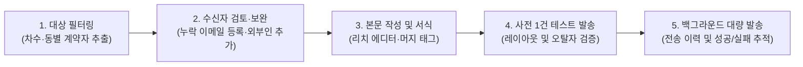

# MAIL 발송 관리

프로젝트 계약자 또는 임의의 외부 수신자에게 공식 안내문, 소식지, 분담금 납부 안내 등을 대량 이메일(HTML)로 발송하고 그 이력을 추적·관리하는 화면입니다.

- **위치**: `고객 고지 관리 > MAIL 발송 관리`

::: tip 📸 실제 화면 안내

*관리자 참고: 해당 화면의 실제 캡처 이미지를 `./images/mailing.png` 경로에 등록해 주세요.*
:::

## 개요

문자 메시지(SMS/LMS)의 글자 수 한계와 비용 부담을 보완하여, 서식과 표, 이미지가 포함된 완성도 높은 공식 안내문을 이메일로 대량 발송할 수 있습니다. 위지윅(WYSIWYG) 리치 텍스트 서식 에디터, 계약자 정보 자동 치환 태그, 수신 대상자별 이메일 주소 직접 수정 및 외부 관계자 수기 추가 기능, 그리고 대량 발송을 안정적으로 처리하는 백그라운드 비동기 발송 엔진 및 상세 전송 결과(성공/실패 내역) 조회를 지원합니다.

## 주요 기능

- **타깃 필터링 및 수신자 자동 추출**: 프로젝트 내 특정 차수 또는 동을 지정하여 해당 계약자 이메일 목록을 즉시 추출
- **유연한 수신 대상자 정밀 관리**:
  - 이메일 주소가 비어있는 계약자 확인 및 인라인 이메일 주소 즉시 등록/수정
  - 개별 수신자의 이번 발송 대상 포함/제외 토글
  - 은행, 신탁사, 시공사 등 외부 관계자 이메일 수기 추가 기능
- **리치 텍스트(HTML) 서식 에디터 내장**: 제목, 본문 글자 스타일(크기, 굵기, 색상, 정렬 등), 인용구, 번호 목록, 하이퍼링크 및 이미지 첨부 지원
- **동적 머지 태그(Merge Tags) 치환**: 계약자 성명, 계약 동호수, 프로젝트 명칭 등을 치환 코드로 작성하여 개인별 맞춤 안내문 자동 생성
- **안정적인 백그라운드 비동기 대량 발송**: 수백·수천 통의 메일 발송 시에도 화면 멈춤이나 대기 지연 없이 백그라운드 엔진을 통해 순차 전송
- **상세 발송 이력 및 전송 결과 대장**:
  - 발송 일시, 발송자, 제목, 총 대상자 수, 성공/실패 건수 실시간 집계
  - 상세 보기: 실제 발송된 서식 본문 렌더링 미리보기, HTML 원문 코드 확인, 수신자별 전송 성공 여부 및 실패 원인(오류 로그) 확인

## 화면 구성 및 실무 가이드

상단 탭을 통해 **[MAIL 발송]**과 **[발송 내역]** 화면으로 전환할 수 있습니다.

### 1. MAIL 발송 (탭)

메일 수신 대상자를 선정하고 본문 서식을 작성하여 발송하는 화면입니다.

#### ① 발송 기본 정보 및 수신자 설정

| 항목 | 상세 설명 및 실무 팁 |
| :--- | :--- |
| **차수 / 동 선택** | 메일을 발송할 대상 차수 및 동을 필터링하여 계약자를 추출합니다. |
| **수신 대상자 관리 버튼** | 추출된 계약자 명단 모달을 열어 이메일 주소를 점검·수정하거나 특정인을 발송 대상에서 제외합니다. |
| **발송자 (From)** | 시스템 로그인 사용자의 이름과 사전 등록된 대표 발송 메일 주소로 구성됩니다. |
| **안내 메일 제목** | 수신자의 이메일 편지함에 노출될 메일 제목을 명확하고 신뢰성 있게 입력합니다. |

#### ② 본문 작성 (리치 에디터) 및 치환 태그

- **서식 도구함**: 폰트 크기, 제목 서식(H1~H3), 굵게(B), 기울임, 밑줄, 글자색 및 배경색, 정렬, 번호 목록, 하이퍼링크, 이미지 첨부 등 제공
- **머지 태그(치환 변수) 안내**:
  - `{{ 계약자명 }}`: 수신 계약자의 실제 성명으로 자동 변환
  - `{{ 동호수 }}`: 해당 계약자의 동·호수(배치 전일 경우 계약 일련번호)로 자동 변환
  - `{{ 프로젝트명 }}`: 현재 선택된 사업지 명칭으로 자동 변환

#### ③ 수신 대상자 관리 모달

[수신 대상자 확인] 버튼을 누르면 열리는 팝업창으로, 실제 메일을 수신할 명단을 꼼꼼하게 점검합니다.

- **이메일 주소 인라인 수정**: 이메일이 등록되지 않았거나 변경된 계약자는 테이블 내에서 직접 이메일 주소를 입력하여 즉시 반영할 수 있습니다.
- **체크박스 선택/해제**: 특정 계약자를 이번 발송에서 제외하려면 체크를 해제합니다.
- **외부 수신자 직접 추가**: 상단의 [수신자 추가] 영역에서 성명, 이메일, 비고를 입력하여 계약자 명단 외의 관계자(금융기관, 대행사 담당자 등)를 수신인에 포함할 수 있습니다.

### 2. 발송 내역 (탭)

지금까지 발송된 모든 대량 이메일의 기록을 조회하고 결과를 점검합니다.

- **발송 이력 목록**:
  - **발송일시**: 메일 발송이 접수되어 전송 처리된 일시
  - **프로젝트 및 발송자**: 메일을 발송한 프로젝트와 발송 실행 사용자 계정
  - **제목**: 발송된 이메일 제목
  - **전송 통계**: 총 발송 대상 수, 성공 건수, 실패 건수를 배지로 직관적 표시
  - **상세보기**: [상세보기] 버튼 클릭 시 발송 상세 모달 호출
- **발송 상세 모달**:
  - **발송 정보 요약**: 프로젝트, 발송자, 발송일시, 최종 성공/실패 통계
  - **발송 본문 확인**: 실제 발송된 서식 본문 렌더링을 미리 볼 수 있으며, 머지 태그가 어떻게 적용되었는지 확인 가능합니다. (필요시 [HTML 코드 보기] 토글로 원문 확인)
  - **수신자별 전송 결과 테이블**: 수신자명, 이메일 주소, 전송 상태(성공/실패), 오류 발생 시 상세 사유(예: 유효하지 않은 메일 주소 형식, 수신 서버 거부 등) 기록 제공

## 💡 실무 활용 팁 및 주의 사항

- **본인 이메일로 1건 사전 테스트 발송 필수**: 수백 명의 계약자에게 대량 전송하기 전, [수신 대상자 관리]에서 계약자 선택을 모두 해제하고 **본인(담당자)의 이메일만 1건 추가**하여 시험 발송하세요. PC와 모바일 메일 앱에서 줄바꿈, 이미지 표시, 폰트 크기가 자연스러운지 직접 확인하는 것이 실수를 예방하는 가장 확실한 방법입니다.
- **이메일 주소 유효성 사전 검토**: 주소에 공백이 포함되어 있거나 `@` 또는 도메인(`.com`, `.net`)이 누락된 주소는 발송 엔진에서 즉시 실패 처리됩니다. [수신 대상자 관리] 모달에서 이메일 형식 오류를 미리 수정하세요.
- **치환 태그 정확한 표기 준수**: 머지 태그는 `{{ 계약자명 }}`, `{{ 동호수 }}`, `{{ 프로젝트명 }}`과 같이 중괄호 2개를 정확히 감싸야 치환 엔진이 올바르게 인식합니다. 중괄호가 1개만 입력되면 태그가 텍스트 그대로 노출될 수 있으니 주의하세요.
- **대용량 이미지 주의**: 본문에 삽입하는 이미지는 용량이 너무 크면 수신자의 메일 로딩이 느려지거나 스팸 메일함으로 자동 분류될 수 있습니다. 웹용으로 적절히 최적화된 이미지(가로폭 800px 이하 권장)를 사용하는 것이 좋습니다.
