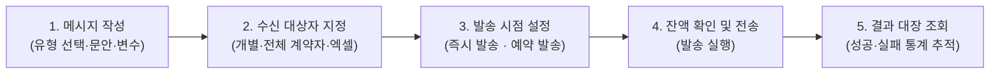

# SMS 발송 관리

프로젝트 계약자에게 개별 또는 단체로 SMS, LMS, MMS 및 알림 메시지를 발송하고 내역을 관리하는 화면입니다.

- **위치**: `고객 고지 관리 > SMS 발송 관리`

::: tip 📸 실제 화면 안내

*관리자 참고: 해당 화면의 실제 캡처 이미지를 `./images/sms.png` 경로에 등록해 주세요.*
:::

## 개요

분양 계약자 및 고객에게 납부 안내, 총회 소집 통지, 입주 절차 공지 등을 휴대전화 문자 메시지로 신속하게 전달합니다. 단순 텍스트 안내뿐만 아니라 수신자별 성함과 미납액이 자동 치환되는 개인화 메시지, 이미지 첨부(MMS), 사전 예약 발송 및 실시간 전송 결과 추적을 지원합니다.

## 주요 기능

- **다양한 문자 채널 지원**: 단문 문자(SMS), 장문 문자(LMS), 이미지 첨부(MMS) 채널 지원
- **유연한 수신자 추출 및 등록**: 개별 번호 직접 입력, 프로젝트 '전체 계약자' 원클릭 추출, 엑셀 파일 대량 업로드 지원
- **동적 개인화 머지 변수**: `{성함}`, `{미납액}` 등 치환 태그를 활용하여 수신자마다 맞춤형 금액과 호칭 자동 반영
- **자주 쓰는 템플릿 관리**: 중도금 납부 안내, 총회 일정 공지 등 정기적으로 반복되는 문안을 서식으로 등록·불러오기
- **시간 예약 발송**: 심야 시간을 피해 다음 날 오전 등 원하는 시점(최소 15분 후 ~ 최대 1개월 이내)으로 예약 전송
- **실시간 잔액 및 전송 이력 추적**: 문자 발송 가능 잔액 실시간 조회, 건별 성공/실패 상태 및 상세 수신 번호 내역 제공

## 화면 구성 및 실무 가이드

### 1. 메시지 작성 (좌측 영역)

발송할 메시지의 유형을 선택하고 본문 내용을 구성합니다.

| 입력 항목 | 구분 | 상세 설명 및 실무 팁 |
| :--- | :---: | :--- |
| **메시지 타입** | 필수 선택 | **SMS**(단문: 90바이트/한글 45자 이내), **LMS**(장문: 2,000바이트 이내), **MMS**(이미지 첨부 장문) 중 선택합니다. |
| **메시지 템플릿** | 문안 관리 | 기존에 저장된 문안을 불러오거나 [템플릿 관리] 버튼을 눌러 새 표준 문구를 등록합니다. |
| **이미지 첨부** | MMS 전용 | MMS 선택 시 활성화되며, **100KB 미만의 JPG 파일**만 첨부할 수 있습니다. (최대 3장) |
| **발송자 번호** | 필수 선택 | 통신사 인증을 통해 사전에 등록·승인된 공식 발신 번호를 선택합니다. |
| **특수문자 패널** | 편의 도구 | 당구장표시(※), 별표(★), 괄호 등 문안 작성에 자주 쓰이는 기호들을 클릭 한 번으로 본문에 삽입합니다. |

### 2. 수신자 관리 (우측 영역)

메시지를 수신할 대상 명단을 구성합니다. 한 번에 최대 1,000건까지 일괄 발송이 가능합니다.

- **개별 번호 입력**: 전화번호를 직접 입력하거나 텍스트 문서의 번호 목록을 복사하여 붙여넣습니다. (줄바꿈 단위로 구분)
- **그룹 선택 (전체 계약자)**: 현재 선택된 프로젝트의 모든 유효 계약자 연락처를 원클릭으로 한 번에 수신자 목록에 불러옵니다.
- **Excel 파일 대량 업로드**:
  - 엑셀의 첫 번째 열(A열)을 휴대전화 번호로 인식하여 대량 등록합니다.
  - 템플릿에 `{성함}`, `{미납액}` 등의 변수가 포함된 경우, 엑셀 1행 헤더에 해당 변수명을 지정하면 B열 이후의 열 데이터가 개인별로 자동 치환됩니다.

### 3. 발송 설정 및 실행

| 설정 항목 | 상세 내용 |
| :--- | :--- |
| **발송 시점** | **즉시 발송** 또는 **예약 발송**을 선택합니다. |
| **예약 설정** | 예약 발송 선택 시 날짜와 시간을 분 단위로 지정합니다. (설정 시간 기준 최소 15분 이후부터 가능) |
| **잔액 확인** | 현재 남아있는 충전 잔액을 실시간 표시하며, 잔액 부족 시 [새로고침] 또는 충전 안내 링크를 이용합니다. |

### 4. 발송 내역 (탭)

과거에 전송한 모든 문자 발송 기록을 조회하고 결과를 확인합니다.

- **필터 및 검색**: 발송 기간, 메시지 유형(SMS/LMS/MMS), 발신 번호별 필터링 지원
- **상세 결과 보기**: 특정 발송 건의 [확인] 버튼을 누르면 실제 수신자별 발송 성공 여부, 실패 사유, 발송 원문 내용을 상세히 확인할 수 있습니다.

## 💡 실무 활용 팁 및 주의 사항

- **SMS ➔ LMS 자동 전환 주의**: 문안 작성 중 내용이 90바이트(한글 약 45자)를 1자라도 초과하면 시스템이 **자동으로 LMS(장문)로 전환**됩니다. 단문 요금 기준을 유지해야 하는 경우 바이트 수 표시기를 수시로 확인하세요.
- **MMS 이미지 규격 엄수 (100KB 미만 JPG)**: 이동통신사 게이트웨이 규격에 따라 **JPG 형식, 용량 100KB 미만** 파일만 전송 가능합니다. 스마트폰으로 직접 촬영한 사진은 수 MB에 달하므로, 반드시 그림판이나 이미지 툴로 해상도와 용량을 줄여서 첨부해야 발송 실패를 방지할 수 있습니다.
- **발신번호 사전 등록 법적 의무**: 전기통신사업법에 따라 발신번호 변조(피싱)를 방지하기 위해 사전에 통신 서비스사(iwinv)에서 본인 확인 및 통신서비스 이용증명원 인증을 마친 발신 번호만 드롭다운에 노출됩니다. 번호 추가가 필요할 때는 전산 관리자에게 사전 등록을 요청하세요.
- **야간 광고성 문자 전송 제한**: 정보통신망법상 야간 시간대(오후 9시 ~ 익일 오전 8시)에는 고객 동의 없는 고지 및 마케팅 문자 발송이 엄격히 금지됩니다. 퇴근 전 대량 발송 시에는 [예약 발송]을 이용하여 다음 날 오전(예: 오전 10시)으로 지정하는 것을 권장합니다.
- **담당자 본인 번호 테스트 발송**: 수백 명의 계약자에게 대량 발송하기 전, 수신자에 담당자 본인 번호를 1건 입력하여 문안의 띄어쓰기, 치환 변수 작동 여부, 이미지가 휴대폰 화면에서 잘 보이는지 먼저 확인하세요.
