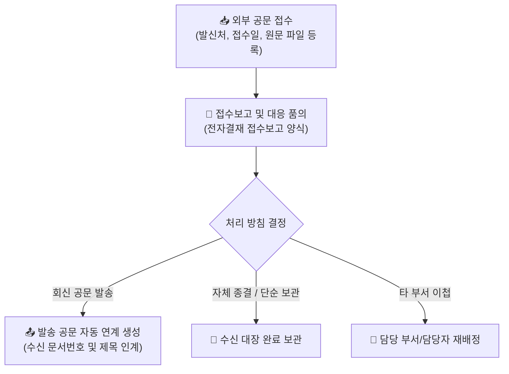

# 수신 공문 관리

::: tip 📸 실제 화면 안내

*관리자 참고: 해당 화면의 실제 캡처 이미지를 `./images/inbound.png` 경로에 등록해 주세요.*
:::

> **수신 공문 관리**는 관공서, 금융기관, 협력업체 등 외부로부터 접수된 공식 서한을 등록하고, 처리 방침(회신/종결/이첩)을 수립하여 전자결재 보고 및 회신 공문 발송으로 연계하는 시스템입니다.

- **메뉴 위치**: `본사 관리 > 대외 공문 관리 > 수신 공문 관리` (`/official-letter/inbound`)
- **적용 대상**: 경영지원팀, 프로젝트 공무 담당자, 수신 부서 담당자

## 1. 수신 공문 등록

외부 기관에서 발송한 종이 문서(우편, 등기, 인편) 또는 전자 문서(이메일, 전자팩스)를 수신하면 접수 대장에 등록합니다.

- **접수 정보 기입**:
  - `발신처`: 문서를 발송한 기관명/법인명 및 발신자
  - `발신 문서번호`: 외부 문서에 기재된 원래 문서번호
  - `접수 일자`: 사내에서 실제로 문서를 수령·접수한 날짜
  - `공문 제목 및 요약`: 핵심 내용 요약
  - `회신 기한`: 상대방이 요구한 기한이나 법정 처리 기한이 있는 경우 지정
- **원문 파일(PDF/스캔본) 첨부**: 접수된 원본 공문서를 스캔하여 PDF 또는 이미지 형태로 업로드합니다.

## 2. 수신 공문 접수보고 및 대응 품의 연동

중요도가 높은 공문이나 공식 회신·의사결정이 필요한 경우, 전자결재 시스템의 **`수신 공문 접수보고 및 대응 품의서`** 양식을 통해 결재선에 상신합니다.

- **자동 데이터 연동**: 수신 공문 상세 화면에서 `[접수보고 품의 작성]` 클릭 시 발신처, 접수번호, 공문 제목, 원문 파일이 전자결재 품의서로 자동 인계됩니다.
- **처리 방침 심사**:
  - `회신공문 발송`: 공식 대응 공문을 작성하여 회신 발송
  - `자체 종결`: 내부 검토 후 별도 회신 없이 조치 완료
  - `부서 이첩`: 관련 실무 부서로 주관 부서 변경 이관
- **임원 및 대표이사 결재**: 수신 공문의 내용과 대응 방향을 경영진에 보고하고 공식 승인을 득합니다.

## 3. 회신 공문 작성 자동 연계

처리 방침이 `회신공문 발송`으로 확정된 경우, 클릭 한 번으로 발송 공문 작성 화면으로 연결됩니다.

- **문맥 자동 인계**:
  - 수신처가 원래 발신처로 자동 지정됩니다.
  - 제목에 수신 공문 참조 표기(예: `[회신] ... 건`)가 자동 완성됩니다.
  - 수신 문서 원문이 회신 공문의 참조 문서로 자동 링크됩니다.
- **수발신 히스토리 추적**: 하나의 외부 이슈에 대해 어떤 공문이 들어왔고 어떻게 회신되었는지 수발신 대장에서 상호 추적할 수 있습니다.

## 4. 신입사원을 위한 공문 접수 실무 팁

* **💡 우편물 수령 즉시 스캔 등록**:
  * 외부에서 우편이나 등기로 공문이 도착하면 표지만 보지 말고 내용 전체를 고해상도 PDF로 스캔하여 즉시 수신 대장에 등록하십시오. 원본 종이 서류는 공문 보관철에 날짜순으로 편철합니다.
* **💡 회신 기한 설정 필수**:
  * 구청, 세무서 등 관공서 공문이나 법정 통지서는 회신 기한(예: 수신일로부터 14일 이내)이 명시되어 있는 경우가 많습니다. 반드시 시스템에 **'회신 기한'**을 등록하여 기한 경과로 인한 과태료나 불이익이 발생하지 않도록 주의하십시오.
