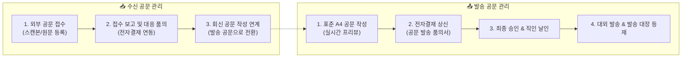

# 대외 공문 관리 개요

> **대외 공문 관리**는 관공서, 금융기관, 시행·시공사, 협력업체 등 외부 기관과 수발신하는 모든 공식 서한(공문서)을 표준 A4 서식으로 작성하고, 전자결재 품의와 연동하여 발송 대장 및 수신 대장으로 체계화하는 시스템입니다.

- **메뉴 위치**: `본사 관리 > 대외 공문 관리` (`/official-letter/outbound`, `/official-letter/inbound`)
- **주요 사용자**: 본사 기안자, 프로젝트 관리자, 공무/경영지원 담당자

## 1. 대외 공문 관리의 핵심 특징

* **실시간 A4 미리보기 (Live Preview)**: 작성 화면에서 공문의 수신처, 본문, 붙임 서류, 직인이 실제 A4 용지에 인쇄되는 레이아웃을 1:1 비율로 즉시 확인하며 작성할 수 있습니다.
* **전자결재 품의 자동 연동**: 별도로 품의서를 작성할 필요 없이, 작성된 공문 내용이 전자결재 시스템의 `대외 공문 발송 품의서`로 자동 이첩되어 승인 절차를 거칩니다.
* **법적 효력 및 증빙 무결성 보장**:
  - 시스템 등록 회사 직인을 전자 날인하거나, 출력 후 실물 인감을 날인하여 스캔본을 업로드할 수 있습니다.
  - 발송 완료 처리된 공문서는 법적 대항력 유지를 위해 시스템 PDF 재생성이 엄격히 금지됩니다.
* **수신 → 회신 공문 유기적 파이프라인**: 외부에서 접수된 공문의 처리 방침을 수립하고, 회신이 필요한 경우 접수 대장에서 회신용 발송 공문으로 원클릭 연계됩니다.

## 2. 권한 및 보안 정책

대외 공문은 기업의 법적 권리의무와 직결되므로 다음과 같은 보안 정책이 적용됩니다.

| 구분 | 일반 사용자 | 부서장 / 승인권자 | 관리자 (HQ Staff) |
| :--- | :--- | :--- | :--- |
| **공문 작성 및 임시저장** | 본인 작성 공문 가능 | 가능 | 전체 공문 가능 |
| **전자결재 상신** | 가능 | 가능 | 가능 |
| **인장(법인/직인) 선택** | 품의 승인 전제 선택 | 결재선 승인 검토 | 인장 등록 및 관리 |
| **발송 완료 및 스캔본 등록** | 본인 기안 건 등록 | 부서 기안 건 등록 | 전사 공문 등록/수정 |
| **발송 완료 후 증빙 교체** | 불가 | 불가 | **관리자 전용 권한** |
