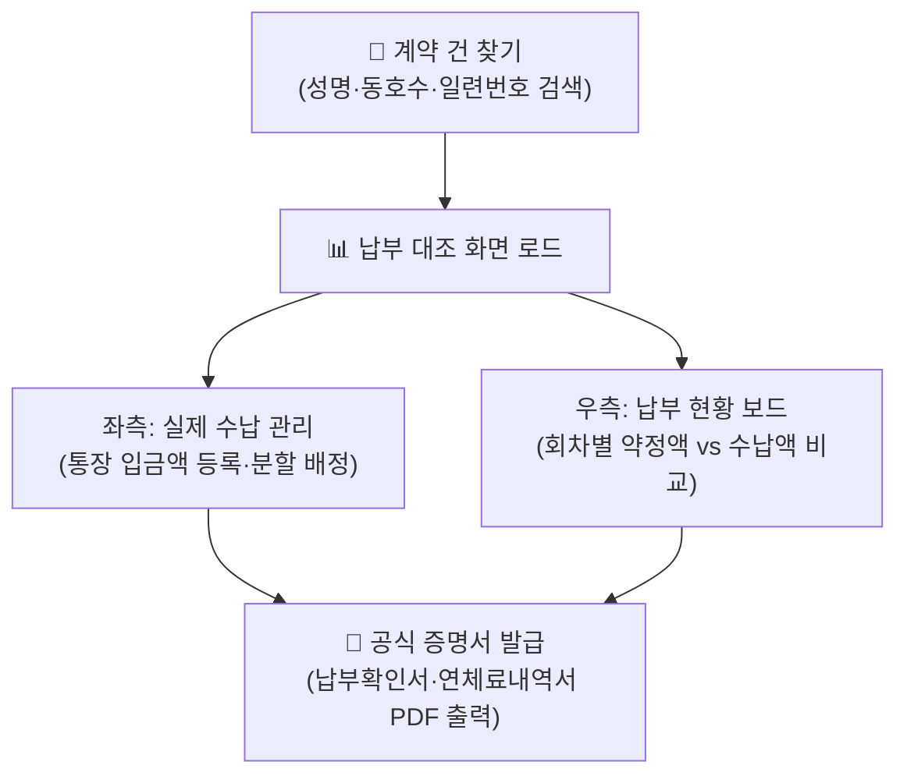

# 건별 납부 관리

::: tip 📸 실제 화면 안내

*관리자 참고: 해당 화면의 실제 캡처 이미지를 `./images/manage.png` 경로에 등록해 주세요.*
:::

> **건별 납부 관리** 페이지는 특정 계약자의 전체 분양 대금 납부 일정(약정액)과 실제 통장 수납 내역을 1:1로 정밀 대조하여 미납액을 파악하고, 수납 등록 및 수정, 분할 배정, 그리고 각종 공식 증명서(납부 확인서, 연체료 내역서 등)를 발급하는 수납 상세 카드입니다.

* **접근 경로**: 시스템 좌측 내비게이션 메뉴에서 **[PJT 관리 시스템] → [대금 수납 관리] → [건별 납부 관리]**를 선택하여 접속합니다. (또는 납부 내역 목록에서 계약자 클릭)

## 1. 개요 및 화면 2분할 구조

선택된 계약자의 전체 분양 대금 납부 계획(약정액)과 실제 수납 실적을 한 화면에서 비교 검토합니다.
* **좌측 영역 (실제 수납 내역 관리)**: 실제로 통장에 입금된 건별 거래 내역을 등록, 수정, 삭제하거나 여러 회차로 분할 배정합니다.
* **우측 영역 (납부 현황 보드)**: 계약서상 회차별 약정 기일과 약정 금액, 기납부액 및 미납·과오납 상태를 실시간 대조합니다.

## 2. 주요 기능

* **계약자 검색 및 상세 수납 정보 로드**: 성명, 일련번호, 동호수 검색
* **회차별 납부 약정 현황 실시간 대조**: 약정일, 약정금액, 수납금액, 미납액(빨간색), 과오납(파란색) 표출
* **개별 수납 내역 등록 및 다회차 분할 배정**: 1건의 입금액을 2차 계약금과 업무대행비 등으로 나누어 배정
* **금액 일치 검증**: 통장 실제 입금액과 회차별 분할 금액의 합계가 100% 일치하도록 시스템 강제 검증
* **공식 대외 증명서 원클릭 PDF 발급**: 납부 확인서(일반용/확인용), 일자별 연체료 산출 내역서, 선납할인/연체가산금 내역서

## 3. 화면 구성 및 상세 조작법

### 1. 계약 건 찾기
* 상단 검색창에 계약자 성명이나 동호수, 일련번호를 입력하고 `[계약 건 찾기]`를 누르면 하단에 매칭 버튼이 나열됩니다.
* 해당 버튼을 클릭하면 계약자의 동호수, 평형 타입, 총 공급가 정보와 함께 전체 납부 내역이 즉시 로드됩니다.

### 2. 우측: 납부 현황 보드 (약정 대조표)
해당 계약자의 계약 조건에 따른 전체 납부 계획과 현재까지의 성과를 실시간으로 비교하여 보여줍니다.

| 항목 | 상세 설명 및 실무 기준 |
|:---|:---|
| **납부기일** | 각 회차별 납부 약정일 (계약일 및 설정된 경과일수 기반 자동 산출) |
| **구분** | 납부 회차 명칭 (계약금, 중도금 1~6회차, 잔금 등) |
| **약정금액** | [분양 조건 설정](/project/settings)에 따라 산출된 회차별 필수 납부 금액 |
| **수납금액** | 실제로 입금되어 해당 회차에 배정 완료된 금액의 합계 |
| **미(과오)납** | `[수납금액 - 약정금액]` 결과. • **음수(빨간색)**: 납부 기한이 지났으나 덜 낸 **미납금** • **양수(파란색)**: 약정액보다 더 많이 낸 **과오납(초과 입금)** |

### 3. 좌측: 실제 수납 내역 관리 (입금 처리)
* **신규 납부 등록**: 새로운 통장 입금 건을 수동으로 추가 등록합니다.
* **수정 및 확인**: 목록의 금액이나 `[보기]` 버튼을 클릭하여 입금 일자나 회차 배정 내역을 수정합니다.
* **차수 분할 등록 (중요)**:
  * 예: 계약자가 2,000만 원을 한 번에 입금한 경우, 이를 `[2차 계약금 1,000만 원] + [업무대행비 1,000만 원]`으로 분할하여 각각의 회차에 정확하게 배정할 수 있습니다.
* **계약 건 변경 (오입금 원복)**: 다른 동호수의 입금 건을 잘못 매핑한 경우, 해당 수납 내역을 현재 계약자에게서 분리하여 [납부 내역 관리] 목록으로 되돌립니다.

### 4. 납부 확인서 및 공식 증명서 발급

우측 상단의 증명서 발급 버튼을 통해 표준 A4 규격의 공식 문서를 즉시 출력할 수 있습니다:

| 증명서 종류 | 상세 설명 및 실무 용도 |
|:---|:---|
| **납부 확인서 (일반용)** | 미납 내역 및 연체/가산금 정보가 상세히 표기된 종합 확인서 (사내 채권 관리 및 계약자 안내용) |
| **납부 확인서 (확인용)** | 연체나 미납 표기 없이 **실제로 정상 수납 완료된 내역만 깨끗하게 인쇄**되는 대외 제출용 확인서 (은행 대출 연장, 세무서 소득공제 증빙용) |
| **일자별 연체료 내역서** | 납부 약정일 대비 입금 지연 일수 및 적용 이율에 따른 상세 연체료 산출 근거표 |
| **할인/가산금 내역서** | 중도금 선납 할인액과 연체가산금을 종합 정산한 공식 내역서 |

## 4. 💡 주요 관리 포인트 및 실무 가이드

* **금액 일치 자동 검증 로직**:
  * 수납 등록 시 **[은행 실제 입금액]**과 하단의 **[회차별 분할 배정 금액의 합계]**가 1원 단위까지 완벽히 일치해야만 저장이 완료됩니다. 차액이 발생하면 시스템이 경고 메시지를 표출하여 장부 불일치 사고를 원천 방지합니다.
* **데이터 무결성을 위한 90일 수정 제한 규칙**:
  * 회계 결산 및 감사 무결성을 위해, 수납일(거래일)로부터 **90일이 경과한 과거 수납 데이터**는 일반 권한으로 임의 수정이나 삭제가 전면 금지됩니다. 부득이한 수정이 필요한 경우 최고 관리자 권한을 통해 처리해야 합니다.
