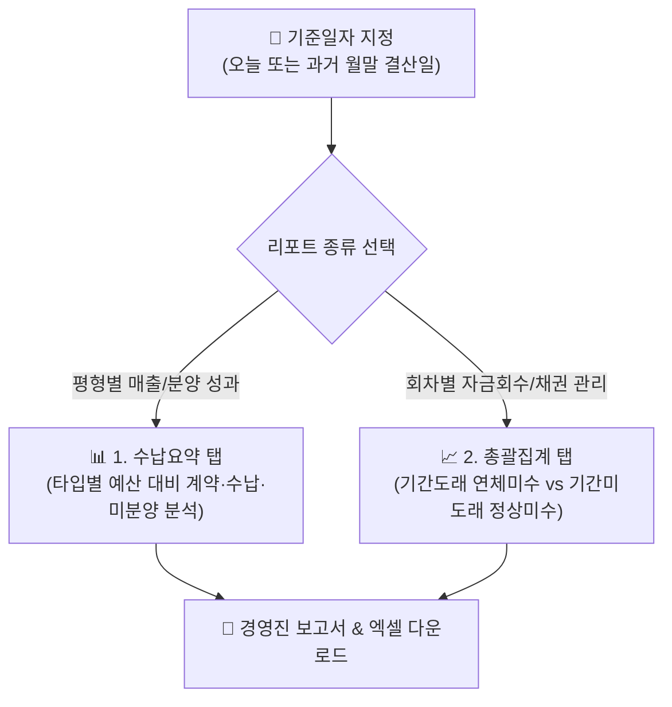

# 납부 현황 집계

::: tip 📸 실제 화면 안내

*관리자 참고: 해당 화면의 실제 캡처 이미지를 `./images/status.png` 경로에 등록해 주세요.*
:::

> **납부 현황 집계** 페이지는 프로젝트의 전체 분양 수납 데이터를 차수별, 평형 타입별, 회차별로 다각도로 집계하여 실시간 통계와 채권 회수 분석 리포트를 제공하는 분양 수지 분석 센터입니다.

* **접근 경로**: 시스템 좌측 내비게이션 메뉴에서 **[PJT 관리 시스템] → [대금 수납 관리] → [납부 현황 집계]**를 선택하여 접속합니다.

## 1. 개요 및 2대 리포트 체계

특정 **기준일자**를 설정하여 해당 시점까지의 누적 수납 실적과 미수금 현황을 다각도로 분석합니다.
* **수납요약 리포트**: 최초 수입 목표 예산 대비 실제 계약 성과와 실수납액, 미분양 물량을 평형 타입별로 입체 분석합니다.
* **총괄집계 리포트**: 분양 대금의 회차(계약금, 중도금, 잔금)별로 약정 기일 도래 여부에 따라 자금 회수율과 미수금(연체금)의 성격을 정밀 분석합니다.

## 2. 주요 기능

* **기준일자 설정을 통한 시점별 실적 조회**: 과거 특정 일자를 지정하여 당시의 수납 현황 보고서를 정확하게 재현
* **타입별 분양 및 수납 현황 분석 (수납요약)**: 타입별 세대수, 계약 세대, 계약액, 실수납액, 미수금, 미계약 잔여액 집계
* **회차별 채권 회수 및 미수금 분석 (총괄집계)**: 회차별 약정액, 기납부액, 기간도래 미수(연체), 기간미도래 미수(대기) 집계
* **원클릭 엑셀 다운로드 지원**: 집계된 통계표를 서식 그대로 엑셀 파일로 추출

## 3. 화면 구성 및 상세 분석 안내

### 1. 기준일자 설정 바
통계 산출의 기준이 되는 날짜를 지정합니다. 기본값은 오늘 날짜이며, 과거 날짜(예: 지난달 말일)를 선택하면 해당 일자 기준으로 수납 통계가 소급 재계산됩니다.

### 2. 수납요약 (탭)
프로젝트의 세대수(물량)와 공급가액을 기준으로 계약 및 수납 성과를 평형 타입별로 보여줍니다.

| 집계 항목 | 상세 설명 및 실무 기준 |
|:---|:---|
| **차수 / 타입** | 프로젝트의 계약 그룹(1차, 일반) 및 평형 타입(59A, 84B 등) |
| **전체 매출액** | [수입 예산 등록](/project/budgets)에서 수립한 해당 타입의 총 목표 금액 |
| **계약 세대(실)수** | 기준일 현재까지 체결 완료된 유효 계약 세대수 |
| **계약 금액** | 체결된 계약 건들의 총 공급가액 합계 |
| **실수납 금액** | 실제로 입금 처리 완료된 순수 납부 대금 합계 |
| **미수 금액** | 계약된 금액 중 아직 입금되지 않고 남아있는 미납액 |
| **미계약 세대 / 금액** | 전체 세대 중 아직 계약되지 않은 잔여 물량 및 잔여 공급 목표액 |

### 3. 총괄집계 (탭)
각 납부 회차별(계약금, 중도금 1~6회차, 잔금 등) 약정 기준일에 따라 자금 회수 현황과 미수금의 성격을 분석합니다.

| 구분 | 상세 집계 내용 |
|:---|:---|
| **기본 정보** | 각 회차별 공식 납부 약정일(기준일) 표출 |
| **계약 현황** | 계약분 금액, 미계약분 금액, 총계 및 현재 실계약률(%) |
| **수납 현황** | 정규 수납액, 선납 할인료, 연체료 가산액, 실수납액 및 누적 수납률(%) |
| **기간도래 미수 (연체)** | **약정일이 이미 지났음에도 수납되지 않은 순수 연체 미수금** 및 발생 연체료 합계 |
| **기간미도래 미수 (정상)** | 아직 약정일이 도래하지 않아 정상적으로 납부를 대기 중인 잔여 미수금 |
| **총계** | 전체 미수금 합계 및 전체 분양가 대비 미수율(%) |

## 4. 💡 실무 활용 가이드

* **💡 경영진 및 PF 대주단 정기 보고서 작성**:
  * 월말 정기 결산 시 기준일자를 **'해당 월의 말일'**로 지정한 후 엑셀 다운로드를 실행하십시오. 과거 시점의 확정된 수납 실적이 오차 없이 정확하게 재현되어 신뢰성 높은 보고서를 즉시 작성할 수 있습니다.
* **💡 '기간도래 미수'를 활용한 연체 채권 관리**:
  * 총괄집계 화면에서 **'기간도래 미수'** 금액이 크게 잡힌 회차는 약정일이 지났는데도 입금이 지연되고 있는 연체 세대입니다.
  * 해당 회차의 연체자 명단을 추출하여 [고객 고지 관리 > 수납 고지서 출력](/notice/bill) 또는 [SMS 발송 관리](/notice/sms)와 연계해 미납 안내문과 독촉 문자를 신속히 발송하십시오.
