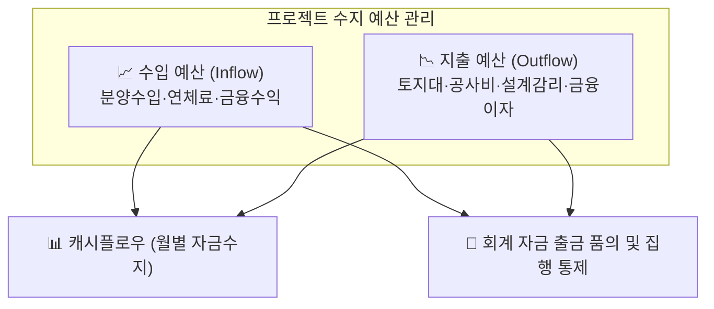

# 예산 정보 설정

::: tip 📸 실제 화면 안내

*관리자 참고: 해당 화면의 실제 캡처 이미지를 `./images/budgets.png` 경로에 등록해 주세요.*
:::

> **예산 정보 설정**은 프로젝트의 전체 수입(분양 수입, 기타 수입) 및 지출(공사비, 토지대, 사업비, 금융비용 등) 예산을 등록하고 관리하는 모듈입니다. 등록된 예산 정보는 향후 프로젝트 자금 집행 및 수납 현황, 캐시플로우 수지 분석의 기준 데이터로 활용됩니다.

* **접근 경로**: 시스템 좌측 내비게이션 메뉴에서 **[PJT 관리 시스템] → [프로젝트 설정] → [예산 정보 설정]**을 선택하여 접속합니다.

## 1. 수입 예산 등록

분양 수입이나 기타 유입 자금에 대한 예산을 계정과목, 차수, 타입별로 세분화하여 등록합니다.

* **위치**: `프로젝트 설정 > 예산 정보 설정 > 수입 예산 등록`

| 라벨 | 필수입력 | 상세 설명 및 실무 기준 |
|:---|:---:|:---|
| **계정과목** | **필수** | 분양수입, 연체료수입, 옵션수입 등 해당 수입의 회계 계정 선택 |
| **차수** | | 수입 예산을 특정 계약 차수(예: 1차 조합원, 일반분양)와 연결할 경우 선택 |
| **타입** | | 수입 예산을 특정 유닛 타입(예: 84A)과 연결할 경우 선택 |
| **항목명칭** | | 타입 미선택 시 필수 입력. 해당 수입 항목의 구체적 명칭 입력 |
| **단위 세대 단가** | | 해당 타입 또는 항목의 1개 단위당 평균 분양 예상 가격 |
| **수량** | **필수** | 공급 세대수 또는 해당 수입 항목의 총 수량 (예: 250세대) |
| **기초 수입 예산** | **필수** | **최초 사업 승인(인준) 시점의 원안 수입 예산 금액** |
| **현황 수입 예산** | | 사업 진행 중 분양가 인상이나 설계 변경 등으로 조정된 **현재 시점의 실행 수입 예산 금액** |

## 2. 지출 예산 등록

프로젝트 수행을 위해 발생하는 각종 토지 매입비, 직접 공사비, 간접 사업비, 제세공과금, 금융비용 등 지출 항목에 대한 예산을 등록합니다.

* **위치**: `프로젝트 설정 > 예산 정보 설정 > 지출 예산 등록`

| 라벨 | 필수입력 | 상세 설명 및 실무 기준 |
|:---|:---:|:---|
| **계정과목** | **필수** | 토지대, 건축공사비, 전기공사비, 설계감리비, 마케팅비, PF금융수수료 등 선택 |
| **산출 근거** | | 해당 예산 금액이 산출된 구체적인 계약 조건이나 산출 공식 요약 |
| **기초 지출 예산** | **필수** | **최초 사업 계획(PF 인준) 시점의 원안 지출 예산 금액** |
| **현황 지출 예산** | | 공사비 인상, 물가 상승, 설계 변경 등으로 증감 조정된 **현재 시점의 실행 지출 예산 금액** |

## 3. 신입사원을 위한 실무 가이드

* **💡 '기초 예산' vs '현황 예산'의 차이**:
  * **기초 예산**: 프로젝트 착수 시 주주총회나 PF 대주단에 공식 보고하여 승인받은 '원안 예산(초기 기준선)'입니다. 사업 도중에 변경하지 않고 동결하는 것이 원칙입니다.
  * **현황 예산**: 사업 추진 중 물가 변동, 공사비 변경계약 등으로 인해 실제로 조정된 '현재 관리 예산'입니다.
  * IBS는 두 예산을 동시에 보관하므로, **"원안 대비 현재 예산이 얼마나 증감되었는가?"**를 사업 수지 분석표에서 한눈에 대조 분석할 수 있습니다.
* **💡 회계 출금 품의 시 지출 예산 연동**:
  * [회계 자금 관리]에서 사업비를 출금 집행할 때 등록된 지출 예산 계정과 잔여 예산을 실시간으로 검증하므로, 사전에 정확한 지출 예산 등록이 필수적입니다.
