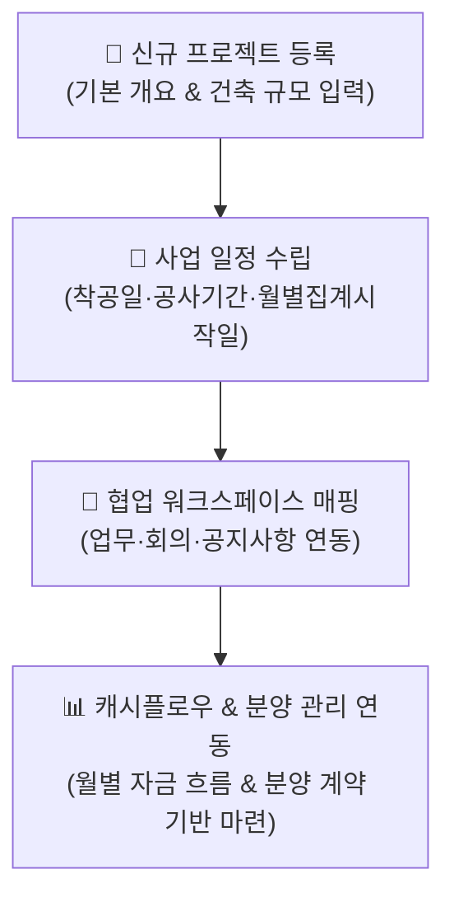

# 프로젝트 등록

::: tip 📸 실제 화면 안내

*관리자 참고: 해당 화면의 실제 캡처 이미지를 `./images/index.png` 경로에 등록해 주세요.*
:::

> **프로젝트 등록** 페이지는 부동산 개발 사업지(아파트, 주상복합, 오피스텔 등)의 기본 속성과 건축 개요, 공사 일정을 등록하고 관리하는 프로젝트 관리 시스템의 최상위 시작점입니다.

* **접근 경로**: 시스템 좌측 내비게이션 메뉴에서 **[PJT 관리 시스템] → [프로젝트 설정] → [프로젝트 등록]**을 선택하여 접속합니다.

## 1. 주요 기능

* **프로젝트 기본 정보 조회**: 현재 선택된 프로젝트의 대지 위치, 건축 규모, 사업 일정 등 마스터 정보 열람
* **신규 프로젝트 등록**: 새로운 부동산 개발 사업지의 기본 속성 및 건축 개요를 신규 생성
* **프로젝트 정보 수정**: 사업시행인가, 인허가 변경 등에 따른 건축 규모 및 일정 정보 변경

## 2. 화면 구성 및 조작 가이드

### 1. 프로젝트 선택기
* 상단 프로젝트 셀렉터에서 관리하고자 하는 대상 프로젝트를 선택합니다.

### 2. 프로젝트 개요 카드
* 선택된 프로젝트의 기본 명칭, 사업 종류, 총 세대수, 공사 기간 및 대지 위치 등 핵심 요약 정보를 한눈에 파악할 수 있습니다.

### 3. 작업 버튼
* **수정하기**: 선택한 프로젝트의 정보를 수정할 수 있는 입력 폼으로 전환합니다.
* **등록하기**: 새로운 사업지를 등록하기 위한 빈 입력 폼으로 전환합니다.

## 3. 프로젝트 입력 항목 상세 안내

프로젝트 등록 및 수정 시 사용하는 주요 입력 영역입니다. 특히 **사업 일정** 섹션은 시스템의 자금 집행 현황(캐시플로우) 산정에 직접적인 영향을 미치므로 정확한 입력이 필요합니다.

| 라벨 | 필수입력 | 상세 설명 및 실무 기준 |
|:---|:---:|:---|
| **업무 프로젝트** | **필수** | 협업 시스템 연계를 위한 워크스페이스 선택. 우측의 `(+)` 버튼을 클릭하여 새 워크스페이스를 즉시 개설할 수 있습니다. |
| **프로젝트명** | **필수** | 대외 공식 프로젝트 명칭 입력 (예: `OO역 주상복합 신축사업`) |
| **정렬순서** | | 프로젝트 선택 목록에서의 표출 순서 지정 (미입력 시 등록 순서 기준) |
| **프로젝트종류** | **필수** | 아파트, 타운하우스, 주상복합, 오피스텔, 근생, 숙박시설, 지식산업센터 등 선택 |
| **사업개시년도** | **필수** | 프로젝트의 공식 사업 개시 연도 |
| **직영운영여부** | | 본사 직접 운영(자체 사업/시행) 여부 설정 |
| **동호지정여부** | | 분양/모집 시 동호수 지정 관리 여부 (체크 시 동호수 배치도 활성화) |
| **토지환지여부** | | 환지 방식 도시개발사업구역 포함 여부 |
| **월별집계시작일** | **필수** | **캐시플로우 집계 시작월**. 지정일 이전 데이터는 누계로 합산 표시됨 |
| **착공(예상)일** | **필수** | **공사기간의 시작일**. 캐시플로우 및 기성고 산정의 기준일 |
| **공사기간** | **필수** | 총 공사 소요 개월 수 입력 (준공예정일 자동 산정 연계) |
| **대지위치** | | 사업부지 대표 지번 등 위치 정보 |
| **용도지역지구** | **필수** | 도시계획상 용도지역/지구 정보 (예: 일반상업지역) |
| **건축규모** | **필수** | 지하 층수 ~ 지상 층수 등 건축 규모 (예: 지하 3층 / 지상 29층) |
| **세대(호/실)수** | | 총 공급 세대수 또는 호/실수 |
| **면적 관련 항목** | | 제곱미터(㎡) 단위 입력, 소수점 4자리까지 정밀도 지원 (대지, 연면적, 건축면적 등) |
| **용적률/건폐율** | | % 단위 입력, 소수점 4자리까지 지원 |
| **법정/계획주차** | | 법정 기준 및 실제 계획된 주차 대수 |

## 4. 신입사원을 위한 실무 가이드

* **💡 업무 프로젝트 매핑의 중요성**:
  * IBS는 부동산 개발 프로젝트와 협업 워크스페이스가 1:1로 연결되어 작동합니다. '업무 프로젝트'를 연결해 두어야 프로젝트 현장에서 발생하는 이슈, 회의록, 공지사항, 문서가 해당 프로젝트 맥락 안에서 통합 관리됩니다.
* **💡 사업 일정(착공일/공사기간) 입력 시 주의사항**:
  * 착공(예상)일과 공사기간은 향후 [회계 자금 관리]의 **캐시플로우(월별 자금 수지 분석)** 타임라인을 구성하는 핵심 기준이 됩니다. 인허가 일정이나 시공사 계약 조건에 맞춰 신중히 입력하십시오.
