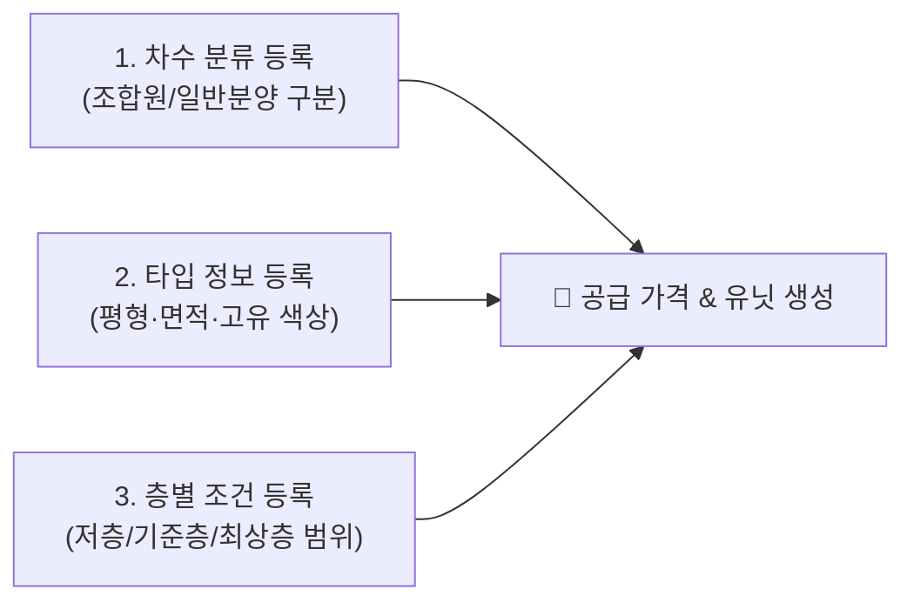

# 차수 타입 설정

::: tip 📸 실제 화면 안내

*관리자 참고: 해당 화면의 실제 캡처 이미지를 `./images/types.png` 경로에 등록해 주세요.*
:::

> **차수 타입 설정**은 프로젝트의 계약 차수(조합원 모집, 1차 분양, 일반 분양 등)와 공급 평형별 세부 타입(59A, 84B 등), 그리고 층별 차등가 적용을 위한 층별 범위를 등록하는 기준 정보 관리 모듈입니다.

* **접근 경로**: 시스템 좌측 내비게이션 메뉴에서 **[PJT 관리 시스템] → [프로젝트 설정] → [차수 타입 설정]**을 선택하여 접속합니다.

## 1. 차수 분류 등록

프로젝트의 계약 진행 단계에 따른 차수 그룹을 등록합니다. 이 정보는 향후 계약 등록 및 분양가 산정 시 기준으로 활용됩니다.

* **위치**: `프로젝트 설정 > 차수 타입 설정 > 차수 분류 등록`

| 라벨 | 필수입력 | 상세 설명 및 실무 기준 |
|:---|:---:|:---|
| **등록차수** | **필수** | 해당 차수의 순서(회차)를 숫자로 입력 (예: `1`, `2`) |
| **차수구분** | **필수** | `조합모집` 또는 `일반분양` 중 선택 |
| **차수그룹명** | **필수** | 차수를 식별할 수 있는 명칭 (예: `1차 조합원 모집`, `일반분양분`) |
| **미계약세대 기본설정** | | 미계약 세대 공급가격 생성 시 기본 적용할 차수 (프로젝트당 1개만 설정 가능) |

## 2. 타입 정보 등록

공급 시설의 타입(평형)별 세부 정보를 등록하고 면적 및 가격 책정 방식을 정의합니다.

* **위치**: `프로젝트 설정 > 차수 타입 설정 > 타입 정보 등록`

| 라벨 | 필수입력 | 상세 설명 및 실무 기준 |
|:---|:---:|:---|
| **타입종류** | **필수** | 공동주택, 오피스텔, 숙박시설, 근린생활시설 등 시설 용도 선택 |
| **타입구분** | **필수** | `메인유닛`(주거 세대) 또는 `보조시설`(창고, 주차장 등) 여부 선택 |
| **타입명칭** | **필수** | 타입을 식별하는 공식 명칭 (예: `59A`, `84B`, `114P`) |
| **타입색상** | **필수** | **동호수 배치도(유닛 현황판) 등에서 타입을 구분하기 위한 전용 색상** 지정 |
| **전용면적** | | 전용면적 (제곱미터, ㎡) |
| **공급면적** | | 공급면적 (제곱미터, ㎡) |
| **계약면적** | | 계약면적 (제곱미터, ㎡) |
| **평균가격** | | 해당 타입의 기준 평균 분양가격 (예산 미수립 시 초기 단가로 활용) |
| **공급가 설정 옵션** | **필수** | 가격 책정 기준 (`타입별` / `층타입별` / `호별 설정` 중 선택) |
| **세대수** | **필수** | 해당 타입으로 공급되는 총 세대수 |

## 3. 층별 조건 등록

층별로 분양가를 다르게 적용(층별 차등 분양가)하기 위한 층 범위를 설정합니다. 이 설정은 타입 정보 등록에서 '층타입별 설정'을 선택한 경우에 적용됩니다.

* **위치**: `프로젝트 설정 > 차수 타입 설정 > 층별 조건 등록`

| 라벨 | 필수입력 | 상세 설명 및 실무 기준 |
|:---|:---:|:---|
| **타입종류** | **필수** | 층 조건을 적용할 시설 용도 선택 (공동주택 등) |
| **시작 층** | **필수** | 범위의 시작 층 (지하층은 -1 이하 숫자로 입력) |
| **종료 층** | **필수** | 범위의 종료 층 |
| **방향/위치(선택)** | | 조망권, 향(동/서/남/북)이나 라인 등 추가 구분 조건 입력 |
| **층별 범위 명칭** | **필수** | 해당 범위를 식별할 명칭 (예: `1~3층(저층부)`, `4~19층(기준층)`, `20층 이상(로열층)`) |

## 4. 신입사원을 위한 실무 가이드

* **💡 왜 차수와 타입을 먼저 등록해야 하나요?**:
  * 동호수(유닛)를 생성할 때 각 호실에 어떤 평형(타입)이 들어가는지 지정해야 하고, 분양가를 등록할 때도 차수와 타입, 층별 조건을 기준으로 가격표가 만들어지기 때문입니다. 따라서 **[차수/타입 등록]은 프로젝트 분양 세팅의 가장 첫 관문**입니다.
* **💡 타입 색상 지정 팁**:
  * 59타입은 파란색 계열, 84타입은 주황색 계열 등 직관적으로 구분되는 색상을 지정해 두면, 향후 [계약 현황판]이나 [유닛 동호수 배치도]를 볼 때 분양 상담사나 고객에게 평형별 위치를 한눈에 안내하기 매우 편리합니다.
