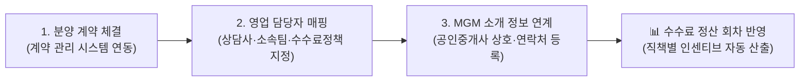

# 계약 실적 관리

::: tip 📸 실제 화면 안내

*관리자 참고: 해당 화면의 실제 캡처 이미지를 `./images/index.png` 경로에 등록해 주세요.*
:::

> **계약 실적 관리** 페이지는 프로젝트에서 체결된 분양 계약 건에 대해 담당 영업 인력(분양상담사, 소속 팀장) 및 외부 공인중개사(MGM)를 매핑하고, 실시간 영업 배정률과 성과 실적을 추적 관리하는 모듈입니다.

* **접근 경로**: 시스템 좌측 내비게이션 메뉴에서 **[PJT 관리 시스템] → [분양 대행 관리] → [계약 실적 관리]**를 선택하여 접속합니다.

## 1. 개요 및 비즈니스 연계

프로젝트에서 체결되는 모든 분양 계약을 영업 조직과 유기적으로 연결하여 누가 어떤 계약을 유치했는지 실적을 투명하게 관리합니다.
* 계약 건별 담당 상담사와 소속 팀, 적용할 수수료 정책(R값), 성과 인정일을 지정합니다.
* 외부 공인중개사가 고객을 알선한 경우 MGM 소개 정보를 등록하여 소개 수수료 지급 근거를 마련합니다.
* 본 화면에서 매핑된 데이터는 향후 **[수수료 정산 관리](/sales/settlement)** 시 개인별·대행사별 인센티브를 산출하는 핵심 원천 데이터가 됩니다.

## 2. 주요 기능

* **실적 KPI 대시보드**: 프로젝트 전체 계약 건수, 영업 담당자 배정 건수, 배정률(%), MGM 연계 건수 실시간 집계
* **계약 실적 대장 조회**: 계약 정보(일련번호, 계약자명, 유니트 동호수)와 매핑된 영업 인력 현황 통합 조회
* **다차원 필터링 및 검색**: 배정 상태(전체/배정 완료/미배정), 소속 팀, 담당 상담사별 필터 및 계약자/동호수 키워드 검색
* **담당자 배정 및 수정**: 미배정 계약에 대한 신규 영업 담당자 배정 또는 기 배정된 담당자/정책/MGM 정보 수정

## 3. 화면 구성 및 조작 가이드

### 1. 상단 실적 KPI 대시보드
선택된 프로젝트의 분양 계약 및 영업 인력 배정 진척도를 한눈에 파악할 수 있는 요약 카드를 제공합니다.
* **총 분양 계약 건수**: 현재 프로젝트에서 체결된 총 계약 건수
* **영업 담당 배정 건수**: 영업 인력이 배정 완료된 계약 건수
* **담당자 배정률**: 총 계약 대비 영업 담당자 배정 완료 비율(%)
* **MGM 연계 계약 건수**: 공인중개사 소개(MGM)로 체결된 계약 건수

### 2. 목록 제어 및 검색 툴바
* **매핑 상태 필터**: `전체 계약`, `배정 완료 계약`, `미배정 계약` 선택
* **소속 팀 필터**: 특정 영업 본부 또는 팀으로 필터링
* **담당 상담사 필터**: 특정 영업 상담사로 필터링
* **통합 검색창**: 계약자명, 동호수, 계약 일련번호, 상담사명 등으로 빠른 검색
* **[담당자 배정] 버튼**: 신규로 계약과 영업 담당자를 매핑하는 팝업 호출

### 3. 계약 실적 & 영업 담당자 매핑 대장 테이블

| 항목 | 상세 설명 및 실무 기준 |
|:---|:---|
| **계약 정보** | 계약 일련번호, 계약자 성명, 동호수 및 유니트 평형 정보 |
| **담당 영업직원** | 계약을 유치한 담당 분양상담사 성명 (미배정 시 붉은색 배지 표시) |
| **소속 팀** | 담당 상담사가 소속된 영업 본부 및 팀명 |
| **적용 수수료 정책** | 해당 계약에 적용될 수수료 정책(R값) 명칭 |
| **성과 인정일** | 영업 실적으로 공식 인정되는 기준 일자 |
| **MGM 연계 정보** | 연계된 공인중개사/소개자 상호 및 연락처 (해당 시 표출) |
| **관리 액션** | `[수정]` (기존 배정 정보 변경) 또는 `[배정하기]` (신규 담당자 지정) |

### 4. 영업 담당자 배정/수정 팝업

계약 건에 영업 담당자를 연결하거나 기존 매핑 정보를 수정하는 입력 팝업창입니다.

| 입력 항목 | 필수 여부 | 상세 설명 및 실무 기준 |
|:---|:---:|:---|
| **대상 계약 선택** | **필수** | 담당자를 지정할 분양 계약 건 선택 (미배정 계약 우선 표출) |
| **담당 영업 상담사** | **필수** | 계약을 성사시킨 영업 인력(상담사) 선택 |
| **소속 팀** | 자동/선택 | 상담사 선택 시 소속 팀이 자동 연동되며, 필요 시 수동 변경 가능 |
| **수수료 정책** | **필수** | 해당 계약에 적용할 수수료 정책 기준표 선택 |
| **영업 성과 인정일** | 선택 | 실적으로 인정할 일자 (달력 입력) |
| **MGM 성명/상호** | 선택 | 고객을 소개한 외부 공인중개사 상호 또는 성명 |
| **MGM 연락처** | 선택 | 공인중개사 휴대전화 번호 |
| **비고** | 선택 | 계약 배정 관련 특이사항 및 메모 |

## 4. 신입사원을 위한 실무 가이드

* **💡 정산 전 '미배정 계약' 제로(0) 만들기**:
  * 정산 회차를 마감하기 전, 상단 필터에서 **'미배정 계약'**을 선택하여 담당 영업 인력이 빠진 계약 건이 없는지 확인하십시오. 담당자가 매핑되지 않은 계약은 수수료 정산 집계에서 누락되어 상담사 성과급이 미지급될 수 있습니다.
* **💡 MGM(공인중개사 소개료) 등록 주의사항**:
  * 외부 공인중개사(MGM) 소개 건은 고객 상담 카드나 청약 접수증에 기재된 중개업소 상호, 공인중개사 성명, 등록번호를 정확히 확인하고 입력하십시오. 추후 중개수수료 세금계산서 발행 및 지급 증빙으로 활용됩니다.
