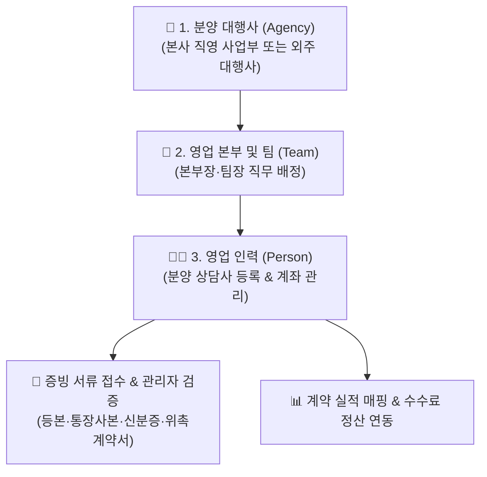

# 영업 조직 관리

::: tip 📸 실제 화면 안내

*관리자 참고: 해당 화면의 실제 캡처 이미지를 `./images/organization.png` 경로에 등록해 주세요.*
:::

> **영업 조직 관리** 페이지는 프로젝트에 투입되는 분양 대행사, 영업 본부/팀, 그리고 영업 상담사 및 팀장 등 영업 인력을 3단계 계층 구조로 등록하고, 계좌 정보, 3.3% 프리랜서 과세 유형, 그리고 필수 증빙 서류(등본, 통장 사본, 신분증, 위촉계약서 등)를 체계적으로 관리하는 기준 정보 센터입니다.

* **접근 경로**: 시스템 좌측 내비게이션 메뉴에서 **[PJT 관리 시스템] → [분양 대행 관리] → [영업 조직 관리]**를 선택하여 접속합니다.

## 1. 개요 및 3단계 조직 아키텍처

분양 영업을 전담하는 조직 체계를 체계적으로 전산화합니다.
* **1단계: 분양 대행사**: 최상위 조직 단위로, 본사 직영 사업부 또는 외부 전문 분양대행사를 등록합니다.
* **2단계: 영업 본부 및 팀**: 대행사 산하의 영업 본부 및 실무 팀을 계층형 트리로 구성합니다.
* **3단계: 영업 인력**: 각 팀에 소속되는 상담사, 팀장, 본부장을 등록하고, 수수료 입금 계좌 및 과세 유형(3.3% 프리랜서)을 관리합니다.
* **증빙 서류 검증 체계**: 수수료 정산 및 금융 이체를 위해 법적으로 필수적인 증빙 서류(등본, 통장 사본, 신분증 사본, 위촉계약서, 보안서약서 등)의 파일 업로드 및 관리자 검증을 지원합니다.

## 2. 주요 기능

* **3단계 영업 조직 계층 관리**: 대행사 ➔ 영업 본부/팀 ➔ 영업 인력(상담사)
* **좌측 조직 트리뷰 연동**: 대행사 또는 팀 클릭 시 우측 명부에 해당 소속 인력만 즉시 필터링
* **대행사 운영 형태 구분**: 본사 직영 분양팀 또는 외부 전문 분양대행사 구분 관리
* **프리랜서(3.3%) 세무 유형 설정**: 사업소득세 원천징수 대상자 등록
* **정산 입금 계좌 관리**: 주요 시중은행, 인터넷전문은행, 지방은행 셀렉터 및 계좌번호, 예금주 등록
* **증빙 서류 접수 및 검증 체계**: 주민등록등본, 통장 사본, 신분증, 영업 위촉계약서, 보안서약서 파일 업로드 및 관리자 검증
* **모바일 서류 열람 및 공유**: 스마트폰 모바일 앱에서 상담사별 제출 서류 확인, PDF/이미지 즉시 열람 및 카카오톡/이메일 공유 지원
* **재직 상태 관리**: 위촉(재직), 휴직, 해촉(퇴사) 상태 관리

## 3. 화면 구성 및 조작 가이드

### 1. 좌측 영업 조직 계층 트리뷰
프로젝트에 등록된 대행사와 산하 팀 구조를 한눈에 볼 수 있는 트리 영역입니다.
* **[대행사 추가] 버튼**: 상단 `+` 버튼으로 신규 대행사 등록
* **대행사 아이템**:
  * 직영/외주 배지 표출
  * 수정, 삭제, 하위 팀 추가 버튼 제공
* **하위 팀 아이템**:
  * 팀 소속 인원수 배지 표출
  * 클릭 시 해당 팀이 강조 표시되며 우측 인력 명부가 자동 필터링
  * 수정 및 삭제 버튼 제공

### 2. 우측 영업 인력 명부
선택된 대행사 또는 팀에 소속된 영업 인력의 상세 명단 테이블입니다.
* **상단 필터 및 제어 바**:
  * 직책 필터 (전체, 분양상담사, 팀장, 본부장, 총괄본부장, 지원/기타)
  * 재직 상태 필터 (전체, 재직, 휴직, 해촉)
  * 성명/연락처/예금주 검색창
  * **`[신규 인력 등록]`** 버튼
* **인력 목록 테이블**:
  * 소속 대행사 및 팀
  * 직책 배지 (상담사, 팀장, 본부장, 총괄)
  * 성명 (클릭 시 수정 팝업 호출)
  * 연락처 및 소득 구분 (3.3% 프리랜서 배지)
  * 정산 계좌 정보 (은행명, 계좌번호, 예금주)
  * **제출 서류 배지**: 제출된 서류 건수 배지 표출 (`[📎 서류 N건]`), 클릭 시 전용 서류 관리 팝업 호출
  * 재직 상태 배지 (재직, 휴직, 해촉)
  * 관리 액션: 수정 및 삭제 버튼

### 3. 입력 팝업 안내

#### ① 대행사 등록 팝업
* **대행사명** (필수): 회사 상호 또는 직영 사업단 명칭
* **운영 형태**: `직영 분양팀` 또는 `외주 대행사` 선택
* **대표자명 / 사업자등록번호 / 연락처 / 담당자 정보**
* **계약 기간**: 대행 계약 시작일 및 종료일

#### ② 영업 팀 등록 팝업
* **소속 대행사** (필수): 소속될 상위 대행사 선택
* **상위 조직**: 본부 산하 팀 구성 시 상위 본부 선택 (다단계 계층 지원)
* **팀/조직명** (필수): 예: "분양 1본부", "영업 2팀"
* **팀장 성명**: 조직 책임자 성명

#### ③ 영업 인력 등록/수정 팝업
* **소속 팀** (필수): 배치될 영업 팀 선택
* **성명** (필수) 및 **직책** (상담사, 팀장, 본부장, 총괄본부장, 지원/기타)
* **휴대전화** (필수) 및 **주민등록번호** (원천세 신고 식별용)
* **소득 구분** (필수): `3.3% 사업소득 (프리랜서)`, `근로소득`, `사업자 (세금계산서)`, `기타`
* **정산 계좌 정보**: 거래 은행 선택, 계좌번호, 예금주명
* **증빙 서류 관리 바로가기**: 기존 인력 수정 모드 시 하단에 증빙 서류 현황 및 바로가기 버튼 제공
* **활동 및 재직 정보**: 재직 상태, 위촉/입사일자 및 해촉/퇴사일자
* **비고 / 특이사항**: 추천인, 영업 경력 사항 등 메모

### 4. 증빙 서류 접수 및 검증 팝업

영업 인력이 영업 활동 및 수수료 정산을 위해 제출한 각종 증빙 서류를 업로드하고 검증하는 전용 창입니다.

| 서류 구분 | 권장/필수 여부 | 세부 내용 및 활용처 |
|:---|:---:|:---|
| **주민등록등본/초본** | **필수** | 본인 실명 확인 및 주소지 확인 (원천징수 영수증 발급용) |
| **통장 사본 (계좌 사본)** | **필수** | 수수료 정산 이체 시 명의 일치 확인 |
| **신분증 사본** | **필수** | 주민등록번호 확인 및 신원 보증 |
| **영업 위촉계약서** | **필수** | 분양 대행 수수료 지급 및 위촉 효력 입증 서류 |
| **각종 서약서/각서** | 선택/권장 | 보안/비밀유지 서약서, 청렴이행각서 등 |
| **기타 증빙서류** | 선택 | 사업자등록증 사본, 공인중개사 자격증 등 |

* **신규 서류 업로드**:
  * 서류 구분 선택 후 PDF, JPG, PNG 파일 선택하여 등록
* **제출 서류 관리**:
  * **다운로드 / 열람**: 파일명 클릭 시 새 창에서 즉시 원본 열람 및 다운로드
  * **관리자 검증**: 서류 대조 후 **`[검증]`** 버튼 클릭 시 `검증완료` 상태로 변경되며 검증자 및 일시 기록 (필요 시 `[검증취소]` 가능)
  * **서류 삭제**: 잘못 접수된 서류는 즉시 삭제 처리

### 5. 모바일 앱 환경 서류 열람 및 공유

현장 관리자나 대행사 관계자가 스마트폰 모바일 환경에서도 상담사의 제출 서류를 즉시 확인하고 공유할 수 있습니다.
* **서류 요약 카드**: 인력 카드에서 제출 서류 건수와 검증 통계(전체/검증완료/확인대기) 한눈에 파악
* **원클릭 열람**: 모바일 화면에서 터치 즉시 PDF 뷰어 또는 이미지 뷰어로 서류 확인
* **원터치 공유**: 모바일 공유 기능을 통해 카카오톡, 이메일로 세무사나 본사 담당자에게 다이렉트 전송
* **현장 검증 지원**: 현장 실사 후 모바일 화면에서 직접 `[검증]` 처리 가능

## 4. 신입사원을 위한 실무 가이드

* **💡 신규 상담사 투입 시 필수 4대 서류 체크리스트**:
  * 상담사가 현장에 투입되면 첫 수수료 정산일 전까지 반드시 **[주민등록등본, 통장 사본, 신분증 사본, 위촉계약서]** 4종을 제출받아 시스템에 등록하십시오. 서류가 미비하거나 예금주명이 일치하지 않으면 수수료 지급이 보류될 수 있습니다.
* **💡 상담사 퇴사(해촉) 처리 요령**:
  * 상담사가 현장을 떠날 때는 프로필을 삭제하지 말고 **재직 상태를 '해촉'으로 변경**하십시오. 그래야 과거에 체결한 분양 계약 실적과 기정산된 수수료 이력이 안전하게 보존됩니다.
