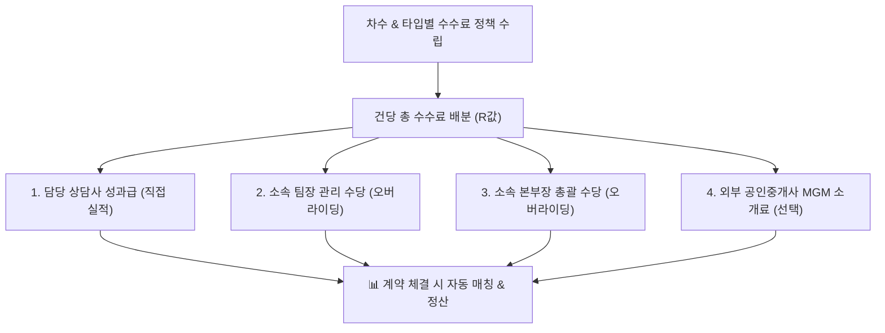

# 수수료 정책 관리

::: tip 📸 실제 화면 안내

*관리자 참고: 해당 화면의 실제 캡처 이미지를 `./images/policy.png` 경로에 등록해 주세요.*
:::

> **수수료 정책 관리** 페이지는 프로젝트의 분양 차수 및 유니트 타입별로 적용할 영업 직책별 수수료(상담사, 팀장, 본부장 성과급 R값)와 외부 공인중개사(MGM) 소개료를 사전에 매트릭스 형태로 등록하는 기준 정책 관리 모듈입니다.

* **접근 경로**: 시스템 좌측 내비게이션 메뉴에서 **[PJT 관리 시스템] → [분양 대행 관리] → [수수료 정책 관리]**를 선택하여 접속합니다.

## 1. 개요 및 수수료 정책(R값) 구조

분양 성공 시 영업 인력에게 지급할 성과급(인센티브 R값: Rate/Reward)의 기준표를 사전에 정의합니다.
* **유니트 타입별 차등 수수료**: 주거용 아파트, 오피스텔, 근린생활시설 등 평형과 분양가에 따라 건당 책정되는 수수료 금액을 유연하게 다르게 설정할 수 있습니다.
* **직책별 오버라이딩 수당 배분**: 계약을 직접 유치한 상담사 개인 수수료 외에도, 조직을 관리하는 팀장 및 본부장에게 귀속되는 관리 오버라이딩 수당을 하나의 정책으로 묶어 관리합니다.
* **MGM 소개료 통합**: 외부 공인중개사가 고객을 알선한 경우 지급할 건당 소개료를 사전에 책정하여 불필요한 분쟁을 예방합니다.

## 2. 주요 기능

* **차수 및 타입별 수수료 매트릭스**: 프로젝트 차수와 유니트 평형별 맞춤형 개별 정책 등록
* **직책별 차등 수수료(R값) 설정**:
  * 담당 상담사 건당 기본 수수료
  * 팀장 건당 관리 수수료 (오버라이딩)
  * 본부장 건당 총괄 수수료 (오버라이딩)
* **MGM 연계 수수료 설정**: 공인중개사 고객 소개 시 지급할 MGM 건당 소개료
* **수수료 지급 조건 설정**: 계약금 완납 시 100%, 1/2차 분할 지급, 정식 공급계약 체결 시 등 지급 조건 명시
* **유효 기간 및 활성 상태 관리**: 정책 적용 시작일/종료일 지정 및 활성화 스위치 토글
* **통계 요약 카드 제공**: 등록된 정책 건수, 평균 상담사 수수료, 최고 수수료, 최저 수수료 실시간 집계

## 3. 화면 구성 및 조작 가이드

### 1. 상단 수수료 정책 요약 카드
* **총 등록 정책 수**: 현재 프로젝트에 등록된 수수료 정책 건수
* **평균 상담사 수수료**: 등록된 정책들의 상담사 평균 건당 수수료 금액
* **최고 / 최저 수수료**: 프로젝트 내에서 가장 높거나 낮게 책정된 건당 수수료 금액

### 2. 수수료 정책 목록 및 필터 바
* **차수 필터**: 특정 분양 차수별 필터링
* **타입 필터**: 특정 유니트 평형 타입별 필터링
* **검색창**: 정책명 키워드 검색
* **[신규 정책 등록] 버튼**: 새로운 수수료 기준표를 등록하는 팝업 호출

### 3. 수수료 정책 대장 테이블

| 항목 | 상세 설명 및 실무 기준 |
|:---|:---|
| **정책명** | 정책 식별 명칭 (예: `1차 일반분양 84A타입 기본 수수료`) |
| **적용 차수 / 타입** | 해당 정책이 적용되는 계약 차수 및 유니트 평형 |
| **상담사 수수료** | 계약 성사 상담사에게 지급되는 건당 인센티브 금액 |
| **팀장 수수료** | 해당 팀의 팀장에게 귀속되는 관리 수수료 |
| **본부장 수수료** | 상위 본부장에게 귀속되는 총괄 수수료 |
| **MGM 소개료** | 외부 공인중개사 소개 성약 시 지급되는 건당 소개료 |
| **지급 조건** | 계약금 100% 완납, 분할 지급 등 설정된 지급 조건 |
| **적용 기간** | 정책의 효력이 유지되는 유효 기간 (시작일 ~ 종료일) |
| **상태** | 활성(초록 배지) 또는 비활성(회색 배지) |
| **관리** | 행별 수정 및 삭제 버튼 |

### 4. 수수료 정책 등록/수정 팝업

| 입력 항목 | 필수 여부 | 상세 설명 및 실무 기준 |
|:---|:---:|:---|
| **정책명** | **필수** | 식별하기 쉬운 수수료 정책 이름 입력 |
| **적용 차수** | 선택 | 특정 차수에 한정할 경우 선택 (미선택 시 전체 차수 적용) |
| **적용 유니트 타입** | 선택 | 특정 평형/타입에 한정할 경우 선택 (미선택 시 전체 타입 적용) |
| **상담사 수수료 (원)** | **필수** | 담당 상담사 건당 지급액 |
| **팀장 수수료 (원)** | 선택 | 팀장 오버라이딩 수당 |
| **본부장 수수료 (원)** | 선택 | 본부장 오버라이딩 수당 |
| **MGM 소개 수수료 (원)** | 선택 | 공인중개사 연계 시 건당 소개료 |
| **지급 조건** | **필수** | `1. 계약금 완납 시 전액`, `2. 1·2차 분할 지급`, `3. 공급계약 체결 시`, `4. 청약금 입금 시` 중 선택 |
| **적용 시작일 / 종료일** | **필수/선택** | 정책 효력 시작 일자 및 종료 일자 (무기한 시 종료일 공란) |
| **활성화 여부** | **필수** | 체크박스를 통해 현재 적용 여부 설정 |

## 4. 신입사원을 위한 실무 가이드

* **💡 계약 시작 전 수수료 정책을 먼저 등록해야 하는 이유**:
  * [계약 실적 관리](/sales/)에서 계약 건에 상담사를 배정할 때 수수료 정책을 선택하게 됩니다. 정책이 미리 등록되어 있지 않으면 계약 실적 매핑과 수수료 자동 정산이 불가능하므로, **분양 개시 전 분양대행 계약 조건에 맞춰 수수료 정책을 가장 먼저 세팅**하십시오.
* **💡 부가세(VAT) 및 시행사 청구액 관계**:
  * 본 화면에서 책정하는 상담사/팀장/본부장 수수료는 **세전 공급가(VAT 별도)** 기준입니다. 외주 분양대행사가 시행사로 용역비를 청구할 때는 대행사 수수료 총액에 **부가가치세 10%가 합산되어 세금계산서가 발행**됩니다.
