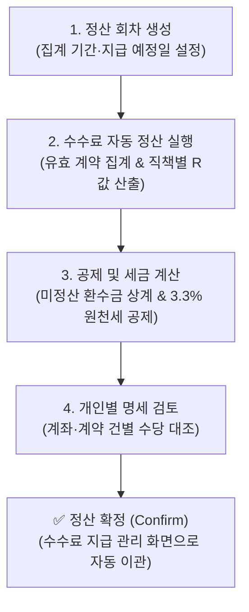

# 수수료 정산 관리

::: tip 📸 실제 화면 안내

*관리자 참고: 해당 화면의 실제 캡처 이미지를 `./images/settlement.png` 경로에 등록해 주세요.*
:::

> **수수료 정산 관리**는 프로젝트의 정산 회차(월별/주기별)를 생성하고, 대상 기간 동안 체결된 유효 계약 실적과 수수료 정책을 매칭하여 개인별 인센티브 산출, 미정산 환수금 자동 상계, 그리고 3.3% 사업소득 원천세를 공제한 세후 실지급액을 확정하는 정산 엔진 모듈입니다.

* **접근 경로**: 시스템 좌측 내비게이션 메뉴에서 **[PJT 관리 시스템] → [분양 대행 관리] → [수수료 정산 관리]**를 선택하여 접속합니다.

## 1. 개요 및 정산 엔진 특징

분양 대행사 및 영업 상담사에게 지급할 수수료를 주기별(예: 매월 말일 또는 격주 단위)로 집계하고 확정하는 종합 정산 엔진을 제공합니다.
* **직책별 차등 수수료(R값) 산출**: 상담사 인센티브 외에도 소속 팀장, 본부장의 오버라이딩 수당을 직급 체계에 맞춰 자동 계산합니다. (팀장 공석 시 상위 본부장 합산 배정 또는 대행사 귀속 지원)
* **미정산 환수금 자동 상계**: 과거 계약 해약 등으로 발생한 환수금(`Clawback`)이 존재할 경우, 이번 회차 수수료에서 자동으로 차감 상계하여 회사의 채권 손실을 방지합니다.
* **법정 3.3% 원천세 자동 계산**: 프리랜서 사업소득세 3% 및 지방소득세 0.3%를 국세청 표준 원단위 절사 방식으로 자동 계산하여 세후 실지급액을 도출합니다.

## 2. 주요 기능

* **정산 회차 생성 및 관리**: 대상 기간(시작일~종료일), 지급 예정일, 회차명을 설정하여 회차 단위 관리
* **수수료 자동 정산 실행**: 버튼 클릭 한 번으로 대상 기간 내 승인 계약을 전수 집계하고 직책별 수당 및 세액 일괄 계산
* **정산 내역 최종 확정**: 검토가 완료된 정산 내역을 '정산 확정' 상태로 변경하여 [수수료 지급 관리](/sales/payout) 단계로 이관
* **개인별 상세 정산 내역 조회**: 팝업창을 통해 상담사별 계약 건별 수수료 산출 근거 및 금융 계좌 정보 대조

## 3. 화면 구성 및 조작 가이드

### 1. 회차 선택 및 제어 툴바
* **정산 회차 선택 드롭다운**: 조회 및 정산 작업을 진행할 대상 회차 선택
* **회차 상태 배지**: 현재 회차의 진행 상태 표시 (`정산 작성 중`, `정산 확정`, `지급 완료`)
* **[신규 회차 생성] 버튼**: 새로운 정산 주기 회차를 개설하는 팝업 호출
* **[수수료 자동 정산 실행] 버튼**: 대상 기간 실적을 기반으로 정산 엔진을 일괄 가동
* **[정산 확정] 버튼**: 작성이 완료된 정산 내역을 최종 승인 및 확정 처리

### 2. 정산 총괄 요약 카드
선택된 회차의 전체 재무 집계 지표를 실시간 요약 카드로 제공합니다.
* **정산 계약 건수**: 해당 회차에 포함되어 정산된 총 계약 건수
* **총 지급액 (세전)**: 직책별 인센티브 합계 + 기본급/일비 - 환수 공제액
* **원천징수 세액 (3.3%)**: 사업소득세(3%) + 지방소득세(0.3%) 합계
* **총 실지급액 (세후)**: 세전 총액에서 원천세를 차감한 실제 은행 이체 대상 총액

### 3. 개인별 정산 및 세금 공제 명세 테이블

| 항목 | 상세 설명 및 실무 기준 |
|:---|:---|
| **소속 팀 / 직책 / 성명** | 영업 인력의 기본 인적 정보 (성명 클릭 시 상세 모달 팝업) |
| **건수** | 해당 인력에게 배정된 정산 대상 계약 건수 |
| **인센티브** | 건당 수수료 정책에 의해 계산된 성과 수수료 합계 |
| **기본급 / 일비** | 기본 지급액 또는 일비 보조금 (해당 시 표출) |
| **공제 / 환수** | 과거 해약 등으로 발생한 미정산 환수금 상계 차감액 |
| **총액 (세전)** | 세전 지급 총액 (`인센티브 + 기본급 - 환수액`) |
| **원천세 (3.3%)** | 사업소득세(3%) + 지방소득세(0.3%) 합계 (10원 단위 절사) |
| **실지급액 (세후)** | 금융기관을 통해 실제 이체될 최종 세후 지급 금액 |
| **상태** | 지급 진행 상태 (`지급대기`, `지급승인`, `지급완료`, `지급보류`) |
| **상세** | `[보기]` 버튼 클릭 시 계약 건별 산출 근거 팝업 호출 |

### 4. 정산 회차 생성 팝업
새로운 정산 주기를 시작하기 위한 기본 설정 팝업창입니다:
* **정산 회차명** (필수): 예: "2026년 10월 1회차 분양 수수료 정산"
* **정산 대상 시작일 / 종료일** (필수): 실적을 집계할 계약 체결일 범위 지정
* **지급 예정일** (선택): 금융 이체 예정 일자 지정
* **정산 상태** (필수): 신규 생성 시 기본값 `정산 작성 중`

### 5. 개인별 수수료 정산 상세 팝업
특정 영업 인력의 행에서 **`[보기]`** 버튼을 클릭하면 나타나는 상세 증빙 창입니다:
* **기본 인적사항 및 계좌 정보**: 성명, 직책, 소속 팀, 입금 은행명, 계좌번호, 예금주
* **금액 산출 구성**: 인센티브 합계, 기본급, 공제/환수액 상세
* **원천세 계산표**: 세전총액, 사업소득세, 지방소득세, 원천징수 합계, 세후 실지급액
* **정산 대상 계약 상세 목록**: 계약 일련번호, 계약자명, 수당 구분(상담사/팀장/본부장), 건당 수수료 금액

## 4. 신입사원을 위한 실무 가이드

* **💡 정산 확정 전 데이터 재검증 요령**:
  * `[수수료 자동 정산 실행]` 버튼을 누른 후, 개인별 명세 테이블에서 **총액(세전)**과 **실지급액(세후)**을 대조하십시오.
  * 특히 환수 대상자(계약 해약자)의 경우 과거 해약 건이 정상적으로 차감 반영되었는지 확인한 뒤 **`[정산 확정]`** 버튼을 눌러야 합니다.
* **💡 정산 확정 후 수정이 필요한 경우**:
  * 이미 정산 확정된 회차는 데이터 무결성을 위해 임의 수정이 잠깁니다. 수정이 불가피한 경우 최고 관리자 권한을 통해 상태를 `정산 작성 중`으로 되돌린 후 재정산을 실행해야 합니다.
