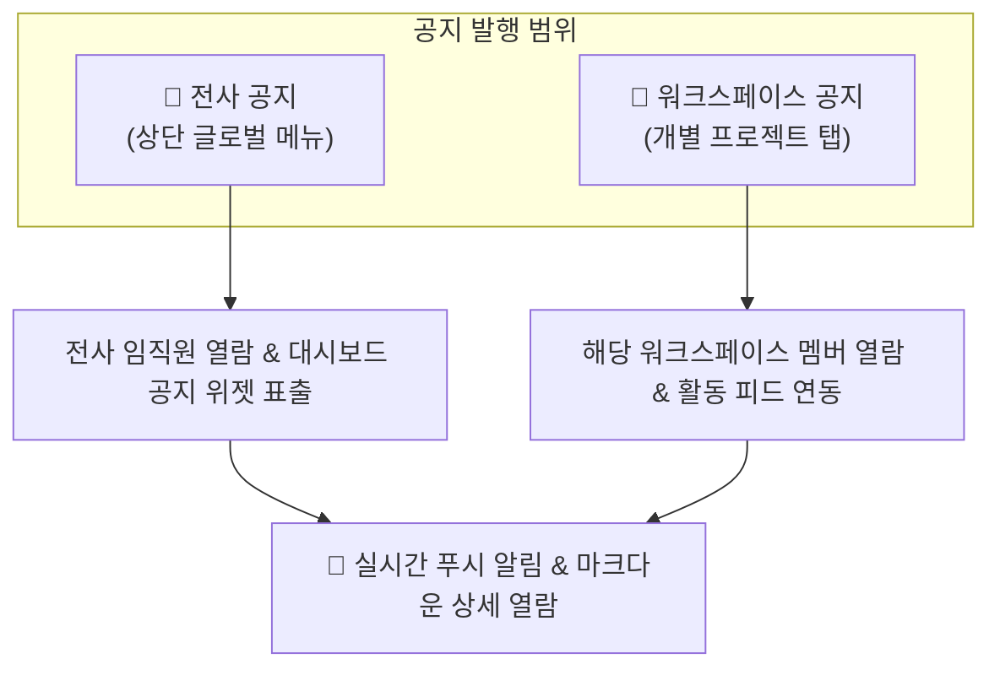

# 공지 (News)

> **공지** 모듈은 전사 임직원 및 프로젝트 워크스페이스 참여자들에게 주요 정책 변경, 프로젝트 마일스톤 달성, 긴급 알림 및 업무 지침을 신속하게 전파하고 아카이빙하는 공식 소통 채널입니다.

::: tip 📸 실제 화면 안내

*관리자 참고: 해당 화면의 실제 캡처 이미지를 `./images/news.png` 경로에 등록해 주세요.*
:::

## 1. 개요 및 2대 운영 범위

공지 시스템은 정보의 전달 대상과 목적에 따라 두 가지 범위로 운영됩니다.

* **전사 공지**: 상단 메인 메뉴의 **[공지]**를 통해 접근하며, 회사 전체 구성원에게 전달되는 경영 방침, 사내 규정 개정, 전사 행사 소식을 확인합니다.
* **워크스페이스 공지**: 특정 워크스페이스 내의 **[공지]** 탭으로 접근하며, 해당 프로젝트나 부서 참여자들에게만 국한된 세부 협업 사항과 현장 뉴스를 모아서 제공합니다.

## 2. 주요 기능 안내

### 📢 공지 목록 및 최근 소식 조회
* **시간순 정렬 피드**: 최신 등록된 공지가 상단에 카드 형태로 배열되며, 작성자, 등록일시, 댓글 수가 함께 표출됩니다.
* **대시보드 위젯 연동**: [대시보드의 공지 목록 위젯](/intro/dashboard)에 실시간으로 연동되어, 로그인 즉시 메인 화면에서 중요한 소식을 놓치지 않고 확인할 수 있습니다.

### 📝 새 공지 작성 및 마크다운 에디터
공지 등록 권한이 있는 관리자 또는 작성자는 우측 상단의 **[새 공지]** 버튼을 통해 소식을 게시합니다.

* **제목 및 요약 (Summary)**: 공지 목록과 [업무실행내역](/work-manage/activity) 피드에 노출될 한 줄 요약문을 작성합니다.
* **본문 마크다운(Markdown) 서식**: 굵은 글씨, 표, 목록, 인용구, 코드 블록 등 다양한 서식을 지원하여 가독성 높은 공문 형태로 작성할 수 있습니다.
* **다중 파일 및 이미지 첨부**: 공문서(PDF), 설계 도면, 현장 사진, 서식 양식 등 필요한 첨부자료를 다중 업로드할 수 있습니다.

### 💬 댓글 소통 및 의견 교환
* 공지 상세 화면 하단에서 구성원들이 질문을 남기거나 확인 댓글을 작성할 수 있어 양방향 소통이 가능합니다.
* 댓글이 등록되면 공지 작성자에게 실시간 알림이 발송됩니다.

### ⭐ 지켜보기 (Watch) 및 알림
* 특정 공지에 '지켜보기'를 활성화하면, 공지 본문이 수정되거나 새로운 댓글이 달릴 때 실시간 알림을 받아볼 수 있습니다.

## 3. 실무 활용 팁

* **요약문(Summary) 작성 권장**: 요약문을 명확하게 작성하면 대시보드 위젯이나 활동 로그 피드에서 클릭하지 않고도 공지의 핵심 골자를 즉시 파악할 수 있어 전달력이 크게 향상됩니다.
* **현장 긴급 공지 활용**: 공사 현장의 기상 악화, 안전 점검 일정 등 긴급 공지는 프로젝트 공지 탭에 등록하여 현장 실무자와 본사 담당자가 동시에 동일한 정보를 인지할 수 있도록 운영합니다.
* **이전 공지 아카이빙**: 지난 공지는 삭제하지 않고 보관하여, 신규 투입된 프로젝트 멤버가 이전의 주요 결정 사항과 히스토리를 언제든지 찾아볼 수 있는 지식 베이스로 활용합니다.
