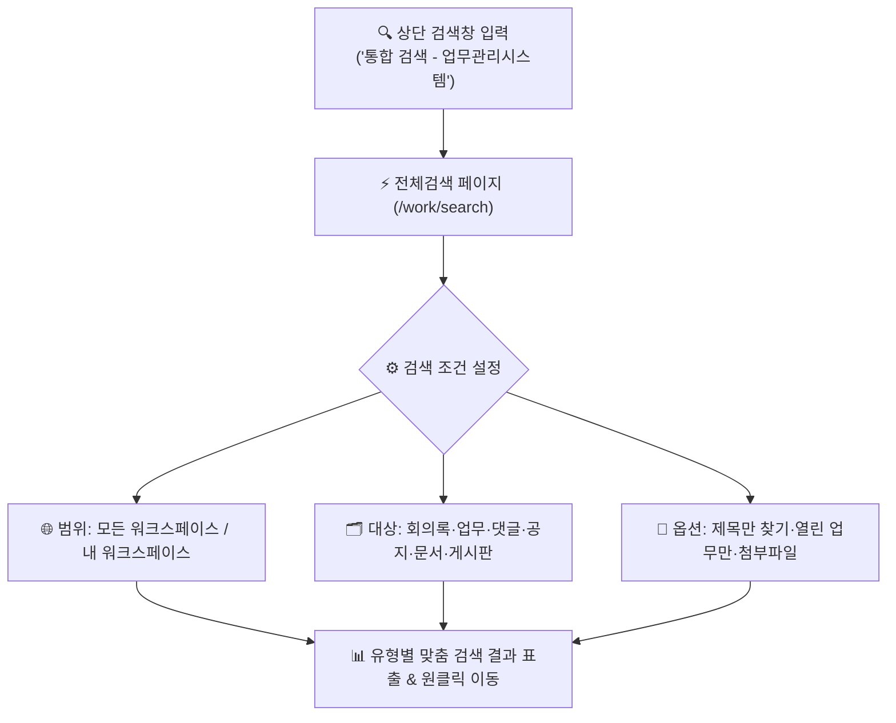

# 통합 검색 (Search)

> **통합 검색**은 업무관리시스템의 모든 워크스페이스와 핵심 모듈(회의록, 업무, 댓글, 공지, 문서, 게시판)에 분산된 방대한 데이터를 키워드 하나로 신속하게 찾아내는 **전사 크로스 도메인 검색 엔진**입니다.

::: tip 📸 실제 화면 안내

*관리자 참고: 해당 화면의 실제 캡처 이미지를 `./images/search.png` 경로에 등록해 주세요.*
:::

## 1. 개요 및 검색 시작하기

협업이 누적될수록 과거의 의사결정 기록, 회의록, 업무 티켓, 첨부 문서를 찾는 데 많은 시간이 소요됩니다. IBS의 통합 검색 시스템은 개별 목록의 단순 필터를 넘어 시스템 전반의 텍스트와 첨부파일 정보를 한곳에서 탐색할 수 있도록 지원합니다.

### 🚀 검색 진입 방법
1. **상단 글로벌 검색창**: 업무관리시스템 어디에서나 화면 상단 헤더의 **`[통합 검색 - 업무관리시스템]`** 입력창에 검색어를 입력하고 `Enter` 키 또는 <i class="mdi mdi-magnify"></i> 돋보기 아이콘을 클릭합니다.
2. **검색 전용 페이지 진입**: 즉시 통합 검색 화면(`/work/search`)으로 전환되며, 입력한 키워드에 대한 검색 결과가 도메인별로 일목요연하게 표시됩니다.
3. **검색어 입력 기준**: 보다 정확하고 신속한 색인을 위해 검색어는 **최소 2자 이상** 입력해야 합니다.

---

## 2. 검색 범위 및 대상 설정

통합 검색 화면에서는 검색 범위를 좁히거나 특정 유형의 데이터만 골라낼 수 있는 직관적인 필터 컨트롤을 제공합니다.

### 🌐 검색 범위 (워크스페이스 선택)
* **모든 워크스페이스**: 사용자가 열람 권한을 가진 전체 워크스페이스를 대상으로 검색을 수행합니다. (타 사업지나 타 부서의 과거 사례/자료를 참조할 때 유용)
* **내 워크스페이스**: 현재 내가 멤버로 참여 중인 워크스페이스의 데이터만 한정하여 검색합니다.

### 🗂️ 6대 검색 대상 선택
검색 대상 체크박스를 통해 필요한 데이터 종류만 선택할 수 있습니다. 기본적으로 모든 대상이 활성화되어 있습니다.

| 대상 구분 | 검색 대상 필드 및 내용 | 주요 활용 상황 |
|:---|:---|:---|
| **회의록** | 회의 명칭, 안건(Agenda), 의결 결정 사항, 상세 내용 | 과거 회의 결정 배경 및 합의 사항 추적 |
| **업무** | 업무 제목, 상세 설명(마크다운), 하위업무 내역 | 진행 중이거나 완료된 실무 과업 및 이슈 조회 |
| **댓글** | 업무에 팀원들이 남긴 의견, 피드백, 변경 메모 | 업무 진행 과정에서 오고 간 구체적 대화 내용 추적 |
| **공지** | 전사 또는 워크스페이스 공지 제목, 요약, 본문 | 주요 공지사항 및 운영 지침 검색 |
| **문서** | 등록된 일반 문서 및 소송 관련 문서 제목, 문서 설명 | 계약서, 기안 양식, 제출용 증빙 문서 확인 |
| **게시판** | 자유게시판/정보공유 게시글 제목 및 본문 | 사내 노하우 공유 및 질의응답 게시물 검색 |

---

## 3. 상세 검색 옵션 활용

검색 폼의 **`[제목에서만 찾기]`** 체크박스와 **`[옵션]`** 토글을 열면 불필요한 검색 결과를 걸러내고 원하는 정보에 정확하게 도달할 수 있는 세부 제어 기능이 제공됩니다.

### 🎯 제목에서만 찾기
* **`제목에서만 찾기`**를 체크하면 본문이나 설명 글을 제외하고, **오직 제목/명칭에 검색어가 포함된 항목만** 빠르게 추출합니다.
* 검색 결과가 너무 많아 핵심 문서나 업무 제목만 명확히 찾고 싶을 때 매우 유용합니다.

### 📂 옵션 (접기/펼치기)
`옵션` 우측의 화살표를 클릭하여 확장하면 다음과 같은 추가 필터를 지정할 수 있습니다:

1. **열린 업무만**:
   * 이미 완료(Closed)된 업무를 제외하고, **현재 진행 중이거나 처리가 필요한 열린(Open) 업무만** 결과로 표시합니다.
2. **첨부파일 검색 모드**:
   * **첨부파일은 검색하지 않음 (기본)**: 텍스트 본문과 제목만 검색하여 가장 빠른 속도로 결과를 조회합니다.
   * **첨부파일명과 설명 검색**: 업로드된 첨부파일의 파일명뿐만 아니라 파일 등록 시 함께 작성된 설명 문구까지 검색 대상에 포함합니다.
   * **첨부파일명만 검색**: 등록된 첨부파일 중 파일 이름에 검색어가 포함된 항목을 검색합니다.

---

## 4. 검색 결과 확인 및 상세 이동

검색이 완료되면 상단에 **총 일치 건수 배지**가 표시되며, 그 아래로 유형별(회의록, 업무, 댓글, 공지, 문서, 게시판)로 그룹화된 결과 카드가 정렬됩니다.

* **원클릭 상세 이동**: 검색된 각 항목의 제목이나 워크스페이스 링크를 클릭하면 해당 상세 페이지(업무 상세, 회의록 상세 등)로 즉시 이동합니다.
* **본문 매칭 스니펫**: 검색어가 포함된 본문 문맥이 카드 내에 요약 표시되어, 상세 화면에 들어가지 않고도 원하는 내용이 맞는지 직관적으로 판별할 수 있습니다.
* **상태 및 메타정보 시각화**:
  * **업무**: 업무 번호(#ID), 트래커 배지, 열림/닫힘 상태, 담당자 및 등록일
  * **회의록**: 회의 상태(`준비`, `종료`, `취소`), 일시 및 장소
  * **첨부파일 아이콘**: 파일이 첨부된 경우 클립 아이콘과 파일명이 함께 노출되어 증빙 유무를 즉시 파악 가능

::: tip 💡 실무 검색 팁
* **단축키 및 빠른 재검색**: 검색창에서 단어를 입력한 뒤 마우스로 검색 버튼을 누를 필요 없이 키보드의 `Enter` 키를 누르면 즉시 검색이 실행됩니다.
* **필터 조건 유지**: 검색 대상이나 옵션을 변경한 후 `[검색]` 버튼을 다시 누르면 현재 입력된 검색어와 새로운 필터 조건이 결합된 결과를 즉시 갱신합니다.
:::

---

## 5. 데이터 보안 및 권한 격리 정책

통합 검색은 시스템의 엄격한 역할 기반 보안 체계(Role-Based Access Control)와 완벽히 연동됩니다.

> [!IMPORTANT] 비공개 데이터의 보안 보호
> * **비공개 워크스페이스**: 사용자가 멤버로 등록되지 않은 비공개 워크스페이스의 데이터는 **검색 결과에 일체 노출되지 않습니다.**
> * **비공개 업무 및 회의록**: 비공개로 등록된 업무나 민감한 회의록은 **작성자, 담당자 또는 해당 권한을 가진 관리자에게만** 검색 결과로 표출됩니다.
> * 본사 관리(`ibs_hq_manage`)의 보안 격리 대상 문서는 권한을 인가받은 임직원에게만 안전하게 제한 검색됩니다.
