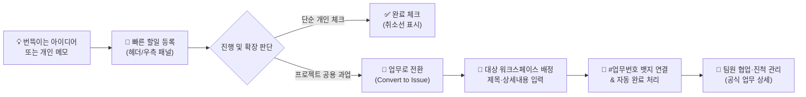

# 나의 할일 관리 (To-Do & Issue 전환)

> **나의 할일 관리**는 하루 동안 처리해야 할 개인 작업과 빠른 메모를 기록하고, 필요할 때 단 한 번의 클릭으로 워크스페이스 공식 과업인 **업무(Issue)**로 승격시킬 수 있는 **개인 업무 생산성 도구**입니다.

::: tip 📸 실제 화면 안내

*관리자 참고: 해당 화면의 실제 캡처 이미지를 `./images/todo.png` 경로에 등록해 주세요.*
:::

## 1. 개요 및 워크플로우

업무를 하다 보면 "오후 2시 감리단 통화", "자재 견적서 확인"처럼 개인적으로 빠르게 메모해두고 체크해야 할 작은 일들이 수시로 발생합니다. 이를 종이나 별도 메모장에 적어두면 잊어버리거나 다른 팀원과 진행 상황을 공유하기 어렵습니다.

IBS의 **나의 할일 관리**는 개인 메모로 가볍게 시작한 할 일을 공식 프로젝트 업무로 자연스럽게 발전시킬 수 있는 최적의 워크플로우를 제공합니다.

::: tip 💡 신입사원 실무 활용 팁
* **나만의 비공개 메모**: 내가 등록한 할 일은 기본적으로 **나에게만 보이는 비공개 데이터**이므로 부담 없이 자유롭게 메모하세요.
* **업무 승격 타이밍**: 혼자 처리할 수 없는 과업이거나, 다른 동료에게 인계해야 하거나, 회의 및 보고가 필요한 사안으로 발전하면 즉시 **`업무로 전환`** 버튼을 눌러 공식 업무로 등록하세요.
:::

---

## 2. 할일 관리 진입 방법 (3가지 경로)

IBS에서는 작업 중인 화면을 벗어나지 않고도 언제든지 할 일을 확인하고 추가할 수 있도록 3가지 진입 경로를 제공합니다.

| 진입 경로 | 위치 및 UI 표출 | 주요 특징 및 권장 사용 상황 |
|:---|:---|:---|
| **1. 상단 헤더 알림 바** | 상단 중앙 **`[<i class="mdi mdi-calendar-check-outline"></i> 할일 N]`** 칩 | 남은 미완료 할 일 건수를 상시 모니터링하며, 클릭 시 전용 팝업 모달 호출 |
| **2. 사용자 프로필 메뉴** | 우측 상단 아바타 클릭 ➔ **`[할일 관리 N]`** 메뉴 | 계정 설정과 함께 내 할 일 목록을 빠르게 열람할 때 사용 |
| **3. 우측 사이드 패널** | 화면 우측 끝 사이드바 열기 ➔ **`오늘/할일`** 탭 | 결재 대기 문서 및 담당 업무와 함께 한 화면에서 인라인으로 할 일을 관리할 때 매우 유용 |

---

## 3. 할 일 등록 및 기본 관리

### 1) 새로운 할 일 등록
* **입력창**: 할 일 목록 상단의 **`[여기에 할 일을 메모 하세요.]`** (또는 우측 사이드 패널의 **`[새로운 할 일 입력 후 추가...]`**) 입력창을 클릭합니다.
* **등록**: 할 일 내용을 작성한 뒤 키보드의 `Enter` 키를 누르거나 우측의 `[추가]` 버튼을 클릭하면 목록 최상단에 즉시 등록됩니다.

### 2) 완료 체크 및 취소선
* 할 일 좌측의 **동그란 체크박스**를 클릭하면 완료 처리되며, 제목에 취소선이 그어지고 텍스트가 옅은 색으로 변경됩니다.
* 다시 체크박스를 누르면 미완료 상태로 즉시 복구됩니다.
* 상단 헤더의 남은 할 일 뱃지 숫자가 실시간으로 차감/증가합니다.

### 3) 내용 수정 (더블클릭)
* 팝업 모달창에서는 수정하고 싶은 할 일 제목을 **마우스로 더블클릭**하면 인라인 편집 모드로 전환됩니다.
* 내용을 수정한 후 `Enter` 키를 누르거나 입력창 바깥을 클릭하면 저장이 완료됩니다. 수정을 취소하려면 `Esc` 키를 누릅니다.

### 4) 할 일 삭제
* 목록 항목에 마우스를 올렸을 때 우측 끝에 나타나는 **`[✕]` 삭제 아이콘**을 클릭하면 해당 할 일이 목록에서 깔끔하게 제거됩니다.

### 5) 보기 필터 및 일괄 정리
팝업 모달창 하단 툴바에서는 목록을 효율적으로 정리할 수 있는 컨트롤을 제공합니다:
* **All (전체)**: 완료 여부와 관계없이 등록된 모든 할 일을 표시합니다.
* **Active (진행 중)**: 아직 완료되지 않은 진행 중인 할 일만 모아서 봅니다.
* **Completed (완료됨)**: 완료 처리된 항목만 필터링하여 확인합니다.
* **Clear completed**: 완료된 모든 할 일을 한 번에 목록에서 삭제 정리합니다.

---

## 4. 핵심 기능: 개인 할 일을 공식 업무(Issue)로 전환

단순한 개인 메모로 시작했던 일도 프로젝트가 구체화되면 팀원들과 공유하고 진척을 관리해야 하는 공식 과업이 됩니다. IBS는 이를 위해 **업무 전환(Convert to Issue)** 기능을 제공합니다.

### 🚀 업무 전환 단계별 가이드

1. **전환 버튼 클릭**:
   * 할 일 항목 우측의 **`[업무로 전환]`** 아이콘(<i class="mdi mdi-transfer-right text-primary"></i>)을 클릭합니다.
2. **업무 전환 팝업 작성**:
   * **대상 워크스페이스** (*필수): 업무를 등록할 프로젝트 워크스페이스를 드롭다운에서 선택합니다.
   * **업무 제목** (*필수): 기존 할 일 제목이 자동으로 채워지며, 필요에 따라 더 구체적으로 보완합니다.
   * **설명** (선택): 업무의 배경, 진행 요청 사항, 참고 링크 등 상세 내용을 입력합니다.
3. **`[업무로 전환]` 버튼 클릭**:
   * 입력 완료 후 하단의 파란색 **`[업무로 전환]`** 버튼을 누릅니다.

::: tip 📸 업무 전환 후 자동 연결 효과
* **공식 업무 자동 발급**: 선택한 워크스페이스에 즉시 고유한 업무 번호(예: `#104`)를 가진 신규 공식 업무가 생성됩니다.
* **할 일 자동 완료 처리**: 기존 할 일 항목은 완료 상태로 자동 변경되며, 제목 옆에 파란색 **`[#104]` 뱃지**가 부착됩니다.
* **1초 만에 업무로 바로가기**: 화면 상단에 녹색 완료 안내 배너와 함께 **`[업무 바로가기]`** 버튼이 나타나며, 클릭 즉시 생성된 공식 업무의 상세 페이지로 이동합니다.
* **영구적인 연결 링크**: 추후 할 일 목록에서 **`[#104]` 뱃지**를 클릭하기만 해도 언제든지 해당 공식 업무 화면으로 즉시 연결됩니다.
:::

---

## 5. 데이터 권한 및 공개 범위 안내

> [!IMPORTANT] 할 일과 공식 업무의 데이터 공개 범위 차이
> * **할 일(To-Do) 상태일 때**:
>   * 해당 할 일을 작성한 **본인에게만** 표출되며, 관리자나 다른 동료에게 일체 노출되지 않는 철저한 개인 데이터입니다.
> * **공식 업무(Issue)로 전환된 후**:
>   * 지정한 워크스페이스의 구성원 모두가 조회하고 협업할 수 있는 **공식 자산**으로 승격됩니다.
>   * 워크스페이스의 업무 목록, 로드맵, 업무실행내역(Activity)에 공식 기록으로 등록되어 진척률 및 담당자 관리가 시작됩니다.
