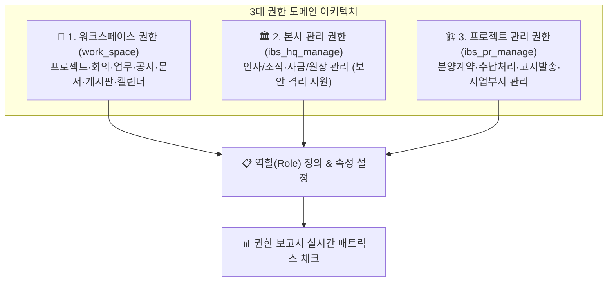

# 역할 및 권한 관리 (Roles & Permissions)

::: tip 📸 실제 화면 안내

*관리자 참고: 해당 화면의 실제 캡처 이미지를 `./images/roll-perm.png` 경로에 등록해 주세요.*
:::

> **역할 및 권한 관리** 페이지는 시스템 관리자가 워크스페이스 및 본사/사업지 관리에서 사용하는 **역할(Role)**을 정의하고, 각 역할별로 수행 가능한 세부 **기능 권한(Permission)**을 3대 비즈니스 도메인 매트릭스를 통해 정밀 제어하는 전사 보안 센터입니다.

## 1. 개요 및 3대 권한 도메인 아키텍처

IBS 시스템은 비즈니스 영역과 보안 수준에 따라 역할과 권한을 **3대 도메인 범주**로 엄격히 구분하여 관리합니다.

* **접근 경로**: 시스템 좌측 내비게이션 메뉴에서 **[설정 관리] → [역할 및 권한]**을 선택하여 접속합니다. (관리자 권한 필요)

## 2. 역할 (Roles) 탭

시스템에서 구성원에게 부여할 역할의 종류를 정의하고 기본 속성 및 보안 격리 여부를 설정합니다.

### 📋 역할 생성 및 주요 속성 설정
역할 추가/수정 팝업에서 다음 7대 핵심 속성을 정의합니다:

* **이름**: 역할의 직무 명칭 (예: `본사 관리자`, `현장 PM`, `분양 담당자`, `협력업체`, `단순 열람자` 등)
* **권한 구분 (카테고리)**:
  * **`워크스페이스`**: 일반 협업 모듈(업무, 회의, 문서 등) 전용 역할
  * **`본사 관리`**: 본사 경영지원, 재경, 인사 직무 전용 역할
  * **`프로젝트 관리`**: 부동산 개발 시행 사업지(분양, 계약, 수납 등) 직무 전용 역할
* **보안 격리 역할 여부**:
  * 최고 관리자(슈퍼유저)만 다룰 수 있는 민감한 역할로 지정합니다. 일반 관리자 화면에서도 해당 역할의 정보와 권한이 완벽히 격리되어 임의 조작을 방어합니다.
* **부동산 개발 프로젝트 기본 적용**:
  * 체크 시 향후 새로 개설되는 모든 부동산 개발 프로젝트에 기본 멤버 역할로 자동 포함됩니다.
* **업무 할당 가능 여부**:
  * 이 역할을 가진 사용자를 업무(Issue)의 '담당자'로 지정할 수 있는지 통제합니다. 외부 협력사나 단순 열람 목적의 역할인 경우 체크를 해제하여 담당자로 오배정되는 것을 방지합니다.
* **업무 보기 범위**:
  * `모든 업무` / `비공개 업무 제외` / `직접 생성 또는 담당한 업무만` / `없음` 중 선택
* **사용자 목록 보기 범위**:
  * `모든 활성 사용자` / `자신이 속한 프로젝트 구성원만` / `없음` 중 선택

## 3. 권한 보고서 (Permission Report) 탭

정의된 각 역할에 대해 기능별 세부 권한을 부여하는 **3단 아코디언 매트릭스** 화면입니다.

### 📊 3대 도메인 아코디언 구조
1. **워크스페이스 권한군**:
   * 프로젝트(생성/수정/삭제/모듈제어), 회의록(작성/확정), 업무(생성/수정/댓글), 공지사항, 문서(보안등급별 열람/등록), 게시판, 캘린더
2. **본사 관리 권한군**:
   * 인사/조직 관리(부서, 직급, 근태, 평가), 본사 자금 및 회계원장
3. **프로젝트 관리 권한군**:
   * 계약 관리(동호수 매핑, 계약자, 양도양수), 수납 및 청구(대금 수납, 분양가, 연체이자), 고객 고지, 사업부지(토지 매입 관리)

### ⚡ 실시간 자동 저장 (Auto-save)
* 각 역할과 권한이 교차하는 지점의 **체크박스를 클릭하는 즉시 시스템에 실시간 자동 반영**됩니다.
* 별도의 '저장' 버튼을 누를 필요가 없으며, 변경 사항이 즉각 적용됩니다.
* 권한 수정은 전사 총괄 관리자 이상의 최고 권한을 가진 계정만 수행할 수 있습니다.

## 4. 권한 설계 모범 사례 (Best Practices)

* **최소 권한의 원칙 (Security First)**:
  * 외부 협력업체나 지원 부서에는 '비공개 업무 제외' 및 '직접 생성/담당한 업무만' 볼 수 있도록 업무 보기 범위를 설정하여 회사의 주요 기밀 정보를 안전하게 보호하십시오.
* **보안 격리 기능 적극 활용**:
  * 인사 평가나 임원 급여, 감사 부서와 관련된 역할은 반드시 **'보안 격리 역할'** 속성을 켜두어, 일반 워크스페이스 관리자가 임의로 권한을 조정하지 못하도록 원천 차단하십시오.
* **기본 시스템 역할 이해**:
  * 시스템에 내장된 기본 역할(익명 사용자, 일반 비회원 등)은 워크스페이스 멤버 배정에서 제외되도록 안전하게 보호되므로 임의로 수정하지 않는 것을 권장합니다.
