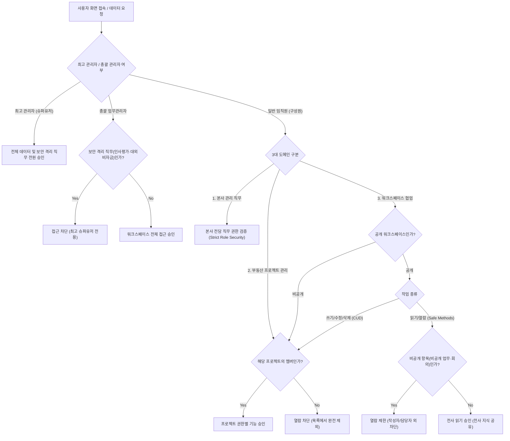

# 프로젝트 권한 & 도메인별 보안 정책 (Security Policy)

::: tip 📸 정책 아키텍처 안내

*관리자 참고: 해당 화면 또는 인포그래픽 이미지를 `./images/security-policy.png` 경로에 등록해 주세요.*
:::

> 본 문서는 **IBS 건설 관리 시스템**의 워크스페이스 협업 도메인, 본사 경영 도메인, 그리고 부동산 개발 프로젝트 도메인에 적용된 **역할 기반 접근 제어(RBAC) 및 행 단위 데이터 보안(Row-Level Security)** 원칙과 실무 운영 가이드를 안내합니다.

## 💡 3분 요약: IBS 보안 및 공개 기본 원칙

처음 시스템을 접하는 임직원과 관리자를 위한 핵심 보안 요약입니다:

1. **공개 워크스페이스는 전사 지식 자산입니다 (열람 개방)**:
   * '공개'로 설정된 워크스페이스의 일반 공지, 업무, 회의록은 **해당 팀 멤버가 아니더라도 전사 임직원이 자유롭게 열람**할 수 있습니다. 지식 사일로를 방지하고 부서 간 협업을 촉진하기 위함입니다.
   * 단, 글이나 업무를 새로 작성하거나 수정·삭제하는 것은 **반드시 해당 워크스페이스에 참여 중인 멤버만** 가능합니다.
2. **비공개 항목은 철저히 보호됩니다 (완전 차단)**:
   * 워크스페이스가 공개 상태이더라도 **'비공개'**로 등록된 업무나 회의록은 **작성자 본인과 지정된 담당자 외에는 누구도 볼 수 없습니다**.
3. **본사 관리와 프로젝트 재무/계약은 엄격히 분리됩니다 (보안 격리)**:
   * 인사 평가, 임원 급여, 법인 자금 및 프로젝트 분양 계약/수납 데이터는 워크스페이스의 공개 여부와 상관없이 **해당 권한(역할)을 부여받은 전담 인원에게만 접근이 허용**됩니다.

## 1. 전사 보안 접근 제어 흐름도

사용자가 화면에서 데이터를 조회하거나 API를 호출할 때 시스템이 검증하는 논리적 절차는 다음과 같습니다.

## 2. 3대 도메인별 공개 및 접근 권한 상세 정책

### 🌐 2.1 워크스페이스 협업 — 전사 읽기 개방 + 비공개 보호
전사 소통과 업무 노하우 자산화를 위해 **공개 워크스페이스의 일반 리소스에 대해서는 비멤버 직원에게도 기본 읽기(Read-Only) 권한을 전사적으로 개방**합니다.

| 모듈 / 리소스 | 공개 워크스페이스 정책 | 비공개 워크스페이스 정책 | 비공개 보호 장치 |
|:---|:---|:---|:---|
| **공지사항** | 전 임직원 읽기 허용 / 등록·수정은 멤버 전용 | 멤버 전용 | - |
| **업무 (이슈)** | 전 임직원 읽기 허용 / 등록·수정은 멤버 전용 | 멤버 전용 | 비공개 업무/댓글은 작성자 및 담당자 외 **100% 차단** |
| **회의록** | 전 임직원 읽기 허용 / 등록·수정은 멤버 전용 | 멤버 전용 | 비공개 회의록은 **100% 차단** |
| **게시판** | 전 임직원 읽기 허용 / 등록·수정은 멤버 전용 | 멤버 전용 | 비밀글 및 비공개 카테고리 차단 |
| **캘린더** | 전 임직원 일정 조회 허용 | 멤버 전용 | 비공개 업무 및 비공개 회의 일정 자동 제외 |
| **업무실행내역** | 전 임직원 활동 이력 조회 허용 | 멤버 전용 | 비공개 업무/댓글 연관 이력 자동 마스킹 및 제외 |

### 🏛️ 2.2 본사 관리 — 본사 직무 권한 & 보안 격리
본사 인사, 조직, 회계, 자금, 감사 직무는 워크스페이스 공개 여부와 무관하게 **해당 직무 역할(Role)이 사전에 부여된 인원에게만 접근을 허용**합니다.
* **보안 격리 역할**:
  * 인사 평가, 임원 급여, 대외비 자금 계좌 등 고도의 보안이 요구되는 직무는 보안 격리 속성이 적용되어, 일반 업무관리자에게도 노출되지 않으며 **최고 슈퍼유저만 열람 및 통제**할 수 있습니다.

### 🏗️ 2.3 프로젝트 관리 — 엄격한 멤버십 통제 (Strict Member)
부동산 개발 프로젝트가 공개 상태라 할지라도 **재무, 계약, 수납, 분양 유니트 및 부지 데이터는 오직 해당 프로젝트에 정식 등록된 멤버에게만 접근을 허용**합니다.

| 도메인 / 메뉴 | 관련 모듈 및 업무 내용 | 공개 프로젝트 접근 정책 | 비공개 프로젝트 접근 정책 |
|:---|:---|:---|:---|
| **`프로젝트 설정`** | 프로젝트 기본정보, 예산(수입/지출), 동호수 유니트, 타입, 부지(토지 매입 관리) | **멤버 전용** | **멤버 전용** |
| **`계약 정보 관리`** | 차수, 분양 계약, 계약자 정보, 권리의무 양도양수, 해약 관리 | **멤버 전용** | **멤버 전용** |
| **`대금 수납 관리`** | 차수별 분양가, 납부회차, 수납 처리, 연체이율 설정 | **멤버 전용** | **멤버 전용** |
| **`회계 자금 관리`** | 사업비 전용 통장, 계정과목, 자금 집행 캐시플로우 및 출금 거래 | **멤버 전용** | **멤버 전용** |
| **`문서 소송 관리`** | 소송 사건 관리, 법원 판결문 및 4단계 보안등급 문서 | **멤버 전용** | **멤버 전용** |

::: info 💡 문서 모듈의 4단계 보안 등급 연동 체계  
문서 모듈은 4단계 보안 등급 체계(1등급 비공개, 2등급 팀공개, 3등급 프로젝트공개, 4등급 전사공개)를 엄격히 준수합니다. 소송 기록물 및 1~2등급 문서는 프로젝트 멤버십 외에도 소속 부서 가드를 추가로 적용하여 이중으로 격리 보호됩니다.  
:::

## 3. 시스템 보안 구현 메커니즘 (참고 가이드)

### 3.1 백엔드 데이터베이스 행 단위 보안 (Row-Level Security)
* **목록 조회 시 원천 필터링**:
  * 사용자가 속하지 않은 프로젝트의 재무/계약 데이터는 API 요청 시 데이터베이스 쿼리 레벨에서 사전에 걸러지므로, 비인가 사용자의 URL 파라미터 변조(IDOR 공격)를 원천 차단합니다.
  * 공개 워크스페이스의 업무 목록을 조회할 때도, 다른 사람이 작성한 '비공개' 업무는 쿼리 단계에서 완전히 제외되어 데이터 유출을 원천 방어합니다.
* **권한 검증 엔진**:
  * 기능 실행 시(등록, 수정, 삭제) 사용자의 역할(Role)에 해당 기능 권한 코드가 부여되어 있는지 실시간으로 대조 검증합니다.

### 3.2 프론트엔드 사용자 경험 (UX) 최적화
* **매끄러운 전사 읽기(Read-Only) 지원**:
  * 사용자가 자신이 멤버가 아닌 공개 워크스페이스를 둘러볼 때, 불필요한 '권한 없음' 경고 팝업 없이 읽기 전용 화면으로 쾌적하게 내용을 열람할 수 있도록 지원합니다.
* **권한에 따른 동적 버튼 제어**:
  * 수정이나 삭제, 신규 등록 등 권한이 없는 작업 버튼은 화면에서 자동으로 숨겨지거나 비활성화되어 사용자의 혼란을 방지합니다.