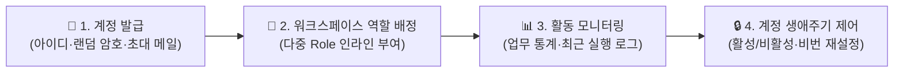

# 사용자 관리 (User Management)

::: tip 📸 실제 화면 안내

*관리자 참고: 해당 화면의 실제 캡처 이미지를 `./images/user.png` 경로에 등록해 주세요.*
:::

> **사용자 관리** 페이지는 시스템 관리자가 전사 임직원의 계정을 발급하고, 활성화 상태 및 관리자 권한을 제어하며, 각 사용자의 업무 부하량·참여 워크스페이스·최근 활동 로그를 다각도로 모니터링하는 종합 계정 센터입니다.

## 1. 개요 및 계정 운영 흐름

관리자는 신규 입사자의 계정을 발급하고 필요한 워크스페이스에 즉시 역할을 배정할 수 있으며, 특정 사용자의 업무 진행 현황과 활동 내역을 대시보드 형태로 파악할 수 있습니다.

* **접근 경로**: 시스템 좌측 내비게이션 메뉴에서 **[설정 관리] → [사용자]**를 선택하여 접속합니다. (관리자 권한 필요)

## 2. 사용자 목록 그리드 및 필터

전체 사용자의 기본 정보와 시스템 접근 상태를 조회하고 필터링할 수 있습니다.

* **계정 식별 정보**: 아이디, 이름, 이메일 주소, 등록일시, 마지막 로그인 시각 (경과 시간 표출)
* **계정 상태 배지**:
  * **활성 (초록색 배지)**: 정상적으로 로그인하고 시스템을 이용할 수 있는 활성 계정입니다.
  * **잠금/비활성 (회색 배지)**: 시스템 로그인이 차단된 계정입니다. (퇴사 또는 휴직 처리 시 활용)
* **관리자 권한 배지**:
  * **업무 총괄 관리자 배지**: 모든 워크스페이스(비공개 포함) 및 업무 설정 메뉴를 총괄 제어할 수 있는 최고 업무 권한자입니다.
  * **관리자 배지**: 관리자 콘솔 및 기본 시스템 관리 화면에 접근할 수 있는 권한자입니다.

## 3. 관리자 메뉴 (계정 편집 및 워크스페이스 배정)

사용자 등록 및 편집 화면은 상단 탭을 통해 2개 영역으로 분리되어 제공됩니다.

### 📋 1. 일반 정보 탭
* **기본 인적 사항**: 사용자 아이디, 한글 성명, 공식 회사 이메일 주소를 등록합니다.
* **비밀번호 자동 생성기**: 복잡하고 안전한 임의 비밀번호를 원클릭으로 자동 생성하여 입력할 수 있습니다.
* **초대/안내 메일 자동 발송**:
  * 새 계정 발급 시 로그인 웹 주소(URL)와 초기 임시 비밀번호 안내 메일이 해당 사용자의 이메일로 자동 전송됩니다. (초기 링크 유효시간: 24시간)
* **계정 상태 및 권한 제어**:
  * **계정 활성화 체크박스**: 체크 해제 시 즉시 로그인이 차단됩니다.
  * **관리자 여부**: 시스템 관리 콘솔 접근 권한 부여
  * **업무 총괄 관리자 여부**: 전사 모든 워크스페이스와 설정을 감독할 수 있는 최고 권한 부여

### 🏢 2. 워크스페이스 탭
특정 사용자가 참여 중인 모든 워크스페이스를 한 화면에서 일괄 관리합니다.
* **다중 역할(Role) 인라인 편집**: 각 워크스페이스별로 부여된 역할(예: `업무관리자`, `개발자`, `보고자` 등)을 인라인 체크박스로 즉시 수정할 수 있습니다.
* **새 워크스페이스 참여 추가**: 모달 팝업을 통해 사용자를 새로운 워크스페이스에 초대하고 역할을 즉시 부여합니다.
* **워크스페이스 제외**: 프로젝트가 종료되거나 담당 부서가 변경된 경우, 해당 워크스페이스에서 사용자를 즉시 제외 처리합니다.

## 4. 사용자 상세 프로필 (User Detail View)

사용자 목록에서 특정 사용자의 행을 클릭하면 해당 임직원의 모든 협업 데이터가 집약된 개인 대시보드로 이동합니다.

### 📊 업무 통계 (Issue Summary)
* 사용자에게 할당된 전체 업무 수, **진행 중 업무 건수**, **완료된 업무 건수**를 카드로 시각화하여 현재 업무 부하량과 진척도를 직관적으로 진단합니다.

### 🌲 참여 워크스페이스 트리 (Project Summary)
* 상위-하위 워크스페이스 계층 구조와 함께 사용자가 어떤 프로젝트에서 어떤 직무 역할로 참여 중인지 트리 뷰로 조망합니다.

### ⏱️ 최근 활동 로그 피드 (Activity Log)
* 해당 사용자가 최근 등록하거나 수정한 업무, 작성한 댓글, 회의록, 문서 등 **최신 활동 내역 10건**을 타임라인 피드로 실시간 추적합니다. (해당 항목 클릭 시 [업무실행내역](/work-manage/activity) 상세 페이지로 바로 이동)

## 5. 실무 운영 가이드

* **퇴사 및 인사이동 시 계정 관리 원칙 (필독 ⭐️)**:
  * 직원이 퇴사하거나 전출하더라도 **절대로 계정을 시스템에서 임의 삭제하지 마십시오**.
  * 해당 사용자가 과거에 작성한 기안문, 결재 승인 이력, 회의록, 등록한 업무 데이터의 무결성을 보존하기 위해, 사용자 편집 화면에서 **'계정 활성화' 체크만 해제**하여 비활성화 상태로 보관하십시오.
* **업무 부하 분산 및 일정 조율**:
  * 사용자 상세 프로필의 업무 통계에서 특정 팀원의 '진행 중 업무'가 과다하게 누적되어 있다면, 진행 중인 업무 목록을 검토하여 타 팀원에게 업무를 재배분하거나 일정을 조정하는 리소스 관리 도구로 활용할 수 있습니다.
