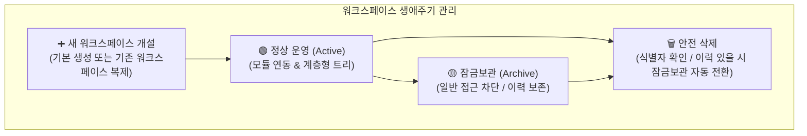

# 워크스페이스 관리 (Workspace Master)

::: tip 📸 실제 화면 안내

*관리자 참고: 해당 화면의 실제 캡처 이미지를 `./images/ws-manage.png` 경로에 등록해 주세요.*
:::

> **워크스페이스 관리** 페이지는 시스템 관리자가 회사 내 모든 협업 공간(본사 관리, 부동산 개발 프로젝트, 기타 공간)의 계층 구조와 생애주기를 전사적 관점에서 총괄 제어하는 마스터 관리 대시보드입니다.

## 1. 개요 및 관리자 허브

개별 워크스페이스 내부의 [설정](/work-manage/settings) 메뉴가 특정 협업 공간의 세부 옵션을 다룬다면, **워크스페이스 관리**는 전사 레벨에서 운영 중인 모든 워크스페이스를 한눈에 파악하고 신규 개설, 복제, 잠금보관(아카이빙), 안전 삭제를 일괄 처리하는 중앙 통제 센터입니다.

* **접근 경로**: 시스템 좌측 내비게이션 메뉴에서 **[설정 관리] → [워크스페이스 관리]**를 선택하여 접속합니다. (관리자 권한 필요)

## 2. 워크스페이스 목록 그리드 및 시각화

전체 워크스페이스를 트리 계층과 상태 배지로 직관적으로 표현하여 조직 전체의 협업 공간 현황을 조망할 수 있습니다.

### 🌲 계층형 트리 구조 (Depth Indentation)
* 상위 워크스페이스와 하위 워크스페이스의 종속 관계가 화살표(`>`)와 들여쓰기로 시각화되어 본사-사업지 간의 지배구조 및 프로젝트 하위 그룹을 한눈에 파악하기 쉽습니다.

### 🏷️ 상태 및 식별 배지
* **내 워크스페이스 (초록색 배지)**: 로그인한 사용자가 현재 구성원으로 참여 중인 공간을 표시합니다.
* **비공개 워크스페이스 (자물쇠 아이콘)**: 초대된 멤버만 접근 가능한 보안 공간입니다.
* **북마크 (별/북마크 배지)**: 사용자가 즐겨찾기로 등록해 둔 주요 워크스페이스입니다.
* **잠금/닫힘 상태**: 이미 마감되었거나 잠금보관된 워크스페이스는 전체 행이 회색 텍스트로 감쇄되어 현재 활성화된 운영 공간과 명확히 구분됩니다.

### 📋 컬럼 커스터마이징 (Column Selector)
우측 상단의 컬럼 선택기 버튼을 통해 그리드에 표출할 항목을 자유롭게 지정할 수 있으며, 설정값은 브라우저에 영구 저장됩니다:
* **제공 컬럼**: 이름(기본 고정), 식별자(`Slug`), 설명, 상태, 홈페이지, 상위 워크스페이스, 공개 여부, 등록일, 수정일

### 🔍 잠금보관 항목 포함 검색
* 기본적으로 정상 운영 중인 활성 워크스페이스만 조회됩니다.
* 과거 종료되었거나 보관 처리된 프로젝트를 확인하려면 검색 옵션의 **'잠금보관 포함'** 체크박스를 활성화하여 검색할 수 있습니다.

## 3. 워크스페이스 생애주기 제어 (Actions)

각 워크스페이스 행 우측의 더보기(`...`) 메뉴를 통해 다음과 같은 생애주기 제어 작업을 수행할 수 있습니다. (관리자 권한 필요)

### ➕ 새 워크스페이스 생성 및 복사 (Copy)
* **새 워크스페이스**: 완전히 새로운 프로젝트나 협업 부서를 위한 공간을 개설합니다. 명칭, 식별자(영문 URL 키), 설명, 공개 여부 및 활성화할 기능 모듈을 설정합니다.
* **워크스페이스 복사**: 기존 워크스페이스의 활성화된 기능 모듈, 업무 트래커, 범주, 기본 설정을 그대로 복제합니다. 유사한 신규 사업지나 새 프로젝트 공간을 만들 때 매우 유용합니다.

### 🔒 잠금보관 (Archive) / 잠금보관 해제
* **잠금보관**: 사업이 종료되었거나 일시 중단된 워크스페이스를 '잠금보관' 상태로 전환합니다.
  * 일반 구성원의 신규 접근 및 데이터 수정이 전면 차단됩니다.
  * 과거의 업무, 회의록, 문서, 결재 이력은 유실 없이 안전하게 영구 보존됩니다.
* **보관 해제**: 재개된 프로젝트나 추가 확인이 필요한 경우, 원클릭으로 잠금보관을 해제하여 즉시 정상 운영 상태로 복원할 수 있습니다.

### 🗑️ 2단계 안전 삭제 및 데이터 보호 정책
* **식별자 검증**: 실수로 인한 데이터 삭제 사고를 원천 방지하기 위해, 삭제 팝업창에 해당 워크스페이스의 **고유 식별자(Slug)를 정확히 타이핑해야만 [삭제] 버튼이 활성화**됩니다.
* **⭐️ 데이터 자동 보호 정책 (중요)**:
  * 업무(Issue), 회의(Meeting), 문서(Document) 등 단 1건이라도 활동 이력이 존재하는 워크스페이스는 물리적으로 완전 삭제되지 않고, **시스템이 자동으로 '잠금보관' 상태로 안전하게 전환**하여 회사의 소중한 데이터 자산 유실을 방지합니다.

## 4. 실무 운영 가이드

* **표준 템플릿 워크스페이스 활용**: 표준 업무 프로세스(트래커, 범주, 기본 마일스톤)가 사전 세팅된 '표준 템플릿' 워크스페이스를 개설해 두고, 새 사업지 런칭 시 **[복사]** 기능을 이용하면 단 1분 만에 일관된 협업 환경을 구축할 수 있습니다.
* **정기적인 아카이빙(보관) 관리**: 분양이 완료되었거나 정산이 끝난 프로젝트는 즉시 '잠금보관' 처리하여 활성 목록을 슬림하게 유지하십시오. 과거 데이터가 필요할 때는 언제든지 '잠금보관 포함' 검색으로 손쉽게 열람할 수 있습니다.